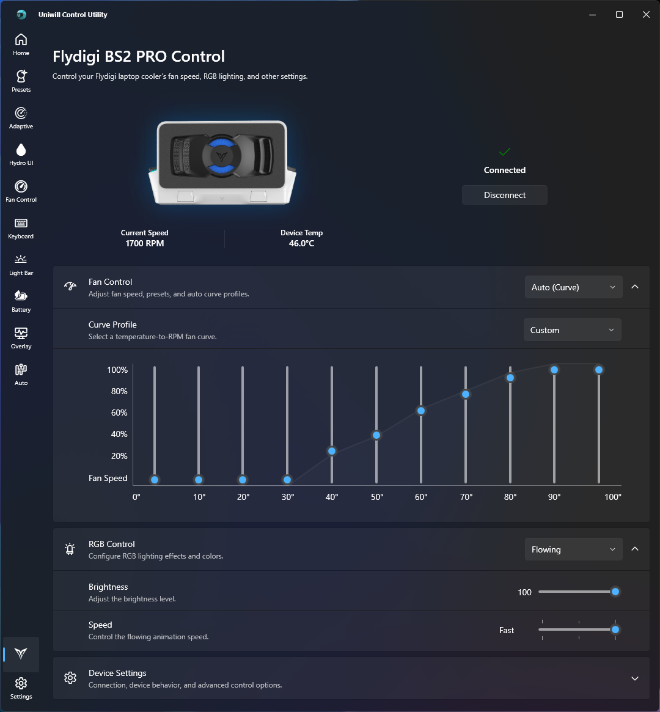
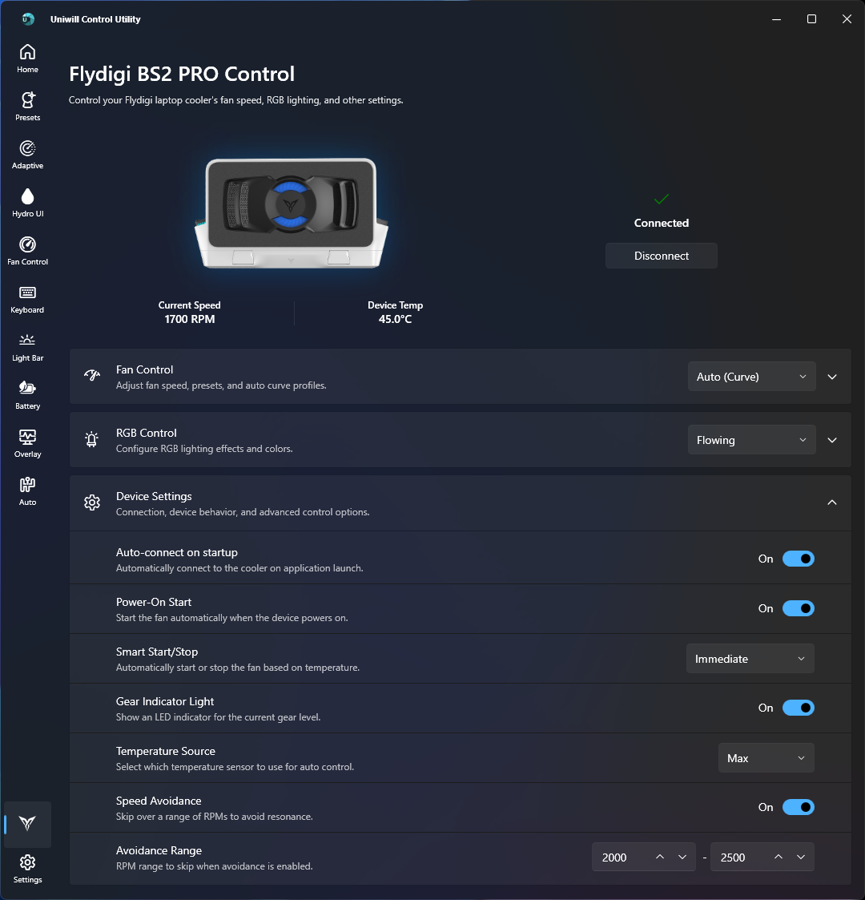

# Uniwill Control Utility

This project is still very much a **WORK IN PROGRESS**!

> **DISCLAIMER:** THE SOFTWARE IS PROVIDED "AS IS" WITHOUT WARRANTY OF ANY KIND, EXPRESS OR IMPLIED, INCLUDING BUT NOT LIMITED TO THE WARRANTIES OF MERCHANTABILITY, FITNESS FOR A PARTICULAR PURPOSE AND NONINFRINGEMENT. MISUSE OF THIS SOFTWARE COULD CAUSE SYSTEM INSTABILITY OR MALFUNCTION. USE AT YOUR OWN RISK.

If you come across any issues or errors, please [open an issue on GitHub](https://github.com/jgudec/Uniwill-Control-Utility/issues).

If you made an improvement or added some new feature, I warmly encourage you to make a PR so that it can be included.

## What is Uniwill Control Utility?

Uniwill Control Utility (UCU) is a hardware tuning and monitoring application for laptops with **Uniwill-based embedded controllers**, with additional support for AMD Ryzen and Intel CPU tuning, NVIDIA GPU controls, and peripheral device management. Its purpose is to serve as a mostly open-source alternative to the XMG/PCSpecialist's closed-source and visually outdated Control Center.

UCU was built on top of the foundation laid by [UXTU](https://github.com/JamesCJ60/Universal-x86-Tuning-Utility) (Universal x86 Tuning Utility), reworking/extending its capabilities with Uniwill EC integration, Flydigi cooler support, watercooler control, and a modern Fluent Design interface in order to provide a tailored software for the hardware used by the XMG Neo A25/E25 and PCSpecialist Recoil 3 16 (Intel/AMD).

## Which hardware has this tool been tested on?
 - **XMG Neo 16 (A25)**
    - CPU: **AMD Ryzen 9 9955HX3D**
    - GPU: **NVIDIA GeForce RTX 5090 Laptop**
    - Panel: **MiniLED**
 - **PCSpecialist Recoil 3 16 (Intel)**
    - CPU: **Intel® Core™ Ultra 9 Processor 275HX**
    - GPU: **NVIDIA GeForce RTX 5080 Laptop**
    - Panel: **MiniLED**

### Testing limitations

 The PCSpecialist Recoil 3 16 (Intel) has CPU voltage control disabled on the BIOS level, so CPU voltage control in the app couldn't be tested.

However, CPU TDP control has been tested and confirmed to be working.
## How were the features achieved?

A fair amount of research into other projects that have been mentioned in the Credits section.

Without the hard work of all those developers, most of the features would have been either harder or impossible to implement.

During my personal debugging/tinkering, I happened to stumble upon additional RGB effects for the Keyboard and Light Bar, and attempted to improve them further. 

And truth be told, a local AI agent was a game-changer when it came to discovering how everything ticked, which brings me to the next point.

## AI  Disclaimer
AI (**Qwen 3.6 27B**) was used to:
 - reverse-engineer closed-source software from the Credits section
 - research open-source software from the Credits section
 - implement a fair amount of the backend
 - set up initial skeletons of the UI

## Features replicated from XMG's Control Center
 - Performance profiles
 - Keyboard global/per-key RGB control
 - Light Bar RGB control
 - Liquid Cooler control
 - CPU and GPU Fan Control
 - Battery control

## Features replicated from Flydigi Space Center
 - Flydigi BS1, BS2, BS2 Pro, BS3 and BS3 Pro support
 - pre-set and custom fan curves
 - RGB control
 - auto power-on

## Additional features 
 - Per-game presets of above features (except the battery, of course)
 - Automatic performance profile application based on the charger being (un)plugged
 - Extra RGB effects/directions for the keyboard
 - Live metric overlay (WIP)
 - System tray controls for Power profile, Hydro UI, Fan and FLydigi control

## Features I tried to but wasn't able to replicate
 - MiniLED control (tried so many approaches to replicating what was done in **tuxedo-drivers** but it wouldn't play ball in Windows - **would greatly appreciate a PR from someone more knowledgeable**)
 - multi-color RGB control of the Light Bar (single-color control works - **PRs are more than welcome**)

# App Features

### **Dashboard**

At-a-glance system overview showing your device's specifications and live hardware metrics.

- Device identification with laptop image (XMG, PC Specialist Recoil, and more)
- Live CPU, GPU, memory, and battery telemetry cards
- Quick-launch device controls for Flydigi coolers and Hydro UI watercoolers (when supported)

### **Presets**

One-click tuning profiles and granular hardware controls for CPU, GPU, and system power management. This is a mix of XMG Control Center's and MSI Afterburner main features.

- **Built-in profiles** — Office, Gaming, and Turbo presets optimized for common use cases
- **Custom profiles** — Save and load your own tuned configurations
- **Status card** — Shows active values for CPU power limits, TjMax, Curve Optimizer, GPU TGP, and Dynamic Boost
- **CPU Power Tuning** (AMD) — Sustained Power Limit (SPL), Fast Power Limit (FPL), TjMax, and Curve Optimizer
- **Intel Tuning** — PL1, PL2 power limits and CPU undervolting via FIVR
- **GPU Tuning** (NVIDIA) — GPU TGP, Dynamic Boost, Dynamic Boost Offset, Core/Memory Clock Offsets, and V-F Curve Editor (a fully working curve editor for undervolting)
- **Custom presets** — Up to 5 custom presets can be set up
- **Preset backup & import** — Export and restore all custom presets and adaptive mode profiles

### **Adaptive Mode**

Intelligent, game-aware performance optimization that automatically adjusts settings based on the active application.

- Per-game profile support — each game gets its own tuned configuration
- **CPU controls** — Power limits (SPL/FPL), TjMax, Curve Optimizer (AMD), PL1/PL2 and undervolt (Intel)
- **GPU controls** — TGP, Dynamic Boost, V-F Curve Editor, Core/Memory Clock Offsets
- **Fan Control** — Custom EC fan curves per game
- **Flydigi cooler** — Custom fan curves and RGB speed per game
- **Keyboard RGB** — Per-game multi-color lighting profiles with auto-detection of running games
- **Per-game presets** — Automatic profile switching when games launch or close

### **Game Overlay**

Click-through hardware monitoring overlay for real-time performance tracking while gaming.

- Configurable sensor tiles — CPU temp, GPU temp, RAM usage, FPS, and more
- Customizable overlay scale (50–200%) and panel opacity
- Adjustable refresh interval to balance accuracy and overhead
- Global keyboard shortcuts to toggle overlay visibility and sensor polling

### **Automations**

Set-and-forget rules that apply presets automatically when system state changes.

- **Preset on Battery Charge** — Apply a preset when the system switches to AC power
- **Preset on Battery Discharge** — Apply a preset when running on battery
- **Preset on System Resume** — Reapply settings after sleep or hibernation

### **Fan Control**

Full control over system fan curves with real-time temperature monitoring.

- **Unified or split curves** — Single curve for both fans, or independent CPU and GPU curves
- Multi-point temperature-speed mapping with presets (Silent, Balanced, Performance, Full Speed, Off, Custom)
- 11 thermal threshold zones per curve
- Turbo mode (100% fans) and Restore Auto to return control to the EC firmware
- Live CPU/GPU temperature display
- Flydigi cooler pad fan control section (when connected)

### Keyboard

Per-key and global RGB keyboard backlight control via the ITE HID controller.

- **Effects mode** — Multiple animation types (Static, Rainbow, Wave, Breathing, Ripple, Aurora, Spark, Random) with speed control
- **Per-key RGB mode** — 61-key grid editor with individual color swatches
- Multi-color palette picker (4 or 7 colors) for complex effects
- Touch reactive toggle for Ripple, Aurora, Spark, and Random effects
- Idle timer — Auto-turn-off backlight after configurable inactivity
- On/off toggle and brightness slider
- White-backlight-only mode for keyboards without RGB

### Light Bar

RGB light bar control with multiple effects and color options.

- Power toggle, color picker, and brightness slider (0–100%)
- Effects — Static, Breathing, Wave, Loading, Marquee, Meteor
- Speed slider for animated effects
- Fixed rainbow palette for Wave and Marquee effects

### Battery

Battery charging management and live telemetry from the EC.

- **Charging Limit** — Set maximum charge to 100%, 80%, or 60% to extend battery lifespan
- **Live telemetry** (polled every 5 seconds):
  - State of charge, battery health (remaining vs. design capacity)
  - Temperature, cycle count, present voltage, charge/discharge rate
  - Power source indicator (AC / battery)
- Manual refresh button

### Flydigi Cooler

Control Flydigi laptop cooling pads via BLE (BS1) and HID (BS2, BS2 Pro, BS3, BS3 Pro).

- **Fan Control** with 3 modes:
  - **Manual** — Direct RPM slider (1300–4000 RPM)
  - **Gear Presets** — Quiet, Standard, Strong, Overclock with Low/Medium/High sub-levels
  - **Auto (Curve)** — Temperature-to-RPM fan curve profiles with editable custom curves
- **Smart Control** — Automatic fan speed based on laptop temperature
- **RGB Control** (BS2+ only): Off, Smart-Temp, Static, Rotation, Flowing, Breathing with color, brightness and speed controls
- **Device Settings** — Temperature source, RPM Range avoidance, Smart Start/Stop
- Live RPM and temperature readback
- Dual protocol support — HID (BS2/BS2 Pro/BS3) and BLE (BS1)

### Hydro UI — Watercooler Control

Full control of LCT liquid cooling systems via Bluetooth Low Energy.

- BLE device discovery with scan and device selection
- **Pump Voltage** — Off, 7V, 8V, 11V
- **Fan Speed** — Off, 25%, 50%, 75%, 90%, 95%, 100%
- **RGB Effect** — Off, Static, Breathe, Colorful, Breathe Color with color picker
- Auto-connect on system startup and auto-reconnect after system resume

### Settings

Application preferences, diagnostics, updates, and embedded system information.

- **Application behaviour** — Language selector (21 languages), start on boot, start minimized, minimize-to-tray, reapply settings on start, auto-reapply interval, auto-start Adaptive Mode, game library sync
- **Preset backup** — Export and import custom and adaptive mode presets as JSON
- **Diagnostics** — Diagnostic logging level (Off, Error, Info, Debug)
- **System Information** — Device, processor, memory, and battery specs with detailed RAM timings and SPD data

## Disclaimers & Cautions

- If you intend to use Uniwill Control Utility in a video, text post, or stream online (e.g. YouTube, Reddit), please credit the project by linking to the [GitHub releases page](https://github.com/jgudec/Uniwill-Control-Utility/releases)! 
- I am not liable for any damages that may occur from using this software. Please use it at your own risk!
- "AMD", "APU", "Ryzen", and "AMD Ryzen" are trademarked by and belong to Advanced Micro Devices, Inc. This project makes no claims to these assets and uses them for informational purposes only.

## Screenshots

## Installation

1. Head over to the [Releases](https://github.com/jgudec/Uniwill-Control-Utility/releases) page
2. Download the latest zip
3. Extract the zip into e.g. the C: drive
4. Launch **Uniwill-Control-Utility.exe**

## Credits

UCU builds on the work of many open-source projects and reverse-engineering efforts. We thank the authors of the following projects for their contributions:

### Foundation
- [UXTU (GitHub)](https://github.com/JamesCJ60/Universal-x86-Tuning-Utility) — Universal x86 Tuning Utility. UCU is built on top of UXTU's codebase, extending it with Uniwill EC support, Flydigi cooler controls, watercooler management, and a rebranded Fluent Design interface.

### Core & Inspiration
- [G-Helper (GitHub)](https://github.com/seerge/g-helper) — Lightweight laptop tuning utility that inspired UCU's design philosophy
- [WPF UI (GitHub)](https://github.com/lepoco/wpfui) — Modern Fluent Design UI library used for the UCU interface
- [Magpie (GitHub)](https://github.com/Blinue/Magpie) — Translation management library used for localization

### Reverse Engineering References
- [reverse_engineering (GitHub)](https://github.com/zllovesuki/reverse_engineering) — DSDT and WMI reverse engineering references
- [Laptops (GitHub)](https://github.com/ahahahahahMtnf/Laptops/tree/main/Asus/WMI) — ASUS WMI method documentation
- [ADLX SDK Wrapper (GitHub)](https://github.com/jgudec/ADLX-SDK-Wrapper) — AMD ADLX SDK wrapper for GPU controls

### Device Protocol References
- [THRM (GitHub)](https://github.com/TIANLI0/THRM) by TIANLI0 — Primary reference for the Flydigi `5A A5` cooler protocol. Provided the most complete documentation of the frame format, RGB upload sequence, and gear RPM table.
- [watercooler-manager (GitHub)](https://github.com/tomups/watercooler-manager) by tomups — Primary reference for the LCT watercooler BLE protocol. The Python implementation confirmed the Nordic UART UUIDs, frame format, and command byte values.
- [UCC (GitHub)](https://github.com/nanomatters/ucc) by nanomatters — Reference for the LCT watercooler protocol (BLE connection lifecycle, error recovery, state management) and for the ITE 8291 keyboard HID controller protocol (HID device enumeration, ACPI interface, zone-based control commands).
- [tuxedo-drivers (GitLab)](https://gitlab.com/tuxedocomputers/development/packages/tuxedo-drivers) by TUXEDO Computers — Authoritative reference for the ITE 8291 per-key RGB protocol. The Linux kernel driver (`src/ite_8291/ite_8291.c`) provided the exact byte layouts for UserMode entry, row announcement, and the 65-byte BGR-planar output report format. Also provided the EC register definitions (`src/uniwill_interfaces.h`) for NVIDIA GPU power control on Schenker/XMG laptops (cTGP/TPP/DB offset registers and the `0x0743` enable register).
- [LenovoLegionToolkit (GitHub)](https://github.com/LenovoLegionToolkit/LenovoLegionToolkit) — Reference for the color picker UI pattern, fan curve editor approach, and keyboard visualizer layout. **Not** used for keyboard protocol details (Lenovo uses different hardware).
- **MechControl.dll** (decompiled, closed-source) — Schenker/Mechrevo utility. Source for the global keyboard effects protocol (zone-based 9-byte HID feature reports).
- **XMG Control Center / GCUService.exe** (closed-source) — Official Schenker/XMG utility. Studied for HID device communication patterns, handle acquisition, and GPU power control EC register sequences (via `GPUInfoDLL.dll` and `ACPIDriverDll.dll` binary analysis).

### Earlier Projects by the Team
- [Ryzen Controller (GitLab)](https://gitlab.com/ryzen-controller-team/ryzen-controller) — Desktop Ryzen tuning utility
- [Renoir Mobile Tuning (GitHub)](https://github.com/sbski/Renoir-Mobile-Tuning) — Early mobile Ryzen tuning experiment
- [Power Control Panel (GitHub)](https://github.com/project-sbc/Power-Control-Panel-v2) — Power limit control utility
