# Uniwill Control Utility

A hardware tuning/monitoring application for laptops with **Uniwill-based embedded controllers**, with additional support for AMD Ryzen and Intel CPU tuning, NVIDIA GPU controls, and peripheral device management.

Its purpose is to serve as an open-source alternative to the official XMG/PCSpecialist Control Center.

UCU was built on top of the foundation laid by [UXTU](https://github.com/JamesCJ60/Universal-x86-Tuning-Utility) (Universal x86 Tuning Utility), reworking/extending its capabilities with Uniwill EC integration, Flydigi cooler support, watercooler control, and a modern Fluent Design interface in order to provide a tailored software for the hardware used by the likes of XMG Neo A25/E25, PCSpecialist Recoil 3 16 (Intel/AMD) and so on.

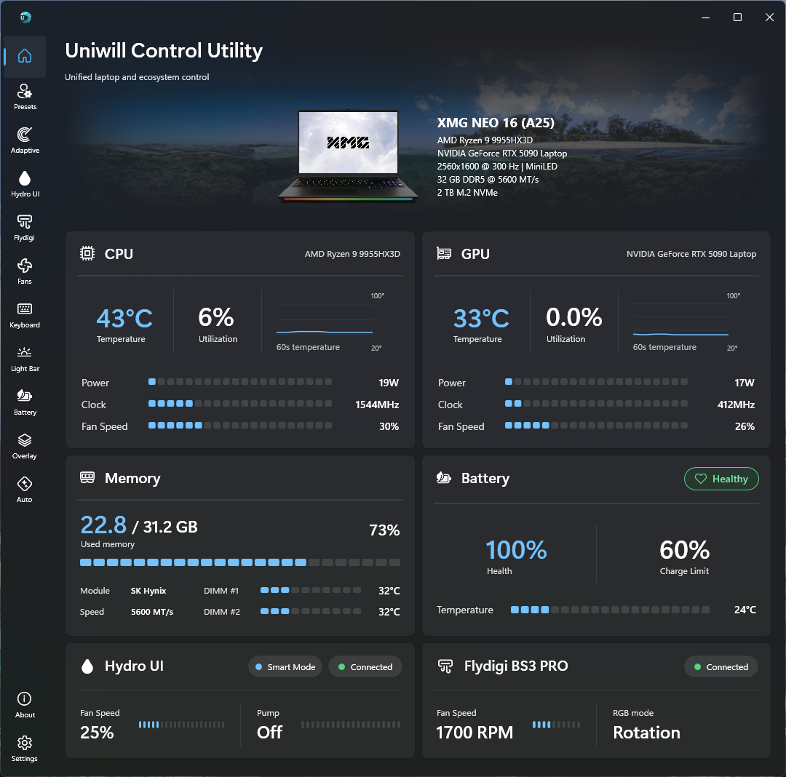

## Disclaimer & Trademarks

* **This project is still very much a WORK IN PROGRESS** - Although a lot of attention and time has been invested into polishing this app, one should still expect some (minor) bugs
* **Unofficial Software:** This project is an independent, community-driven, free and open-source utility. It is **not** affiliated with, endorsed by, or sponsored by XMG, Uniwill, Tongfang, Flydigi or any laptop/cooler brand/reseller mentioned above.
* **Trademarks:** All product names, logos, images, brands, trademarks, and registered trademarks are property of their respective owners. Their use here is strictly for identification and compatibility purposes.
* **No Warranty / Hardware Risks:** This software interfaces directly with hardware management features. **Use it at your own risk.** The developer assumes no liability for any hardware damage, system instability, battery degradation, or voided warranties resulting from the use of this utility.

If you come across any issues or errors, please [open an issue on GitHub](https://github.com/Uniwill-Control-Utility/Uniwill-Control-Utility/issues).

## Which hardware has this tool been tested on?

 - **XMG Neo 16 (A25)**
    - CPU: **AMD Ryzen 9 9955HX3D**
    - GPU: **NVIDIA GeForce RTX 5090 Laptop**
    - Panel: **MiniLED**
 - **XMG Neo 16 (M26)**
    - CPU: **Intel® Core™ Ultra 9 Processor 290HX Plus**
    - GPU: **NVIDIA GeForce RTX 5080 Laptop**
    - Panel: **OLED**
 - **PCSpecialist Recoil 3 16 (Intel)**
    - CPU: **Intel® Core™ Ultra 9 Processor 275HX**
    - GPU: **NVIDIA GeForce RTX 5080 Laptop**
    - Panel: **MiniLED**
 - **Mechrevo Aurora 16 Ultra**
    - CPU: **Intel® Core™ Ultra 9 Processor 275HX**
    - GPU: **NVIDIA GeForce RTX 5080 Laptop**
    - Panel: **IPS**   
 - **Tuxedo Stellaris 16 Gen7**
    - CPU: **Intel® Core™ Ultra 9 Processor 275HX**
    - GPU: **NVIDIA GeForce RTX 5080 Laptop**
    - Panel: **IPS**   
 - **Mifcom 16**
    - CPU: **AMD Ryzen 9 9955HX3D**
    - GPU: **NVIDIA GeForce RTX 5090 Laptop**
    - Panel: **MiniLED**  

## How were the features achieved?

A fair amount of research into other projects that have been mentioned in the Credits section.

Without the hard work of all those developers, most of the features would have been either harder or impossible to implement.

During my personal debugging/tinkering, I happened to stumble upon additional features/ideas, and attempted to improve them further. 

And truth be told, a local AI agent/model was a game-changer when it came to discovering how everything ticked, which brings me to the next point.

## AI Disclaimer

For those who want to know, **Qwen3.8 Flash Next** and **DeepSeek V4.1 Flash** (OpenCode harness) were used for the majority of the project.

AI was used to:
 - reverse-engineer closed-source software from the Credits section
 - research open-source software from the Credits section
 - implement a fair amount of the backend
 - set up initial skeletons of the UI
 - write documentation

## What UCU does that the OEM utility does not

**Parity with the OEM utilities**

- Performance profiles
- Keyboard global and per-key RGB control
- Light bar RGB control
- Liquid cooler control
- CPU and GPU fan curves
- Battery charge limit
- MiniLED local dimming
- Panel refresh rate and colour calibration (Default / sRGB / DCI-P3 / Adobe RGB)
- GPU MUX switch (Hybrid / dGPU Only / iGPU Only)
- GPU Power Saving (On / Off / Auto)
- The physical Performance / Q-key button
- Wi-Fi, Bluetooth, webcam and touchpad switches
- BIOS Advanced Performance Menu unlock (Intel only)
- Flydigi cooler: BS1, BS2, BS2 Pro, BS3 and BS3 Pro, preset and custom fan curves, RGB, auto power-on

**Beyond both**

- Per-game presets of everything above except the battery, plus automatic preset, GPU-preference and refresh-rate changes when the charger is (un)plugged or the system resumes
- **Extra GPU power** (Power boost mode) — a driver-level GPU power ceiling above the EC's stock TGP, which neither OEM utility offers
- BetterRGB software streamer for the keyboard (adaptive 15–60 FPS on the ITE `0xFF03` interface, AC auto-policy, wake resume)
- Stock presets asserted through the EC's own OEM mode engine, so their power limits come from the firmware's factory table exactly like the official Control Center — and Custom presets that stay in our control
- Smart Hydro UI (pump and fan noise optimisation), Smart Fan Mode (all fans on one reference sensor), and extra RGB effects/directions for the keyboard
- Opt-in Power Tuning Guardian, which re-applies the preset's power ceilings when another program resets them
- System tray controls for preset, Hydro UI, fan and Flydigi, plus a Performance-button cycle over UCU's own presets

## App Features

### Tray Widget

Simple metrics and toggles for quick changes.

- **Page-container tray** — the QuickSettings grid is the default page of an in-tray NavigationView; a Display button navigates (with the page transition animation) to a Display page carrying the refresh-rate row, the laptop-panel color-calibration profile row, the runtime Nvidia Optimus switch (iGPU / Auto / dGPU power saving, Hybrid mode only) and the MiniLED local dimming toggle (MiniLED panels only), with the sections scrolling inside the page; a back button returns to the grid
- **Title-bar hand-over button** — a button in the main window's title bar minimizes the main window and opens the mini-tray, mirroring a left-click on the tray icon

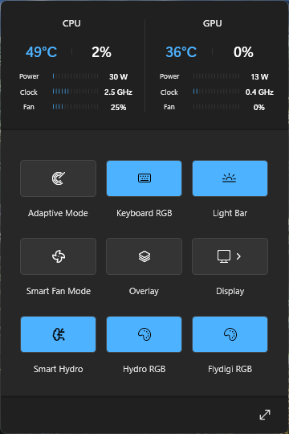

### Dashboard

At-a-glance system overview showing your device's specifications and live hardware metrics.

- Device identification with laptop image (XMG, PC Specialist, Tuxedo Computers, Mechrevo, and more)
- Live CPU, GPU, memory, and battery telemetry cards (GPU metrics fall back to the iGPU when the dGPU is unavailable)
- Quick-launch device controls for Flydigi coolers and Hydro UI watercoolers (when supported)

### Presets

One-click tuning profiles and granular hardware controls for CPU, GPU, and system power management. This is a mix of XMG Control Center's and MSI Afterburner main features.

- **Built-in profiles** — Office, Gaming, and Turbo presets optimized for common use cases, asserted through the EC's own OEM mode engine so their power limits stay in the firmware's factory table
- **Custom profiles** — Save and load your own tuned configurations
- **Status card** — Shows active values for CPU power limits, TjMax, Curve Optimizer, GPU TGP, and Dynamic Boost
- **CPU Power Tuning** (AMD) — Sustained Power Limit (SPL), Fast Power Limit (FPL), TjMax, and Curve Optimizer (AMD only)
- **Intel Tuning** — PL1, PL2 power limits
- **GPU Tuning** (NVIDIA) — GPU TGP, Dynamic Boost, Dynamic Boost Offset, Core/Memory Clock Offsets, and V-F Curve Editor (a fully working curve editor for undervolting)
- **Extra GPU power** (Power boost mode) — raises the GPU's power ceiling above the EC's stock TGP: version-pinned VBIOS records, the EC's own cTGP offset, a driver-level power request and the platform's power budget, each written with a readback check, plus the rail currents (NVVDD / MSVDD / board input) that `Apply limits` saves machine-wide. The EC's cTGP stays the envelope — a preset that lowers it clamps the unlock down, never the other way round — and `Restore stock` returns every record. Off unless Settings → Power boost mode is enabled, which asks for a one-time risk acknowledgement.
- **Custom presets** — Up to 5 custom presets can be set up (mirrored by another set when Power Boost Mode is ON)
- **Preset backup & import** — Export and restore all custom presets and adaptive mode profiles

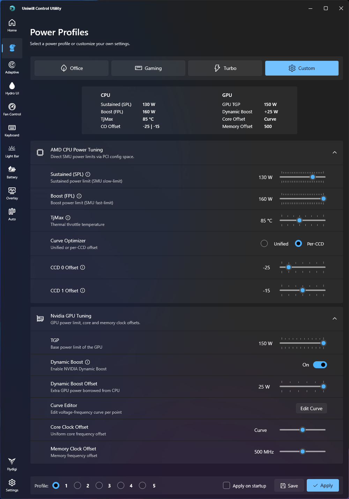

### Performance Button

Interception of the laptop's physical Performance / Q-key button (Uniwill NB02 hardware), so the button cycles UCU's own presets instead of the firmware's.

- **Preset cycling** — Each press advances to the next preset (Office → Gaming → Turbo → every saved Custom preset of the pool Power Boost Mode selects, wrapping) through the same apply path the Presets page uses, and the selection is persisted so the tray, Presets page, and resume handlers stay in sync
- **Q-key LED** — The EC firmware drives the LED from its own internal mode state and the OEM button already cycles it (white → red → yellow), which stays aligned with the Office → Gaming → Turbo order; UCU writes no LED color register at all, the LED follows the preset apply on its own
- **Detection** — The EC's ACPI WMI provider raises an `AcpiTest_EventULong` event whose `ULong` payload is `176` for every physical press, so the press is read from the EC itself rather than inferred from a register latch; UCU's own preset applies therefore cannot be mistaken for a press
- **Manual-control gate** — The press echo only fires while the EC manual-control gate (`0x0741` bit0) is set, so UCU keeps it armed permanently: the button stays live while a Custom preset, custom fan curves, GPU power control or Smart Fan Mode holds manual control, and the EC — not the firmware — owns the mode state
- **Settings** — "Q-Key button preset switching" (default ON; when OFF the button does nothing — UCU has already taken over the button engine, so the firmware's own cycle is not restored)

### Adaptive Mode

Intelligent, game-aware performance optimization that automatically adjusts settings based on the active application.

- Per-game profile support — each game gets its own tuned configuration
- **CPU controls** — Power limits (SPL/FPL), TjMax, Curve Optimizer (AMD), PL1/PL2 (Intel)
- **GPU controls** — TGP, Dynamic Boost, V-F Curve Editor, Core/Memory Clock Offsets
- **Fan Control** — Custom EC fan curves per game
- **Flydigi cooler** — Custom fan curves and RGB speed per game
- **Keyboard RGB** — Per-game lighting profiles with auto-detection of running games: firmware Effects, Per-Key RGB, or the BetterRGB streamer (effect, colors, FPS and software brightness per game; the Adaptive page mirrors the Keyboard page's full per-effect control set — direction buttons, speed/smoothness sliders, random/reverse toggles, style/layout buttons — all saved per profile)
- **Hydro UI** - per-game configuration of the liquid cooler RGB and fan/pump speed
- **Light Bar** - per-game customization of the light bar
- **Per-game presets** — Automatic profile switching when games launch or close

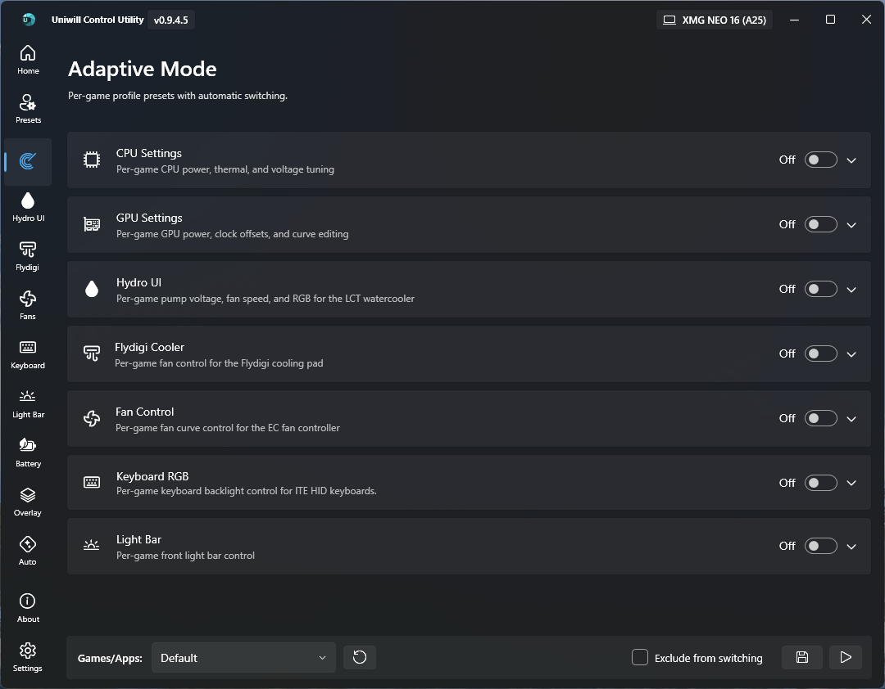

### Game Overlay

Click-through in-game performance overlay, rendered natively by RivaTuner Statistics Server (RTSS) for real-time tracking while gaming.

- **OSD metric rows** — toggle any combination of these rows (each row shows its sub-metrics):
  - **CPU** — temperature, usage, clock (MHz), power (W), fan speed
  - **RAM** — used (MB) and per-DIMM temperatures
  - **GPU** — temperature, usage, clock (MHz), power (W), fan speed
  - **VRAM** — used (MB)
  - **Current FPS** — live FPS + frame time (ms), labelled with the graphics API (DX12 / DX11 / Vulkan)
  - **1% Low** — 1% low FPS + frame time (ms)
  - **0.1% Low** — 0.1% low FPS + frame time (ms)
  - **Hydro UI** — pump voltage and fan % (when a cooler is connected)
  - **Flydigi cooler** — fan RPM (when a cooler is connected)
- **Refresh interval** — configurable (100–5000 ms) to balance accuracy and overhead
- **Global shortcuts** — show/hide the overlay, plus a secondary alias shortcut
- **Rendered by RTSS** — UCU writes the metric data into RTSS's on-screen display; positioning, scale, and opacity are configured in RTSS, and its native hooking keeps the overlay safe in anti-cheat (e.g. EAC) protected games

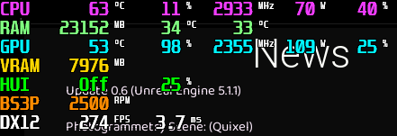

### Automations

Set-and-forget rules that apply presets automatically when system state changes.

- **Preset on Battery Charge** — Apply a preset when the system switches to AC power
- **Preset on Battery Discharge** — Apply a preset when running on battery
- **Preset on System Resume** — Reapply settings after sleep or hibernation
- **GPU Preference on Battery** — Set the GPU preference (No change / iGPU / dGPU / Auto) when running on battery (Hybrid mode only; "No change" is the default)
- **GPU Preference when Plugged In** — Set the GPU preference (No change / iGPU / dGPU / Auto) when connected to power (Hybrid mode only; "No change" is the default)
- **Refresh Rate on Battery** — Set the internal panel's refresh rate when running on battery (internal panel only; "No change" is the default)
- **Refresh Rate when Plugged In** — Set the internal panel's refresh rate when connected to power (internal panel only; "No change" is the default)
- **Power Tuning Guardian** — Opt-in (off by default), per feature: re-applies the preset's GPU power ceiling (TGP / Dynamic Boost) and/or CPU power limits (PL1 / PL2) when the firmware reports a third-party program reset them — verified by an EC register re-read before the toast

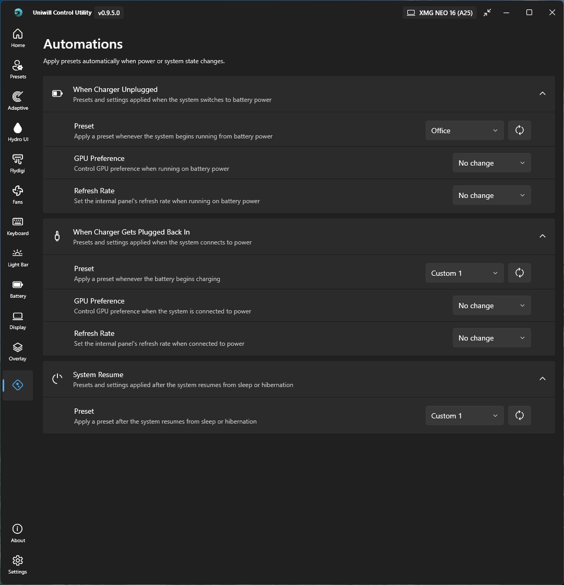

### Fan Control

Full control over system fan curves with real-time temperature monitoring.

- **Unified or split curves** — Single curve for both fans, or independent CPU and GPU curves
- Multi-point temperature-speed mapping with presets (Silent, Balanced, Performance, Full Speed, Off, Custom)
- 11 thermal threshold zones per curve
- Turbo mode (100% fans) and Restore Auto to return control to the EC firmware
- Live CPU/GPU temperature display
- **Smart Fan Mode** — forces all the fans to use the same temperature source - CPU,GPU or the Hottest of the two
- **Stock-preset gating** — fan curve customization (page, tray, resume) is Custom-preset only; stock presets leave the fans to the firmware's own per-mode table and show a "Stock Preset Active" notice

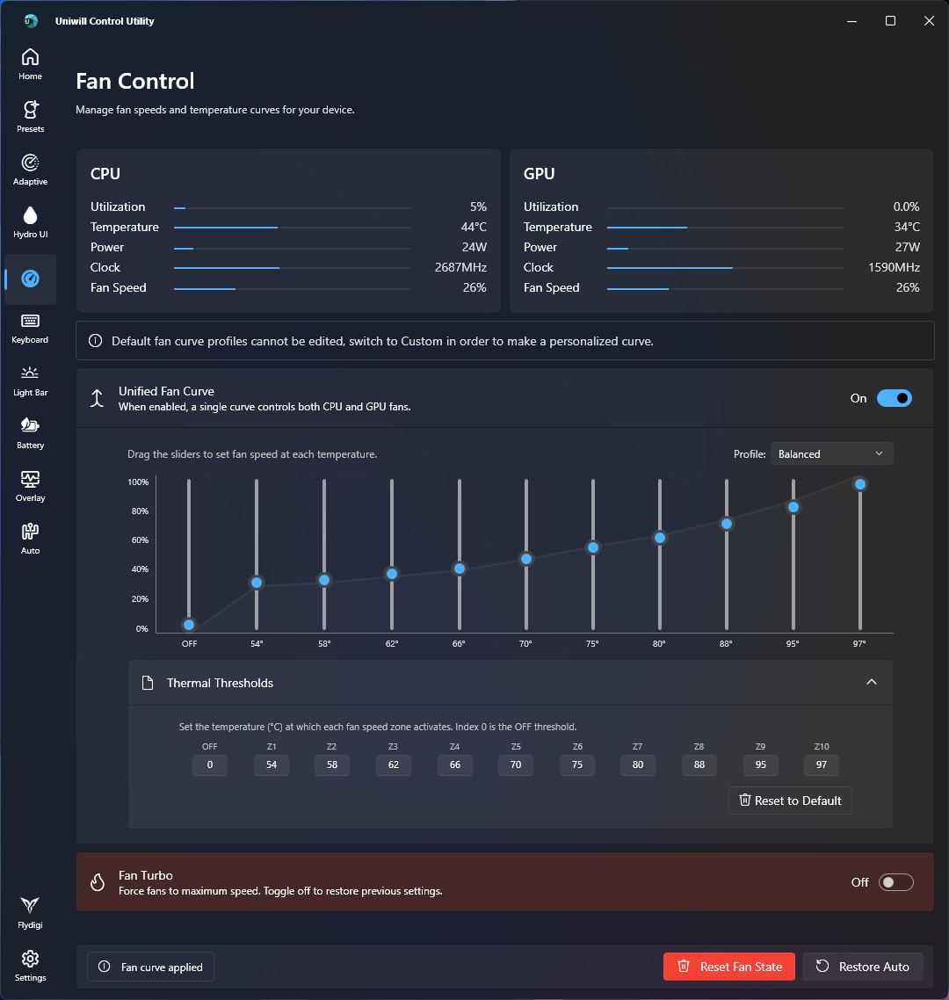

### Keyboard

Per-key and global RGB keyboard backlight control via the ITE HID controller.

- **Effects mode** — Multiple animation types (Static, Rainbow, Wave, Breathing, Ripple, Aurora, Spark, Random) with speed control
- **Per-key RGB mode** — 61-key grid editor with individual color swatches
- Multi-color palette picker (4 or 7 colors) for complex effects
- Touch reactive toggle for Ripple, Aurora, Spark, and Random effects
- Idle timer — Auto-turn-off backlight after configurable inactivity
- Auto Off When Unplugged — opt-in toggle: backlight turns off while the laptop is unplugged (on battery) and restores the saved lighting when plugged in (works in both per-key and effects modes, including the BetterRGB streamer)
- Keyboard Backlight power row (first row, mirroring the Light Bar page): the single off switch — when OFF, every other control on the page is hidden; the mini-tray Keyboard RGB button mirrors this same PowerOn state, and both pages re-sync their controls when the tray or Adaptive writes state (SettingsChanged notifications)
- Bottom bar (action buttons + picker) shows only in Per-Key RGB mode — no streamer-status strip in effects/BetterRGB modes
- **BetterRGB Streamer Engine** — opt-in software mode ported from [BetterRGB-ITE8291-Adaptive](https://github.com/ZavierChen/BetterRGB-ITE8291-Adaptive): 14 effects rendered in software and streamed to the ITE `0xFF03` RGB interface at 15/30/45/60 FPS, with a full per-effect control set, software brightness, keypress-driven reactive effects, an AC auto-policy, sleep/wake resume and a watchdog that falls back to Hardware MCU. The reference's technical detail, and the runtime behaviour in full, are in [docs/betterrgb-streamer.md](docs/betterrgb-streamer.md)
- White-backlight-only mode for keyboards without RGB

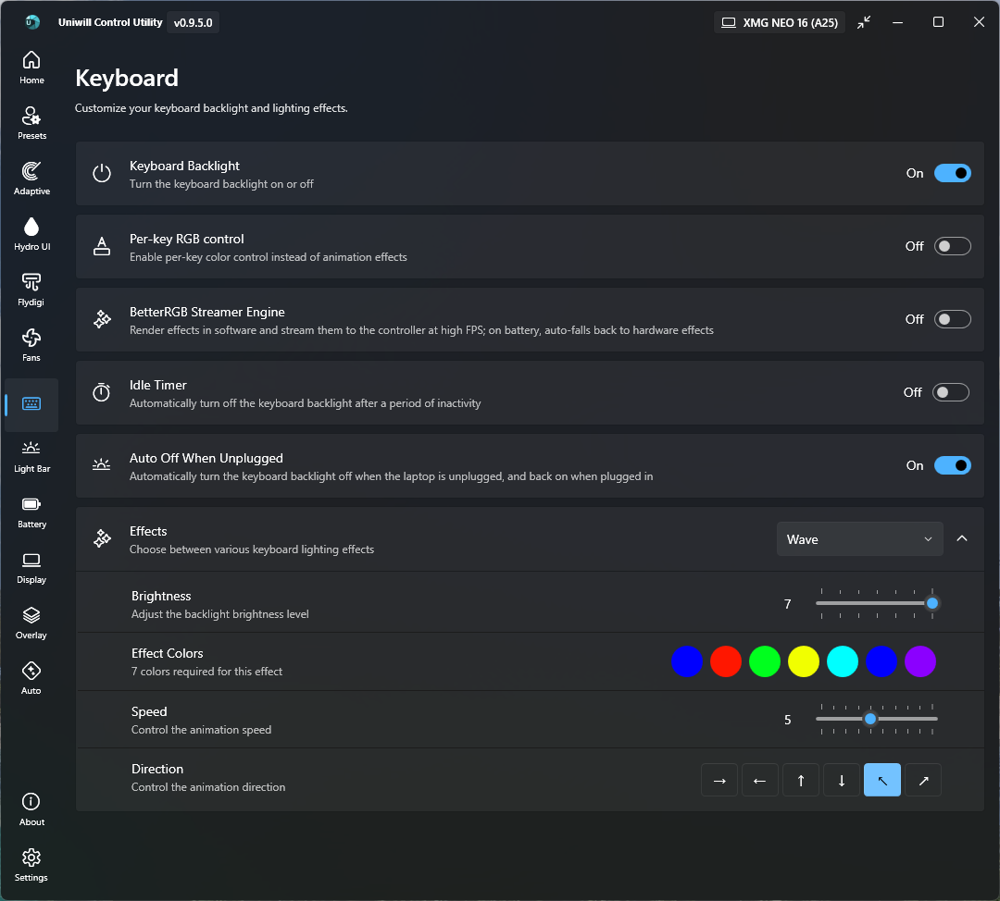

### Light Bar

RGB light bar control with multiple effects and color options.

- Power toggle, color picker, and brightness slider (10–100%) — when the power toggle is OFF, every other control on the page is hidden
- Auto Off When Unplugged — opt-in toggle: light bar turns off while the laptop is unplugged (on battery) and restores the saved lighting when plugged in
- BetterRGB Sync — opt-in toggle on the BetterRGB card: while the streamer engine runs, the strip mirrors the rendered frame's bottom-row middle third (the keys nearest the strip's own physical midpoint — Space/AltGr/CtrlR), pushed as a single zone color at 10 Hz; while sync owns the strip the Light Bar page shows the same override overlay as Adaptive Mode (dark overlay, disabled controls, a "BetterRGB Light Bar Sync" snackbar), and its saved settings are restored when the engine stops — on app shutdown instead, the strip is left on the firmware Wave effect at the minimum brightness level
- Effects — Static, Breathing, Wave, Loading, Marquee, Meteor
- Speed slider for animated effects
- Fixed rainbow palette for Wave and Marquee effects

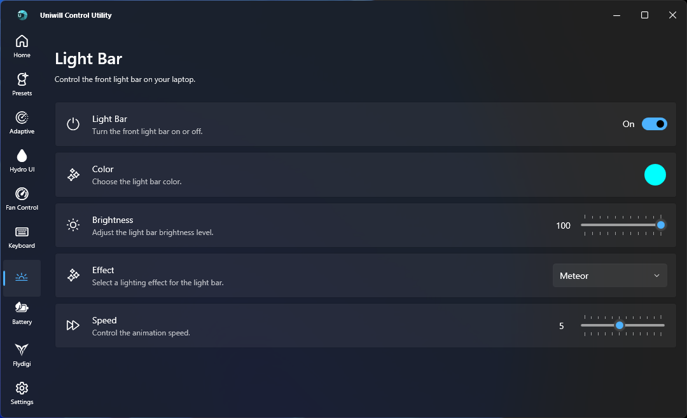

### Battery

Battery charging management and live telemetry from the EC.

- **Charging Limit** — Set maximum charge to 100%, 80%, or 60% to extend battery lifespan
- **Live telemetry** (polled every 5 seconds):
  - State of charge, battery health (remaining vs. design capacity)
  - Temperature, cycle count, present voltage, charge/discharge rate
  - Power source indicator (AC / battery)
- Manual refresh button

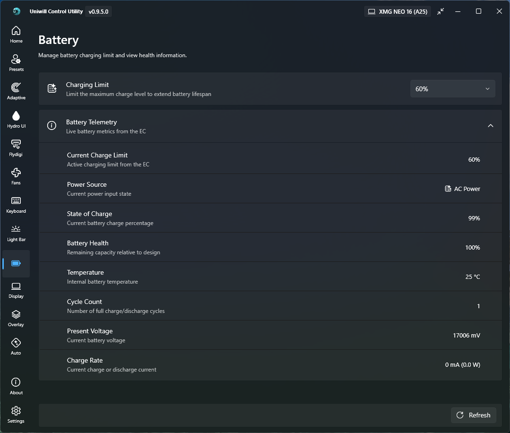

### Display

GPU display mode, GPU power management, and display panel controls (Uniwill EC hardware only).

- **GPU Display Mode** (MUX switch) — Choose **Hybrid (NVIDIA Optimus)**, **dGPU Only**, or **iGPU Only**, with a visual MUX diagram. The choice is persisted to UEFI NVRAM so it survives restarts, and a system reboot is required for the physical MUX change to take effect.
- **GPU Power Saving** (Hybrid mode only) — Live discrete-GPU power control without rebooting: **On (Power Saving)** disables the dGPU via PnP hotswap and routes rendering to the iGPU for maximum savings, **Off (Performance)** re-enables the dGPU, and **Auto** lets Windows/NVIDIA Optimus decide per application.
- **MiniLED Local Dimming** (MiniLED panels only) — Toggle the panel's local dimming, verified with an EC register readback.
- **Display Refresh Rate** (panels offering multiple rates) — Switch the refresh rate of the **laptop panel only** (never an external monitor) through the Windows display-mode pathway, addressed by device name so it lands on the panel whether primary or secondary.
- **Color Calibration** (panels with Windows' ICC profiles) — Associate a Windows ICC profile with the **laptop panel only**: **Default** (uncalibrated), **sRGB**, **P3** (Display P3), or **Adobe RGB**, applied through the genuine Windows colour-engine switch (`mscms.dll`) rather than a registry relabel.

Panel detach, deferred writes, the exact `mscms` sequence and the MUX/NVRAM handshake are documented in [docs/display-panel-control.md](docs/display-panel-control.md).

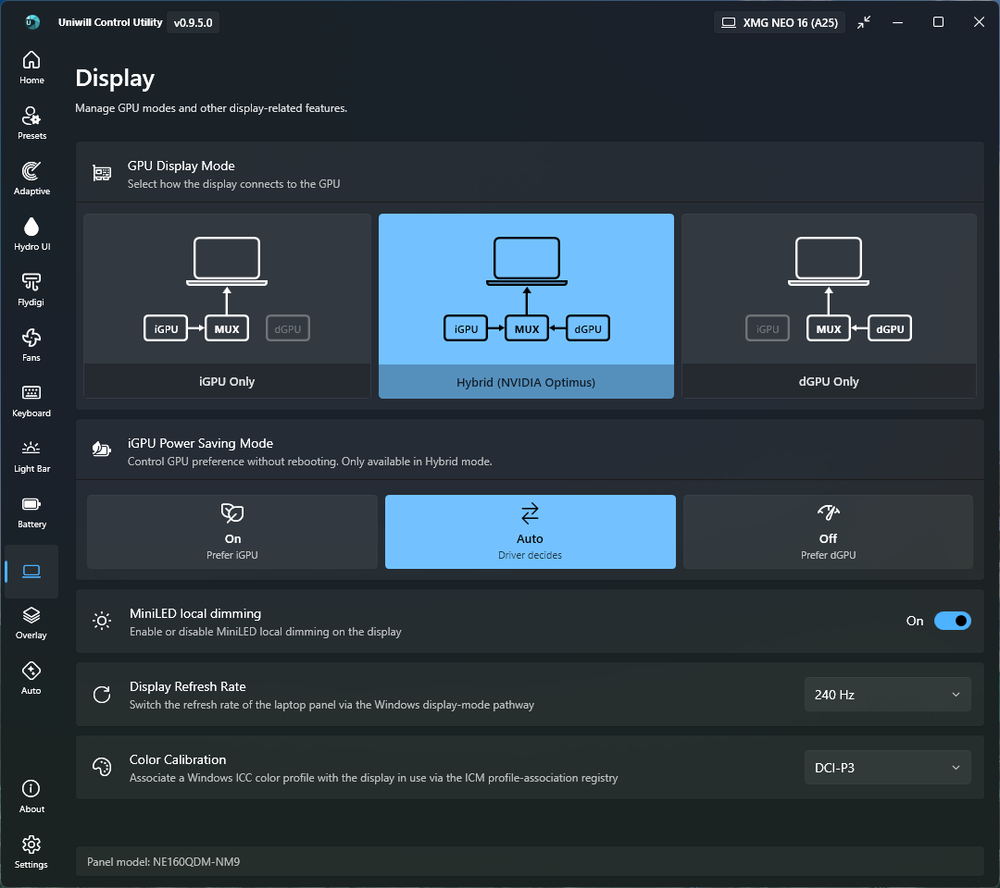

### Flydigi Cooler

Control Flydigi laptop cooling pads via BLE (BS1) and HID (BS2, BS2 Pro, BS3, BS3 Pro).

- **Fan Control** with 3 modes:
  - **Manual** — Direct RPM slider (1300–4000 RPM)
  - **Gear Presets** — Quiet, Standard, Strong, Overclock with Low/Medium/High sub-levels
  - **Auto (Curve)** — Temperature-to-RPM fan curve profiles with editable custom curves
- **Smart Control** — Automatic fan speed based on laptop temperature
- **RGB Control** (BS2+ only): Off, Smart-Temp, Static, Rotation, Flowing, Breathing with color, brightness and speed controls
- **Device Settings** — Temperature source, RPM Range avoidance, Smart Start/Stop
- Live RPM and temperature readback
- Dual protocol support — HID (BS2/BS2 Pro/BS3) and BLE (BS1)

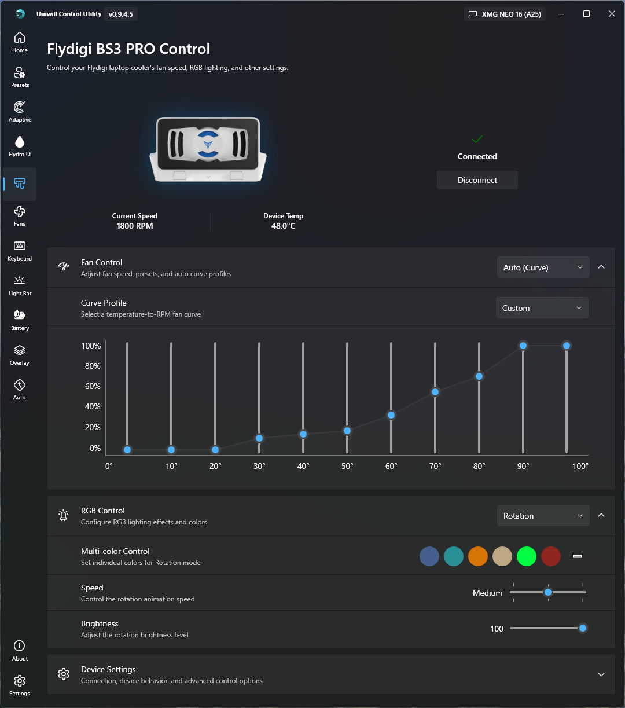

### Hydro UI

Full control of LCT liquid cooling systems (e.g. XMG Oasis) via Bluetooth Low Energy.

- BLE device discovery with scan and device selection
- **Pump Voltage** — Off, 7V, 8V, 11V
- **Fan Speed** — Off, 25%, 50%, 75%, 90%, 95%, 100%
- **RGB Effect** — Off, Static, Breathe, Colorful, Breathe Color with color picker
- Auto-connect on system startup and auto-reconnect after system resume
- **Smart Mode** — Set lower and upper temperature thresholds, at which the pump/fan slow down, speed up or turn off/on

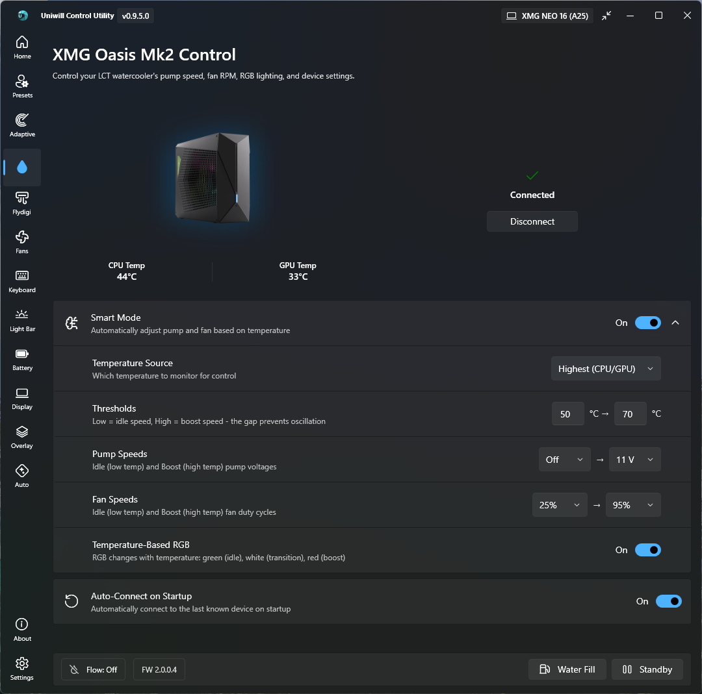

### Settings

Application preferences, diagnostics, updates, and embedded system information.

- **Application behaviour** — Display language, start on boot, startup delay, startup progress window, start minimised, minimise instead of closing, the quick-controls pop-up and notification pop-up toggles, reapply GPU clock offsets / CPU Curve Optimizer at startup, and auto-start Adaptive Mode
- **Thermal failsafe** — Off by default (it costs performance by design): holds the GPU at its base power (Dynamic Boost off) above the GPU temperature threshold and the CPU at 50 W above the CPU one
- **Preset backup** — Export and import custom and adaptive mode presets as JSON
- **Feature control** — enable/disable sidebar pages (Flydigi, Adaptive, Hydro UI, Light Bar, Overlay, Auto) and the GPU clock / CPU voltage control groups
- **Advanced features** — Power boost mode, Q-Key button preset switching, and the CPU Advanced Performance Menu unlock (Intel ONLY - BIOS setup exposes the Advanced Performance Menu on next boot)
- **Hardware management** — Wi-Fi, Bluetooth, webcam, and touchpad toggles, plus firmware-resident device switches: Windows key lock, Fn key lock, and AC power recovery (turn the laptop on when AC is restored) — the lock rows reflect the firmware's own state and survive UCU closing
- **Diagnostics** — Diagnostic logging level (Off, Error, Info, Debug); the app and engine logs live in `%LOCALAPPDATA%\UCU\logs`
- **System Information** — Device, processor, memory, and battery specs with detailed RAM timings and SPD data

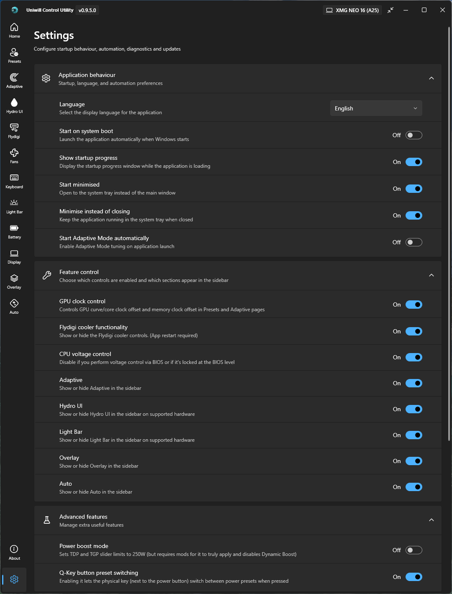

### About

Application info and project resources.

- **App info** — Version and copyright
- **Links** — GitHub repository, latest release, and community
- **Third-party libraries** — The open-source libraries UCU builds on
- **Support** — An optional way to support the project

### More screenshots

| Screenshot | Screenshot |
| --- | --- |
| 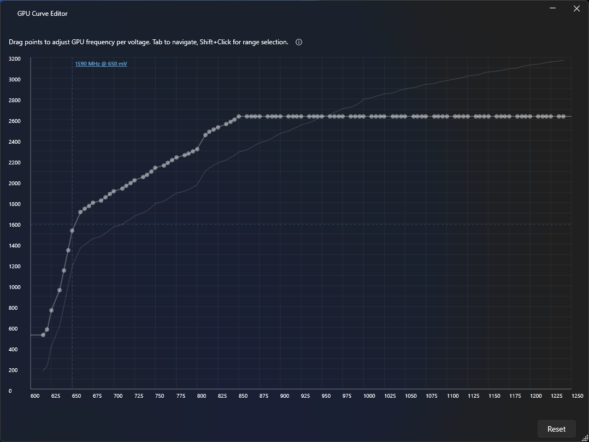<br>The V-F curve editor — Presets | <br>The BetterRGB streamer — Keyboard |
| 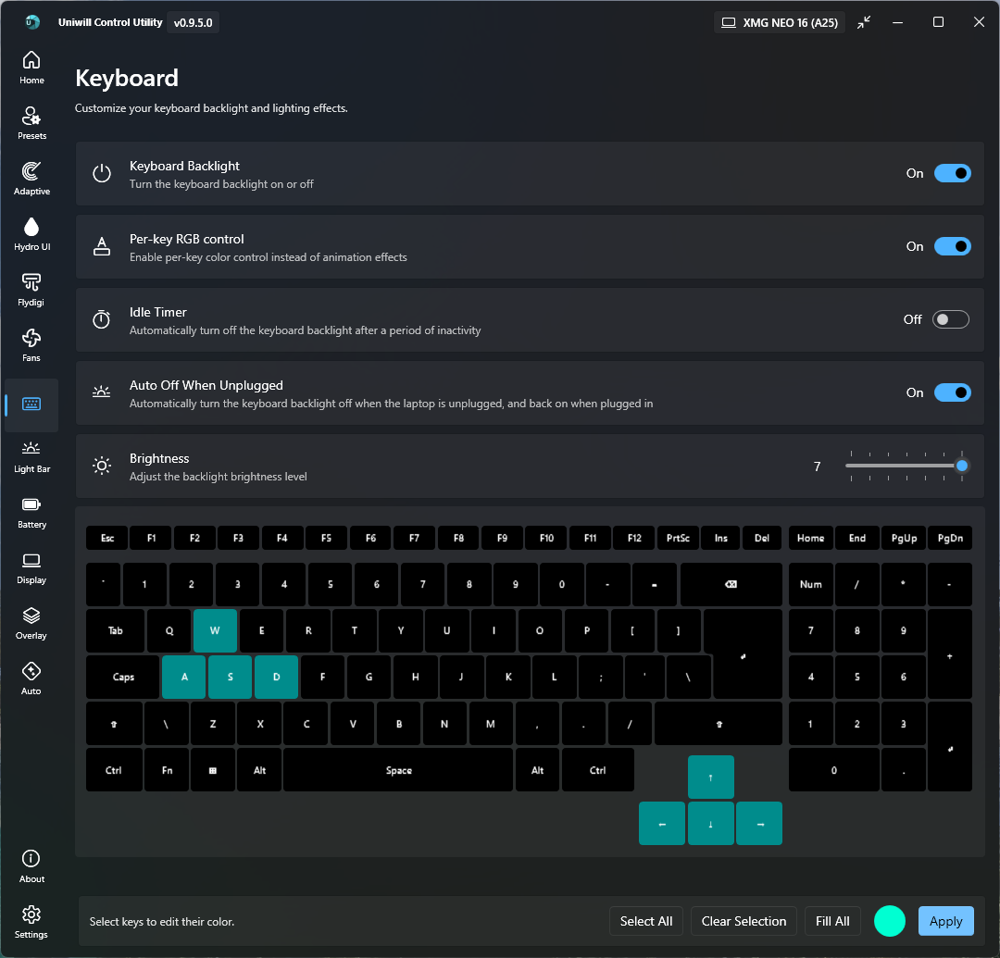<br>The per-key RGB editor — Keyboard | 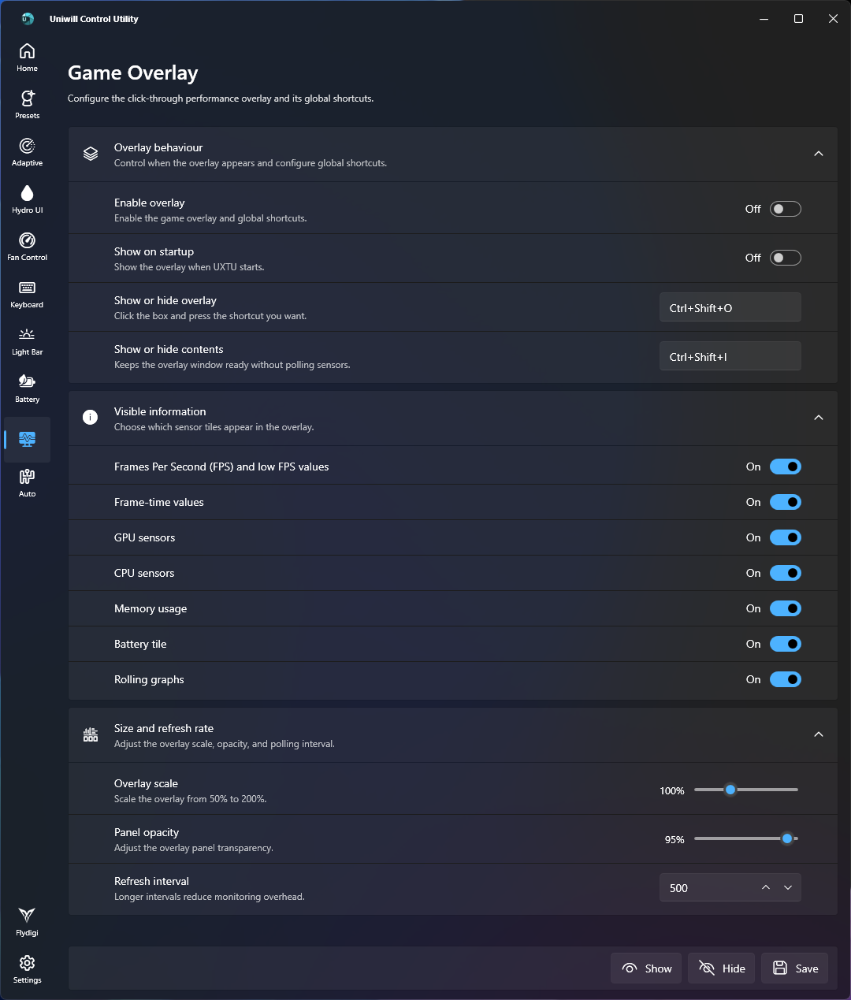<br>The overlay in game — Game Overlay |
| 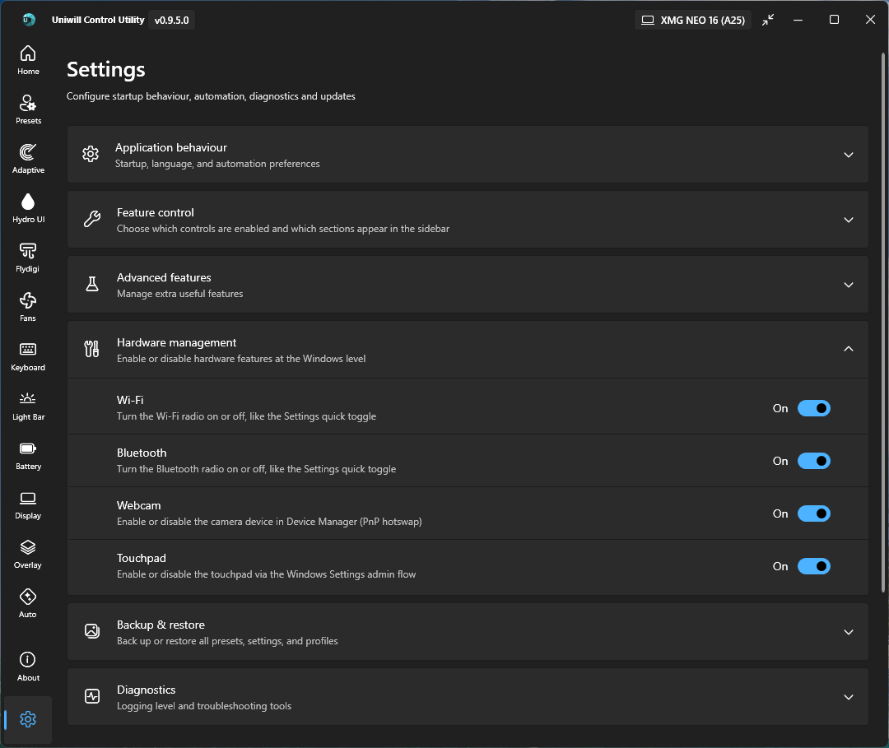<br>Settings, continued — Settings | |

## Prerequisites

UCU targets **Windows 11 (build 22621 or newer), x64** — the app is built against that SDK version, so older builds are not supported. Administrative rights are needed the first time the engine service is installed.

Beyond that, the following have to be present and configured before first use:

### .NET 10 Desktop Runtime (x64)

The app is built framework-dependent, so it needs the **.NET 10 Desktop Runtime**:

```
https://dotnet.microsoft.com/en-us/download/dotnet/10.0
```

The release's **Uniwill-Control-Utility-win-Setup.exe** installs it for you when missing, then installs the app. If you install from the MSI directly, install this runtime first; without it the app cannot start.

### UWACPIDriver.sys (Uniwill EC Driver)

UCU communicates with the Uniwill Embedded Controller through the `UWACPIDriver.sys` kernel driver. Check if it's already present at:

```
C:\Windows\System32\drivers\UWACPIDriver.sys
```

If the file exists, you're good to go. If it doesn't, install the official Control Center for your laptop (e.g., XMG Control Center, MechRevo Control Center, or another OEM utility that ships the Uniwill driver), then uninstall it — the driver file persists on disk after uninstall and is all that's needed.

> **Note:** UCU does not bundle or redistribute this driver. Running as Administrator is required for EC access.

### Pawn.IO

[Pawn.IO](https://github.com/JamesCJ60/Pawn.IO) is required for AMD Ryzen CPU tuning features (power limits, Curve Optimizer, TjMax). Download and install it from the [releases page](https://github.com/JamesCJ60/Pawn.IO/releases).

### RivaTuner Statistics Server (RTSS)

RTSS is required for the **Game Overlay**. UCU writes its metrics into RTSS's on-screen display (OSD), which handles all in-game rendering — so the entire overlay (including FPS) depends on RTSS being installed and running. Download it from the [RivaTuner website](https://www.guru3d.com/download/rivatuner-statistics-server-download/).

## Installation

### Recommended: installer

1. Head over to the [Releases](https://github.com/Uniwill-Control-Utility/Uniwill-Control-Utility/releases) page
2. Download and run **Uniwill-Control-Utility-win-Setup.exe** (the installer bootstrapper: it installs the .NET 10 Desktop Runtime if the machine lacks it, then the app). Already have the runtime, or deploying from a script? **Uniwill-Control-Utility-win.msi** installs the app alone; it needs .NET 10 Desktop Runtime present. Prefer another folder? Install with `msiexec /i Uniwill-Control-Utility-win.msi VELOPACK_INSTALLDIR="D:\UCU"`.
3. Updating is the same route — see [Upgrading](#upgrading). There is no in-app updater; the About page's **Check for updates** button queries GitHub and, when a newer release exists, offers a link to the release page.

### No portable build

There is no zip download. The engine runs as a machine-wide Windows service (`UCUEngine`) so the app itself stays unelevated, and an unpacked copy has no update or removal story of its own - deleting the folder leaves the service registered and pointing at a path that no longer exists. If you still run an old extracted copy, install the MSI: it re-points the service at the Program Files layout, and the old folder can then be deleted.

### Upgrading

Install the newer **Uniwill-Control-Utility-win.msi** (or the `Setup` bootstrapper) over the installed copy - no uninstall first. The installer closes the running app and engine, replaces the files, and re-registers `UCUEngine` against the new layout; your settings, presets and logs are untouched (`%LOCALAPPDATA%\UCU`).

Settings are carried forward per version: anything the new version's config does not yet hold is adopted from the newest older one, so an update does not reset your toggles, Power boost mode state, or opt-ins. Presets, adaptive profiles and rail limits live outside the config and are never rewritten by an update.

Two cases still need a manual uninstall first:

- a pre-release build carrying the **same version number** (Windows Installer skips files whose version is not greater),
- a copy that came from an old extracted zip - install the MSI and the service follows.

- a pre-release build carrying the **same version number** (Windows Installer skips files whose version is not greater),
- a copy that came from an old extracted zip - install the MSI and the service follows.

### Uninstalling

Settings → Apps → Installed apps → **Uniwill Control Utility** → Uninstall. That runs `Uninstall.exe`, which closes the app, removes the MSI product, **stops and deletes the `UCUEngine` service**, and clears the leftover registration and install folder.

Deleting the install folder by hand does **not** remove the service: it keeps running against a missing image, and `sc delete UCUEngine` from an elevated prompt is the manual fallback.

### Antivirus & SmartScreen (security-product-guarded machines)

UCU is a free tool and ships **unsigned** — publisher certificates cost money, and this project doesn't have one. Two practical consequences:

- **SmartScreen:** on the first run of `Setup`/`Uniwill Control Utility.exe` you may see "Windows protected your PC". That's the reputation check on an unsigned download — click **More info → Run**.
- **Aggressive security suites:** UCU registers one Windows service (**UCUEngine**) that owns the hardware control, so the app itself can run unelevated. Products with a service-protection module (observed: Emsisoft Anti-Malware) police the app's access to that service, which shows up as a **UAC prompt for "Uniwill Control Utility Engine" on every launch**, a dashboard that never fills, or `The engine service is not openable` in the app log (`%LOCALAPPDATA%\UCU\logs`).

The fix on such machines is an **application-level allowlist** for both images in your security product — an install-folder exclusion is not enough, because the file scanner is not what's policing the service:

- `C:\Program Files\Uniwill-Control-Utility\current\Uniwill Control Utility.exe`
- `C:\Program Files\Uniwill-Control-Utility\current\Service\Uniwill Control Utility Engine.exe`

This is the same allowlist commercial control centers rely on — theirs ride on a paid publisher certificate instead, which UCU deliberately doesn't buy.

## Building & packaging (maintainers)

```powershell
dotnet tool restore
.\build\pack.ps1
```

The script reads the version from the project file (3-part `a.b.c` — bump the third part for every release), publishes, stages the native payload, and produces the release asset: the per-machine **Uniwill-Control-Utility-win.msi** (plus the `Setup` bootstrapper when vpk emits it). vpk's update packages and feed index are deleted by the script — the product has no in-app updater, and installed copies update by running that MSI. There is no portable zip either - the engine is a machine-wide service, so an unpacked copy has no update or removal story. Upload the printed manifest to a GitHub release **tagged with the same version**. See [wiki/operations/release-process.md](wiki/operations/release-process.md) for the full checklist.

## Optional: ICC colour profiles

For those who want to use color correction profiles, you need to:
1. Download XMG's Control Center (since this one bundles the necessary .icm profiles)
2. Install it
3. Check that the 4 .icm files were added in ```C:\Windows\System32\spool\drivers\color```
4. Uninstall XMG Control Center

## License

UCU is released under the **GNU General Public License v3.0** — see [LICENSE](LICENSE). A modified build you distribute has to carry the same license and make its source available.

## Credits

UCU builds on the work of many open-source projects and reverse-engineering efforts. We thank the authors of the following projects for their contributions:

### Foundation

- [UXTU (GitHub)](https://github.com/JamesCJ60/Universal-x86-Tuning-Utility) — Universal x86 Tuning Utility. UCU is built on top of UXTU's codebase, extending it with Uniwill EC support, Flydigi cooler controls, watercooler management, and a rebranded Fluent Design interface.

### Contribution

- [noteMASTER11](https://github.com/noteMASTER11) - help with optimizing the fan control EC write flow, dashboard re-design and tray feature suggestion/foundation
- [Heavyfail](https://github.com/Heavyfail) - help with getting MiniLED Local Dimming control to work

### Core & Inspiration

- [G-Helper (GitHub)](https://github.com/seerge/g-helper) — Lightweight laptop tuning utility that inspired UCU's design philosophy
- [LenovoLegionToolkit (GitHub)](https://github.com/LenovoLegionToolkit/LenovoLegionToolkit) — Reference for the color picker UI pattern, fan curve editor approach, and keyboard visualizer layout.
- [WPF UI (GitHub)](https://github.com/lepoco/wpfui) — Modern Fluent Design UI library used for the UCU interface
- [Magpie (GitHub)](https://github.com/Blinue/Magpie) — Translation management library used for localization

### Device Protocol References

- **[THRM](https://github.com/TIANLI0/THRM)** by TIANLI0 (repository gone as of October 4th 2026) — the Flydigi `5A A5` cooler protocol.
- **[watercooler-manager](https://github.com/tomups/watercooler-manager)** by tomups — the LCT watercooler BLE protocol.
- **[UCC](https://github.com/nanomatters/ucc)** by nanomatters — LCT watercooler lifecycle and the ITE 8291 keyboard HID protocol.
- **[tuxedo-drivers](https://gitlab.com/tuxedocomputers/development/packages/tuxedo-drivers)** by TUXEDO Computers — the ITE 8291 per-key RGB byte layouts and the Uniwill EC registers for NVIDIA GPU power control.
- **[BetterRGB-ITE8291-Adaptive](https://github.com/ZavierChen/BetterRGB-ITE8291-Adaptive)** by ZavierChen — UCU's BetterRGB streamer engine.
- **MechControl** (decompiled) — Okashira (defty1234), fork by [Heavyfail](https://github.com/Heavyfail) — the global keyboard effects protocol, MiniLED local dimming, and the `UWACPIDriver.sys` IOCTL codes.
- **XMG Control Center / GCUService.exe** (decompiled) — GPU power EC sequences and the NVRAM variables behind GPU mode persistence.
- **[OpenRevo](https://github.com/faintonce/open-revo)** by faintonce — the `OemMagicVariable` offset and gatekeeper handshake, the EC OEM mode engine behind UCU's stock presets, and the device-switch registry behind the key locks and AC recovery.

What each one documented, and which part of UCU it produced, is in [docs/device-protocol-references.md](docs/device-protocol-references.md).

