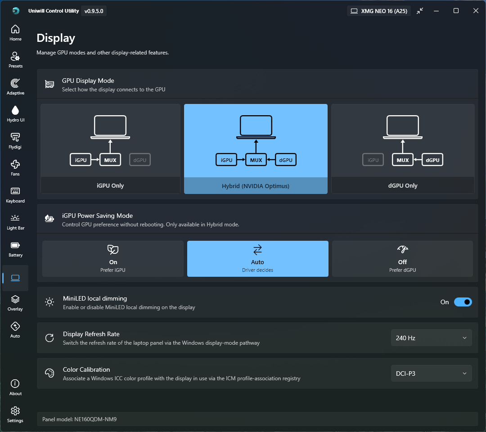

# Uniwill Control Utility

A hardware tuning/monitoring application for laptops with **Uniwill-based embedded controllers**, with additional support for AMD Ryzen and Intel CPU tuning, NVIDIA GPU controls, and peripheral device management.

Its purpose is to serve as an open-source alternative to the XMG/PCSpecialist's official Control Center.

UCU was built on top of the foundation laid by [UXTU](https://github.com/JamesCJ60/Universal-x86-Tuning-Utility) (Universal x86 Tuning Utility), reworking/extending its capabilities with Uniwill EC integration, Flydigi cooler support, watercooler control, and a modern Fluent Design interface in order to provide a tailored software for the hardware used by the likes of XMG Neo A25/E25, PCSpecialist Recoil 3 16 (Intel/AMD) and so on.


## ⚠️ Disclaimer & Trademarks

* **This project is still very much a WORK IN PROGRESS** - Although a lot of attention and time has been invested into polishing this app, one should still expect some (minor) bugs
* **Unofficial Software:** This project is an independent, community-driven, free and open-source utility. It is **not** affiliated with, endorsed by, or sponsored by Uniwill, Tongfang, Flydigi or any laptop/cooler brand/reseller mentioned above.
* **Trademarks:** All product names, logos, images, brands, trademarks, and registered trademarks are property of their respective owners. Their use here is strictly for identification and compatibility purposes.
* **No Warranty / Hardware Risks:** This software interfaces directly with hardware management features. **Use it at your own risk.** The developer assumes no liability for any hardware damage, system instability, battery degradation, or voided warranties resulting from the use of this utility.

If you come across any issues or errors, please [open an issue on GitHub](https://github.com/Uniwill-Control-Utility/Uniwill-Control-Utility/issues).


## Which hardware has this tool been tested on?
 - **XMG Neo 16 (A25)**
    - CPU: **AMD Ryzen 9 9955HX3D**
    - GPU: **NVIDIA GeForce RTX 5090 Laptop**
    - Panel: **MiniLED**
 - **XMG Neo 16 (M26)**
    - CPU: **Intel® Core™ Ultra 9 Processor 290HX Plus**
    - GPU: **NVIDIA GeForce RTX 5080 Laptop**
    - Panel: **OLED**
 - **PCSpecialist Recoil 3 16 (Intel)**
    - CPU: **Intel® Core™ Ultra 9 Processor 275HX**
    - GPU: **NVIDIA GeForce RTX 5080 Laptop**
    - Panel: **MiniLED**
 - **Mechrevo Aurora 16 Ultra**
    - CPU: **Intel® Core™ Ultra 9 Processor 275HX**
    - GPU: **NVIDIA GeForce RTX 5080 Laptop**
    - Panel: **IPS**   
 - **Tuxedo Stellaris 16 Gen7**
    - CPU: **Intel® Core™ Ultra 9 Processor 275HX**
    - GPU: **NVIDIA GeForce RTX 5080 Laptop**
    - Panel: **IPS**   
 - **Mifcom 16**
    - CPU: **AMD Ryzen 9 9955HX3D**
    - GPU: **NVIDIA GeForce RTX 5090 Laptop**
    - Panel: **MiniLED**  

## Testing limitations

Intel CPU voltage control is currently not available.

However, CPU TDP control has been tested and confirmed to be working on both AMD and Intel variants.

## How were the features achieved?

A fair amount of research into other projects that have been mentioned in the Credits section.

Without the hard work of all those developers, most of the features would have been either harder or impossible to implement.

During my personal debugging/tinkering, I happened to stumble upon additional RGB effects for the Keyboard and Light Bar, and attempted to improve them further. 

And truth be told, a local AI agent was a game-changer when it came to discovering how everything ticked, which brings me to the next point.

## AI  Disclaimer
AI (**Qwen 3.6 27B**) was used to:
 - reverse-engineer closed-source software from the Credits section
 - research open-source software from the Credits section
 - implement a fair amount of the backend
 - set up initial skeletons of the UI

## Pull Requests

PRs with additional (well-structured and tested) features are welcome.

We do not mind features/code created with the assistance of AI, as long as it's thoroughly tested by the owner of said code and as long as the code is not of bad quality (aka "AI slop").

## Features replicated from XMG's Control Center
 - Performance profiles
 - Keyboard global/per-key RGB control
 - BetterRGB software streamer engine (adaptive 15–60 FPS, default 30, on the ITE 0xFF03 RGB interface, AC auto-policy, wake resume)
 - Light Bar RGB control
 - Liquid Cooler control
 - CPU and GPU Fan Control
 - Battery control
 - MiniLED Local Dimming control
 - Display refresh rate control (laptop panel only)
 - Display color calibration control (Default / sRGB / P3 / Adobe RGB)
 - GPU MUX switch control (Hybrid / dGPU Only / iGPU Only)
 - GPU Power Saving (On / Off / Auto)
 - Performance button preset switching (physical Performance/Q-key button)

## Features replicated from Flydigi Space Center
 - Flydigi BS1, BS2, BS2 Pro, BS3 and BS3 Pro support
 - pre-set and custom fan curves
 - RGB control
 - auto power-on

## Additional features 
 - Per-game presets of above features (except the battery, of course)
 - Automatic performance profile application based on the charger being (un)plugged
 - Automatic GPU preference application based on the charger being (un)plugged (Hybrid mode)
 - Extra RGB effects/directions for the keyboard
 - System tray controls for Power profile, Hydro UI, Fan and Flydigi control
 - Smart Hydro UI - turn the pump on/off and the fan up/down (noise optimization)
 - Smart Fan Mode - all fans now use one temperature sensor as the reference
 - Stock presets assert through the EC's own OEM mode engine (no power-register writes), so their power limits come from the firmware's factory table exactly like the official Control Center
 - Manual-control gating: Fan Control and the Adaptive GPU power controls are disabled while a stock preset is active, since the firmware ignores custom fan tables and cTGP/Dynamic Boost offsets then
 - Keyboard brightness re-assert after UCU hands EC manual control back to the firmware, so the firmware's own restore leaves no visible brightness flash

# App Features

### **Tray Widget**

Simple metrics and toggles for quick changes.

- **Page-container tray** — the QuickSettings grid is the default page of an in-tray NavigationView; a Display button navigates (with the page transition animation) to a Display page carrying the refresh-rate row, the laptop-panel color-calibration profile row, the runtime Nvidia Optimus switch (iGPU / Auto / dGPU power saving, Hybrid mode only) and the MiniLED local dimming toggle (MiniLED panels only), with the sections scrolling inside the page; a back button returns to the grid
- **Title-bar hand-over button** — a button in the main window's title bar minimizes the main window and opens the mini-tray, mirroring a left-click on the tray icon


### **Dashboard**

At-a-glance system overview showing your device's specifications and live hardware metrics.

- Device identification with laptop image (XMG, PC Specialist Recoil, and more)
- Live CPU, GPU, memory, and battery telemetry cards (GPU metrics fall back to the iGPU when the dGPU is unavailable)
- Quick-launch device controls for Flydigi coolers and Hydro UI watercoolers (when supported)


### **Presets**

One-click tuning profiles and granular hardware controls for CPU, GPU, and system power management. This is a mix of XMG Control Center's and MSI Afterburner main features.

- **Built-in profiles** — Office, Gaming, and Turbo presets optimized for common use cases, asserted through the EC's own OEM mode engine so their power limits stay in the firmware's factory table
- **Custom profiles** — Save and load your own tuned configurations
- **Status card** — Shows active values for CPU power limits, TjMax, Curve Optimizer, GPU TGP, and Dynamic Boost
- **CPU Power Tuning** (AMD) — Sustained Power Limit (SPL), Fast Power Limit (FPL), TjMax, and Curve Optimizer
- **Intel Tuning** — PL1, PL2 power limits and CPU undervolting via FIVR
- **GPU Tuning** (NVIDIA) — GPU TGP, Dynamic Boost, Dynamic Boost Offset, Core/Memory Clock Offsets, and V-F Curve Editor (a fully working curve editor for undervolting)
- **Custom presets** — Up to 5 custom presets can be set up (mirrored by another set when Power Boost Mode is ON)
- **Preset backup & import** — Export and restore all custom presets and adaptive mode profiles


### **Performance Button**

Interception of the laptop's physical Performance / Q-key button (Uniwill NB02 hardware), so the button cycles UCU's own presets instead of the firmware's.

- **Preset cycling** — Each press advances to the next preset (Office → Gaming → Turbo → every saved Custom preset of the pool Power Boost Mode selects, wrapping) through the same apply path the Presets page uses, and the selection is persisted so the tray, Presets page, and resume handlers stay in sync
- **Q-key LED** — The EC firmware drives the LED from its own internal mode state and the OEM button already cycles it (white → red → yellow), which stays aligned with the Office → Gaming → Turbo order; no LED color register is written by default
- **Detection** — The EC's ACPI WMI provider raises an `AcpiTest_EventULong` event whose `ULong` payload is `176` for every physical press, so the press is read from the EC itself rather than inferred from a register latch; UCU's own preset applies therefore cannot be mistaken for a press
- **Manual-control gate** — The press echo only fires while the EC manual-control gate (`0x0741` bit0) is set, so UCU keeps it armed permanently: the button stays live while a Custom preset, custom fan curves, GPU power control or Smart Fan Mode holds manual control, and the EC — not the firmware — owns the mode state
- **Settings** — "Q-Key button preset switching" (default ON) and "Q-Key LED sync (experimental)" (default OFF, mirrors the active preset into the EC mode index register for firmware that drives the LED from it)

### **Adaptive Mode**

Intelligent, game-aware performance optimization that automatically adjusts settings based on the active application.

- Per-game profile support — each game gets its own tuned configuration
- **CPU controls** — Power limits (SPL/FPL), TjMax, Curve Optimizer (AMD), PL1/PL2 and undervolt (Intel)
- **GPU controls** — TGP, Dynamic Boost, V-F Curve Editor, Core/Memory Clock Offsets
- **Fan Control** — Custom EC fan curves per game
- **Flydigi cooler** — Custom fan curves and RGB speed per game
- **Keyboard RGB** — Per-game lighting profiles with auto-detection of running games: firmware Effects, Per-Key RGB, or the BetterRGB streamer (effect, colors, FPS and software brightness per game; the Adaptive page mirrors the Keyboard page's full per-effect control set — direction buttons, speed/smoothness sliders, random/reverse toggles, style/layout buttons — all saved per profile)
- **Hydro UI** - per-game configuration of the liquid cooler RGB and fan/pump speed
- **Light Bar** - per-game customization of the light bar
- **Per-game presets** — Automatic profile switching when games launch or close


### **Game Overlay**

Click-through in-game performance overlay, rendered natively by RivaTuner Statistics Server (RTSS) for real-time tracking while gaming.

- **OSD metric rows** — toggle any combination of these rows (each row shows its sub-metrics):
  - **CPU** — temperature, usage, clock (MHz), power (W), fan speed
  - **RAM** — used (MB) and per-DIMM temperatures
  - **GPU** — temperature, usage, clock (MHz), power (W), fan speed
  - **VRAM** — used (MB)
  - **Current FPS** — live FPS + frame time (ms), labelled with the graphics API (DX12 / DX11 / Vulkan)
  - **1% Low** — 1% low FPS + frame time (ms)
  - **0.1% Low** — 0.1% low FPS + frame time (ms)
  - **Hydro UI** — pump voltage and fan % (when a cooler is connected)
  - **Flydigi cooler** — fan RPM (when a cooler is connected)
- **Refresh interval** — configurable (100–5000 ms) to balance accuracy and overhead
- **Global shortcuts** — show/hide the overlay, plus a secondary alias shortcut
- **Rendered by RTSS** — UCU writes the metric data into RTSS's on-screen display; positioning, scale, and opacity are configured in RTSS, and its native hooking keeps the overlay safe in anti-cheat (e.g. EAC) protected games
- **RTSS required** — the overlay and FPS data depend on RTSS being installed and running


### **Automations**

Set-and-forget rules that apply presets automatically when system state changes.

- **Preset on Battery Charge** — Apply a preset when the system switches to AC power
- **Preset on Battery Discharge** — Apply a preset when running on battery
- **Preset on System Resume** — Reapply settings after sleep or hibernation
- **GPU Preference on Battery** — Set the GPU preference (iGPU / dGPU / Auto) when running on battery (Hybrid mode only)
- **GPU Preference when Plugged In** — Set the GPU preference when connected to power (Hybrid mode only)
- **Refresh Rate on Battery** — Set the internal panel's refresh rate when running on battery (internal panel only; 0 = off)
- **Refresh Rate when Plugged In** — Set the internal panel's refresh rate when connected to power (internal panel only; 0 = off)


### **Fan Control**

Full control over system fan curves with real-time temperature monitoring.

- **Unified or split curves** — Single curve for both fans, or independent CPU and GPU curves
- Multi-point temperature-speed mapping with presets (Silent, Balanced, Performance, Full Speed, Off, Custom)
- 11 thermal threshold zones per curve
- Turbo mode (100% fans) and Restore Auto to return control to the EC firmware
- Live CPU/GPU temperature display
- **Smart Fan Mode** — forces all the fans to use the same temperature source - CPU,GPU or the Hottest of the two
- **Stock-preset gating** — fan curve customization (page, tray, resume) is Custom-preset only; stock presets leave the fans to the firmware's own per-mode table and show a "Stock Preset Active" notice


### Keyboard

Per-key and global RGB keyboard backlight control via the ITE HID controller.

- **Effects mode** — Multiple animation types (Static, Rainbow, Wave, Breathing, Ripple, Aurora, Spark, Random) with speed control
- **Per-key RGB mode** — 61-key grid editor with individual color swatches
- Multi-color palette picker (4 or 7 colors) for complex effects
- Touch reactive toggle for Ripple, Aurora, Spark, and Random effects
- Idle timer — Auto-turn-off backlight after configurable inactivity
- Auto Off When Unplugged — opt-in toggle: backlight turns off while the laptop is unplugged (on battery) and restores the saved lighting when plugged in (works in both per-key and effects modes, including the BetterRGB streamer)
- Keyboard Backlight power row (first row, mirroring the Light Bar page): the single off switch — when OFF, every other control on the page is hidden; the mini-tray Keyboard RGB button mirrors this same PowerOn state, and both pages re-sync their controls when the tray or Adaptive writes state (SettingsChanged notifications)
- Bottom bar (action buttons + picker) shows only in Per-Key RGB mode — no streamer-status strip in effects/BetterRGB modes
- **BetterRGB Streamer Engine** — opt-in software mode ported from the open-source [BetterRGB-ITE8291-Adaptive](https://github.com/ZavierChen/BetterRGB-ITE8291-Adaptive) engine: all 14 effects (breathing, wave, sparkle, reactive, wheel, lightning, flame, raindrop, matrix, static, ripple, rainbow, quicksand, current) rendered in software and streamed on the dedicated ITE 0xFF03 RGB interface with the reference's interleaved 512-byte framing, at 15/30/45/60 FPS (button-selected, default 30; the pacer self-degrades if the device lags). Its own Effects card carries the full reference control set per effect (speeds, smoothness, widths, densities, multi-color palettes capped per effect — up to 5 for Raindrop, 3 for Matrix/Quicksand/Current, random-color toggles, reactive duration, matrix styles, and Wave direction arrow buttons at 45° increments) — the firmware Effects card stays separate. 3–100 software brightness, keypress-driven reactive/ripple via the system key-state hook, AC auto-policy (plugged → streamer, on battery → firmware effects at 0% CPU), sleep/wake resume, a 3-attempt watchdog that falls back to Hardware MCU, and a live status line (running FPS + frame counter). On a normal UCU exit the engine hands the keyboard a static white firmware effect at the second-lowest brightness (in-memory only, never persisted) so the keyboard never goes black. Off by default — the hardware path is byte-identical
- White-backlight-only mode for keyboards without RGB


### Light Bar

RGB light bar control with multiple effects and color options.

- Power toggle, color picker, and brightness slider (10–100%) — when the power toggle is OFF, every other control on the page is hidden
- Auto Off When Unplugged — opt-in toggle: light bar turns off while the laptop is unplugged (on battery) and restores the saved lighting when plugged in
- BetterRGB Sync — opt-in toggle on the BetterRGB card: while the streamer engine runs, the strip mirrors the rendered frame's bottom row (the keys nearest the front edge), pushed as a single zone color at 10 Hz; while sync owns the strip the Light Bar page shows the same override overlay as Adaptive Mode (dark overlay, disabled controls, a "BetterRGB Light Bar Sync" snackbar), and its saved settings are restored when the engine stops
- Effects — Static, Breathing, Wave, Loading, Marquee, Meteor
- Speed slider for animated effects
- Fixed rainbow palette for Wave and Marquee effects


### Battery


Battery charging management and live telemetry from the EC.

- **Charging Limit** — Set maximum charge to 100%, 80%, or 60% to extend battery lifespan
- **Live telemetry** (polled every 5 seconds):
  - State of charge, battery health (remaining vs. design capacity)
  - Temperature, cycle count, present voltage, charge/discharge rate
  - Power source indicator (AC / battery)
- Manual refresh button


### **Display**

GPU display mode, GPU power management, and display panel controls (Uniwill EC hardware only).

- **GPU Display Mode** (MUX switch) — Choose **Hybrid (NVIDIA Optimus)**, **dGPU Only**, or **iGPU Only**, with a visual MUX diagram. The choice is persisted to UEFI NVRAM so it survives restarts, and a system reboot is required for the physical MUX change to take effect.
- **GPU Power Saving** (Hybrid mode only) — Live discrete-GPU power control without rebooting: **On (Power Saving)** disables the dGPU via PnP hotswap and routes rendering to the iGPU for maximum savings, **Off (Performance)** re-enables the dGPU, and **Auto** lets Windows/NVIDIA Optimus decide per application.
- **MiniLED Local Dimming** (MiniLED panels only) — Toggle the panel's local dimming, verified with an EC register readback.
- **Display Refresh Rate** (panels offering multiple rates) — Switch the refresh rate of the **laptop panel only** (never an external monitor) through the Windows display-mode pathway (`EnumDisplaySettings`/`ChangeDisplaySettingsEx`). The panel is addressed by device name, so the write lands on it whether it is primary or secondary, and Windows' per-display registry carries the mode across primary/secondary switches. When only an external monitor is in use and the panel is detached (GDI hides it), the panel's known rate set is still offered, the last known rate stays selected, and a new selection is deferred — it is applied once the panel reattaches. Rates the panel does not report are hidden and the visible buttons spread evenly across the row.
- **Color Calibration** (panels with Windows' ICC profiles) — Associate a Windows ICC color profile with the **laptop panel only** (never an external monitor): **Default** (uncalibrated), **sRGB**, **P3** (Display P3), or **Adobe RGB**, applied through the genuine Windows color-engine switch — `mscms.dll` `InstallColorProfile` + `WcsSetDefaultColorProfile` at SYSTEM_WIDE and CURRENT_USER scope (the exact sequence XMG Control Center's `GCUUtil.exe` runs), against the built-in spool profiles (`sRGB.icm`, `DCIP3.icm`, `AdobeRGB.icm`). Unlike a bare `ICM\ProfileAssociations` registry write (which only relabels the selection), this forces Windows' color engine to reload and actually repaint the panel. When the panel is detached (external-only), the last known profile stays selected and a new selection is deferred — it is applied once the panel reattaches.
- **GPU Information** — Live readout of the active MUX mode, GPU module ID, physical MUX hardware state, and the persisted NVRAM mode.



### Flydigi Cooler

Control Flydigi laptop cooling pads via BLE (BS1) and HID (BS2, BS2 Pro, BS3, BS3 Pro).

- **Fan Control** with 3 modes:
  - **Manual** — Direct RPM slider (1300–4000 RPM)
  - **Gear Presets** — Quiet, Standard, Strong, Overclock with Low/Medium/High sub-levels
  - **Auto (Curve)** — Temperature-to-RPM fan curve profiles with editable custom curves
- **Smart Control** — Automatic fan speed based on laptop temperature
- **RGB Control** (BS2+ only): Off, Smart-Temp, Static, Rotation, Flowing, Breathing with color, brightness and speed controls
- **Device Settings** — Temperature source, RPM Range avoidance, Smart Start/Stop
- Live RPM and temperature readback
- Dual protocol support — HID (BS2/BS2 Pro/BS3) and BLE (BS1)


### Hydro UI 

Full control of LCT liquid cooling systems (e.g. XMG Oasis) via Bluetooth Low Energy.

- BLE device discovery with scan and device selection
- **Pump Voltage** — Off, 7V, 8V, 11V
- **Fan Speed** — Off, 25%, 50%, 75%, 90%, 95%, 100%
- **RGB Effect** — Off, Static, Breathe, Colorful, Breathe Color with color picker
- Auto-connect on system startup and auto-reconnect after system resume
- **Smart Mode** — Set lower and upper temperature thresholds, at which the pump/fan slow down, speed up or turn off/on


### Settings

Application preferences, diagnostics, updates, and embedded system information.

- **Application behaviour** — Start on boot, start minimized, minimize-to-tray, reapply settings on start, auto-reapply interval, auto-start Adaptive Mode
- **Preset backup** — Export and import custom and adaptive mode presets as JSON
- **Feature Control** - enable/disable various pages (e.g. the Flydigi cooler page if you do not need it)
- **Diagnostics** — Diagnostic logging level (Off, Error, Info, Debug)
- **System Information** — Device, processor, memory, and battery specs with detailed RAM timings and SPD data


### **About**

Application info and project resources.

- **App info** — Version and copyright
- **Links** — GitHub repository, latest release, and community
- **Third-party libraries** — The open-source libraries UCU builds on
- **Support** — An optional way to support the project

## Prerequisites

UCU requires the following to be installed and configured before first use:

### UWACPIDriver.sys (Uniwill EC Driver)

UCU communicates with the Uniwill Embedded Controller through the `UWACPIDriver.sys` kernel driver. Check if it's already present at:

```
C:\Windows\System32\drivers\UWACPIDriver.sys
```

If the file exists, you're good to go. If it doesn't, install the official Control Center for your laptop (e.g., XMG Control Center, MechRevo Control Center, or another OEM utility that ships the Uniwill driver), then uninstall it — the driver file persists on disk after uninstall and is all that's needed.

> **Note:** UCU does not bundle or redistribute this driver. Running as Administrator is required for EC access.

### Pawn.IO

[Pawn.IO](https://github.com/JamesCJ60/Pawn.IO) is required for AMD Ryzen CPU tuning features (power limits, Curve Optimizer, TjMax). Download and install it from the [releases page](https://github.com/JamesCJ60/Pawn.IO/releases).

### RivaTuner Statistics Server (RTSS)

RTSS is required for the **Game Overlay**. UCU writes its metrics into RTSS's on-screen display (OSD), which handles all in-game rendering — so the entire overlay (including FPS) depends on RTSS being installed and running. Download it from the [RivaTuner website](https://www.guru3d.com/download/rivatuner-statistics-server-download/).

## Installation

1. Head over to the [Releases](https://github.com/jgudec/Uniwill-Control-Utility/releases) page
2. Download the latest zip
3. Extract the zip
4. Launch **Uniwill-Control-Utility.exe**

## Credits

UCU builds on the work of many open-source projects and reverse-engineering efforts. We thank the authors of the following projects for their contributions:

### Foundation
- [UXTU (GitHub)](https://github.com/JamesCJ60/Universal-x86-Tuning-Utility) — Universal x86 Tuning Utility. UCU is built on top of UXTU's codebase, extending it with Uniwill EC support, Flydigi cooler controls, watercooler management, and a rebranded Fluent Design interface.

### Contribution
- [noteMASTER11](https://github.com/noteMASTER11) - help with optimizing the fan control EC write flow, dashboard re-design and tray feature suggestion/foundation
- [Heavyfail](https://github.com/Heavyfail) - help with getting MiniLED Local Dimming control to work

### Core & Inspiration
- [G-Helper (GitHub)](https://github.com/seerge/g-helper) — Lightweight laptop tuning utility that inspired UCU's design philosophy
- [LenovoLegionToolkit (GitHub)](https://github.com/LenovoLegionToolkit/LenovoLegionToolkit) — Reference for the color picker UI pattern, fan curve editor approach, and keyboard visualizer layout.
- [WPF UI (GitHub)](https://github.com/lepoco/wpfui) — Modern Fluent Design UI library used for the UCU interface
- [Magpie (GitHub)](https://github.com/Blinue/Magpie) — Translation management library used for localization

### Device Protocol References
- [THRM (GitHub)](https://github.com/TIANLI0/THRM) (user and repository gone at the time of writing - October 4th 2026) by TIANLI0 — Primary reference for the Flydigi `5A A5` cooler protocol. Provided the most complete documentation of the frame format, RGB upload sequence, and gear RPM table.
- [watercooler-manager (GitHub)](https://github.com/tomups/watercooler-manager) by tomups — Primary reference for the LCT watercooler BLE protocol. The Python implementation confirmed the Nordic UART UUIDs, frame format, and command byte values.
- [UCC (GitHub)](https://github.com/nanomatters/ucc) by nanomatters — Reference for the LCT watercooler protocol (BLE connection lifecycle, error recovery, state management) and for the ITE 8291 keyboard HID controller protocol (HID device enumeration, ACPI interface, zone-based control commands).
- [tuxedo-drivers (GitLab)](https://gitlab.com/tuxedocomputers/development/packages/tuxedo-drivers) by TUXEDO Computers — Authoritative reference for the ITE 8291 per-key RGB protocol. The Linux kernel driver (`src/ite_8291/ite_8291.c`) provided the exact byte layouts for UserMode entry, row announcement, and the 65-byte BGR-planar output report format. Also provided the EC register definitions (`src/uniwill_interfaces.h`) for NVIDIA GPU power control on Schenker/XMG laptops (cTGP/TPP/DB offset registers and the `0x0743` enable register).
- [BetterRGB-ITE8291-Adaptive (GitHub)](https://github.com/ZavierChen/BetterRGB-ITE8291-Adaptive) by ZavierChen — Primary reference for UCU's BetterRGB software streamer engine. Its `better_rgb.c` established the RGB runtime-mode negotiation on the ITE 0xFF03/MI_01 HID interface, the synchronous interleaved 512-byte frame transport (one SetFeature + eight 65-byte writes per frame), the 102-entry KEYMAP frame layout, and the full per-effect animation math (14 of the reference's 16 effects ported into UCU's software renderer — Touch Current and Screen Ambient were dropped).

- **MechControl** (decompiled, closed-source) — Original by Okashira (Discord: defty1234), fork by [Heavyfail (GitHub)](https://github.com/Heavyfail). Schenker/Mechrevo utility. Source for the global keyboard effects protocol (zone-based 9-byte HID feature reports), MiniLED Local Dimming control (WMI `AcpiTest_MULong` / `GetSetULong` invocation pattern), and UWACPIDriver.sys IOCTL codes (0x9C40A488/0x9C40A48C) for direct EC access.
- **XMG Control Center / GCUService.exe** (closed-source) — Official Schenker/XMG utility. Studied for HID device communication patterns, handle acquisition, GPU power control EC register sequences (via `GPUInfoDLL.dll` and `ACPIDriverDll.dll` binary analysis), and NVRAM GUID/variable names for GPU mode persistence.
- **[OpenRevo (GitHub)](https://github.com/faintonce/open-revo)** by faintonce — Mechrevo control center (Rust/Tauri), a sibling of UCU's target on the same Uniwill EC family. Used for runtime NVRAM probing to determine the correct offset (98) within `OemMagicVariable` for BIOS-visible GPU MUX mode switching — without this, UCU's NVRAM writes would not have been recognized by the BIOS. Its mode-apply path was also decompiled for the EC OEM mode engine (the per-mode `0x0751` fan-control literals that recolor the Q-key LED, the `0x0787` commit write, the `0x0741` manual-control gate, and the fact that stock modes write **no** power registers at all), which is what UCU's stock presets now assert through, and for the Performance-button intercept architecture behind UCU's own button handling.

