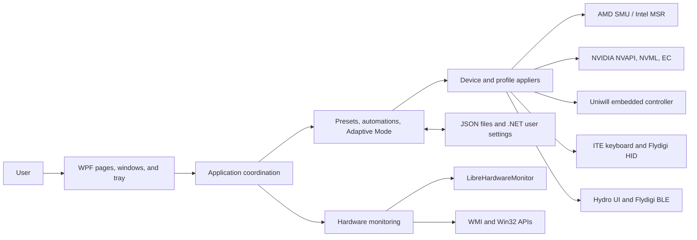

# Uniwill Control Utility Documentation

This documentation describes Uniwill Control Utility (UCU) as it exists at source commit [`eea723e`](https://github.com/Uniwill-Control-Utility/Uniwill-Control-Utility/commit/eea723ef555fe410bc46b390c30030086a71b0a8), dated 2026-09-26.

UCU is a Windows desktop application for monitoring and tuning Uniwill-based laptops and selected peripherals. It combines laptop embedded-controller access, AMD and Intel CPU controls, NVIDIA GPU tuning, RGB and fan controls, per-game profiles, automation, and an on-screen performance overlay in one WPF process.

Statements labelled **Current state** describe observed code and repository contents. Statements labelled **Recommendation** describe proposed changes and are not implemented behavior.

## Documentation map

### Project

- [Project overview](project/project-overview.md)
- [Supported hardware and features](project/supported-hardware-and-features.md)
- [Current-state assessment](project/current-state-assessment.md)
- [Testing strategy](project/testing-strategy.md)
- [Glossary](project/glossary.md)

### Architecture

- [System architecture](architecture/system-architecture.md)
- [Codebase map](architecture/codebase-map.md)
- [Startup and lifecycle](architecture/startup-and-lifecycle.md)
- [Preset and Adaptive Mode pipelines](architecture/preset-and-adaptive-pipelines.md)
- [Hardware integration](architecture/hardware-integration.md)

### Engineering and operations

- [Developer guide](operations/developer-guide.md)
- [Configuration and data](operations/configuration-and-data.md)
- [Operations runbook](operations/operations-runbook.md)
- [Release process](operations/release-process.md)
- [Contribution workflow](operations/contribution-workflow.md)

### Protocol reference

- [Device communication protocols](protocols/device-communication-protocols.md)
- [Uniwill EC fan control](protocols/uniwill-ec-fan-control.md)
- [ITE 8291 keyboard HID protocol](protocols/ite-8291-keyboard-hid-protocol.md)
- [MiniLED local dimming](protocols/miniled-local-dimming.md)
- [NVIDIA GPU power control](protocols/nvidia-gpu-power-control.md)
- [OEM control-center profiles](protocols/oem-control-center-profiles.md)
- [Smart fan control](protocols/smart-fan-control.md)

## System at a glance

## Repository snapshot

| Item | Observed value |
| --- | --- |
| Application version | `26.2.2` |
| Target | `net10.0-windows10.0.22621.0` |
| Desktop stack | WPF plus WPF UI, with selected Windows Forms APIs |
| Source size | 53,706 C# lines + 11,920 XAML lines across 172 files |
| Packages | 24 NuGet `PackageReference` entries |
| Localization | 22 embedded JSON language files |
| Repository history | 617 commits; initial commit 2022-05-25 |
| Current branch/tag shape | `master` only; no tags in the cloned repository |
| Automated tests | No test project or test framework found |
| CI/CD | No GitHub Actions workflow found |
| Tracked native/binary payload | 30 files, approximately 12.66 MiB |
| License | GNU General Public License v3.0 |

## Source repository

- Code: https://github.com/Uniwill-Control-Utility/Uniwill-Control-Utility
- License: https://github.com/Uniwill-Control-Utility/Uniwill-Control-Utility/blob/master/LICENSE
- Main README: https://github.com/Uniwill-Control-Utility/Uniwill-Control-Utility/blob/master/README.md

