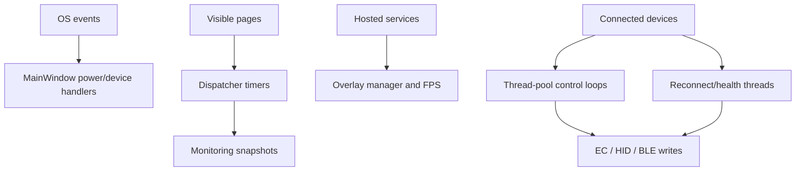

# Background Processing

## Overview

UCU runs multiple independent polling, control, monitoring, reconnect, and UI-refresh loops. They use WPF dispatcher timers, `System.Threading.Timer`, background tasks, named threads, OS callbacks, and hosted-service lifetimes.

## Process-lifetime work

| Owner | Work | Start | Stop |
| --- | --- | --- | --- |
| `App` | Single-instance show-event listener | First instance startup | App exit cancellation/disposal |
| `HardwareMonitoringService` | LibreHardwareMonitor tree and category snapshots | Persistent startup lease plus consumer leases | Host disposal |
| `OverlayManagerService` | Overlay visibility, hooks and view model | Hosted-service start | Hosted-service stop/disposal |
| `FpsMonitoringService` | RTSS reads or ETW trace session | Acquired by overlay | Lease release/disposal |
| Flydigi HID service | Input loop, power/device notifications, health and reconnect | Service construction/connection | Suspend, disconnect or disposal |
| Flydigi BLE service | GATT notifications, heartbeat, OS device watcher | Connection/background resume | Suspend, disconnect or disposal |
| Watercooler service | GATT notifications, reconnect, meter polling, smart mode | Connection/settings | Disconnect or disposal |

## View-lifetime work

| Surface | Work and cadence |
| --- | --- |
| Dashboard | Hardware snapshot each second; EC battery details every 10 seconds while active. |
| Fan Control | Temperature/RPM status each second; separate debounce for curve writes. |
| Keyboard | 150 ms apply debounce; one-second idle check; 500 ms wake check. |
| Light Bar | 150 ms apply debounce. |
| Overlay Settings | RTSS status every two seconds. |
| Overlay view model | User-configured refresh, clamped by store to 100–5000 ms and by view model to at least 16 ms. |
| V-F curve editor | Live clocks every two seconds and a 300 ms resize debounce. |
| Flydigi page | Temperature display every two seconds plus UI animation/debounce timers. |
| Watercooler page | Temperature/visual status timers in addition to service-level meters. |
| Adaptive page | Process/profile and sensor timers with a semaphore preventing overlapping update bodies. |

## Smart-control loops

- `EcSmartFanControl`: default 1,000 ms; computes linked CPU/GPU demand and writes EC tables/duty.
- `FlydigiSmartControl`: default 1,000 ms; maps selected temperature to HID cooler RPM.
- `FlydigiBs1SmartControl`: default 2,000 ms; maps temperature to BLE cooler RPM.
- Watercooler Smart Mode: service timer applies pump/fan policy from current metrics and settings.

Control loops must remain single-owner. Manual pages and Adaptive Mode use override flags so two loops do not continuously compete for one device.

## Reconnect behavior

Flydigi HID and Hydro UI maintain background reconnect loops with delay arrays, cancellation, generation counters, and wake signals from device-arrival notifications. Generation checks prevent an earlier loop from reconnecting after a newer user action. Health checks can begin a new HID reconnect round after backoff is exhausted.

Flydigi BS1 uses retry delays around GATT creation, responsiveness verification, OS-level device watcher callbacks, and a 2.5-second heartbeat because the device expects traffic near every three seconds.

## Coordination risks

- Timers owned by pages must stop on navigation/unload; singleton pages require explicit disposal at process exit.
- `async void` callbacks cannot be awaited by their caller. Exceptions and overlap must be handled inside the callback.
- Dispatcher `Invoke` can deadlock if shutdown blocks the UI thread while a background loop synchronously marshals back; the current shutdown intentionally stops the host on a background task.
- `Thread.Sleep`, `.Wait`, and dispatcher calls are used around protocol timing and UI state. Keep protocol-mandated waits off the UI thread.
- Fire-and-forget work must observe exceptions and have a cancellation/ownership story.
- Resume can start loops while stale sessions still exist; current flows disconnect and delay before rebuilding device state.

## Review checklist for a new loop

1. Define owner and lifetime.
2. Use a cancellation token or disposable timer.
3. Prevent overlapping callback bodies.
4. Separate protocol timing from UI dispatch.
5. Stop on navigation/suspend/disconnect as appropriate.
6. Restart exactly once on resume/reconnect.
7. Expose failures in the diagnostic log and state model.
8. Add deterministic fake-clock tests.
9. Include the loop in process-exit and long-run soak scenarios.

[Back to documentation index](../README.md)

