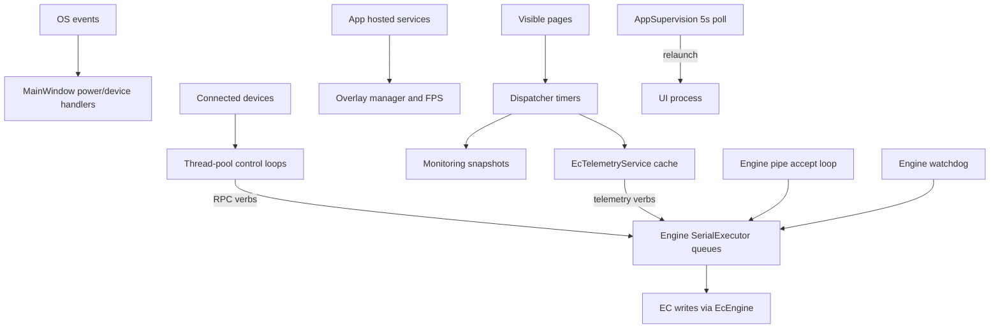

# Background Processing

## Overview

Work runs on both sides of the RPC boundary. The **app** runs UI-refresh, device-session, control-loop and telemetry timers; the **engine service** runs the pipe accept loop, the per-domain hardware queues, the queue watchdog, and the app supervisor.

## Engine process-lifetime work

| Owner | Work | Cadence and guards |
| --- | --- | --- |
| `EnginePipeServer` | Accept connections, frame, dispatch, reply. | One request per connection; caller timeout releases the client without cancelling the hardware write. |
| `SerialExecutor` × 7 (fan, power, mux, keyboard, battery, telemetry, engine) | FIFO, single-threaded hardware operations per domain. | 30 s per-item budget; depth 64 → `Busy`; unknown verb prefixes route to telemetry. |
| `EngineWatchdog` | Detect a queue wedged on a stuck call. | `FailFast` beyond 2 min → SCM restart (3/min). |
| `AppSupervision` | Watch the app, relaunch after crash/kill. | 5 s poll; armed only after sighting the app; `GuardianPolicy` backoff (10 s base, ×2, ≤10 min, 3 fast-crash budget); disarms on graceful exit. |

## App process-lifetime work

| Owner | Work | Start | Stop |
| --- | --- | --- | --- |
| `App` | Single-instance show-event listener | First instance | Exit cancellation/disposal |
| `HardwareMonitoringService` | LHM tree and category snapshots | Startup lease + consumer leases | Host disposal |
| `EcTelemetryService` | Fan duty/temperature/RPM cache over RPC | Host start / page demand | Host disposal |
| `OverlayManagerService` | Overlay visibility, hooks, view model | Hosted-service start | Hosted-service stop |
| `FpsMonitoringService` | RTSS reads or ETW session | Acquired by overlay | Lease release |
| Flydigi HID / BLE, Watercooler | Input loops, heartbeats, reconnect, smart mode | Connection | Suspend/disconnect/disposal |
| `EngineLifecycle` | One-shot engine install/start at startup | Deferred at launch | Completes; the service outlives the app |

`ShortcutService` (U-204) is not its own loop: chord matching runs inside `OverlayManagerService`'s global hook thread (one hook, one set of field lessons), and the matched action is queued on the UI dispatcher. The hook is installed when the overlay is enabled **or** at least one shortcut exists - a shortcut set does not die with the overlay toggle.

`OemTakeoverService` (U-203) has no loop either: status is probed on demand (Settings card expansion, the title-bar chip's 60 s tick) and pause/restore run against the engine verbs. `DiagnosticsExportService` (U-208) runs only when the user exports.

## View-lifetime work

| Surface | Work and cadence |
| --- | --- |
| Dashboard | Snapshot each second; EC battery details every 10 s while active. |
| Fan Control | Temperature/RPM each second; debounce for curve writes. |
| Keyboard | 150 ms apply debounce; 1 s idle check; 500 ms wake check. |
| Light Bar | 150 ms apply debounce. |
| Display | Brightness slider debounced 400 ms before the WMI write (a drag is not one write per pixel); panel/refresh/ICC state read on navigation. |
| Automations | Shortcut rows rebuild from `shortcuts.json` on navigation and on culture change; summaries are localized fragments. |
| Overlay Settings | RTSS status every 2 s. |
| Overlay view model | Configured refresh, clamped 100–5000 ms (store) / ≥16 ms (view model). |
| V-F curve editor | Live clocks every 2 s; 300 ms resize debounce. |
| Flydigi page | Temperature every 2 s plus animation/debounce timers. |
| Watercooler page | Temperature/visual timers plus service meters. |
| Adaptive page | Process/profile and sensor timers, semaphore-guarded bodies. |

## Smart-control loops

- `EcSmartFanControl`: ~1,000 ms; computes linked CPU/GPU demand and writes EC tables/duty **through the capability proxies** (each write lands on the fan queue, ordered against manual fan changes).
- `FlydigiSmartControl`: ~1,000 ms; temperature → HID cooler RPM. Realtime RPM needs a keepalive re-send ≤5 s.
- `FlydigiBs1SmartControl`: ~2,000 ms; temperature → BLE RPM.
- Watercooler Smart Mode: service timer applies pump/fan policy.

Control loops remain single-owner; manual pages and Adaptive Mode use override flags.

## Reconnect behavior

Flydigi HID and Hydro UI run reconnect loops with delay arrays, cancellation, generation counters, and device-arrival wake signals; generation checks prevent stale loops from reconnecting after newer user actions. Flydigi BS1 retries GATT creation, verifies responsiveness, watches OS arrival/removal, and heartbeats every 2.5 s.

## Coordination risks

- **RPC and the dispatcher:** proxies complete on the thread pool; synchronous call sites use `.GetAwaiter().GetResult()`. A hardware call can block a caller up to the engine's 30 s queue budget — long waits belong on background tasks, not dispatcher callbacks.
- Telemetry polling must stay on the telemetry domain; do not poll state through a write-heavy domain queue (it will ride behind curve writes).
- Timers owned by pages stop on navigation/unload; singleton pages dispose at exit.
- `async void` callbacks must handle their own exceptions/overlap; fire-and-forget work observes exceptions (`SafeFireAndForget`).
- Dispatcher `Invoke` deadlocks if shutdown blocks the UI thread — shutdown stops the host on a background task.
- Engine restarts (crash, watchdog fail-fast) are transparent to loops: the next verb connects a fresh pipe; `EngineException(HardwareUnavailable)` between death and SCM restart is a normal transient to handle, not retry-bombard.
- Resume can start loops while stale sessions exist; disconnect and delay before rebuilding.

## Review checklist for a new loop

1. Define owner and lifetime; pick the domain queue the work belongs to.
2. Cancellation token or disposable timer; prevent overlapping bodies.
3. Separate protocol timing from UI dispatch; keep polling off write domains.
4. Handle `EngineException` codes per feature (disable, retry-with-backoff, log).
5. Stop on navigation/suspend/disconnect; restart exactly once on resume.
6. Expose failures in the diagnostic log (app log and `Service\` engine log are separate streams).
7. Add deterministic fake-clock tests; include the loop in exit and soak scenarios.

[Back to documentation index](../README.md)
