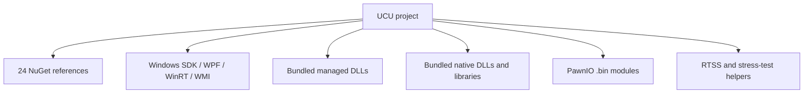

# Dependency Inventory

## Dependency model

UCU combines NuGet packages, Windows platform APIs, bundled managed assemblies, bundled native libraries, PawnIO modules, and helper executables.



## NuGet packages

| Group | Packages | Use in the codebase |
| --- | --- | --- |
| Application/UI | `WPF-UI`, `WPF-UI.Tray`, `CommunityToolkit.Mvvm`, `MahApps.Metro.IconPacks`, `PixiEditor.ColorPicker` | Fluent shell/tray, MVVM generation, icons, and color controls. |
| Hosting/logging | `Microsoft.Extensions.Hosting`, `Serilog.Extensions.Logging`, `Serilog.Sinks.Console`, `Serilog.Sinks.File` | DI/lifecycle and structured logs. |
| Hardware/system | `LibreHardwareMonitorLib`, `System.Management`, `Microsoft.Windows.SDK.BuildTools`, `TaskScheduler`, `MouseKeyHook` | Telemetry, WMI, Windows contracts, startup task, hotkeys/input. |
| GPU/performance | `LLT.NvAPIWrapper.Net`, `Microsoft.Diagnostics.Tracing.TraceEvent` | NVIDIA API wrapper and ETW FPS fallback. |
| Device/data | `hidlibrary`, `Newtonsoft.Json`, `Accord.Math` | HID devices, JSON models/migrations, numeric utilities. |
| Discovery/content | `GameLib.NET`, `craftersmine.SteamGridDB.Net`, `FuzzyStrings.NetStandard` | Installed-game discovery, artwork, name matching. |
| Notifications/update | `Microsoft.Toolkit.Uwp.Notifications`, `Octokit` | Toasts and GitHub release API. |

Exact versions are pinned in `Uniwill Control Utility.csproj`. `System.Management` uses an `11.0.0-preview` build while the application targets .NET 10; build/release validation should record the resolved package graph.

## Windows platform dependencies

The code directly calls:

- WPF and selected Windows Forms APIs.
- WMI/CIM namespaces including `root\CIMV2`, `root\wmi`, and OEM WMI classes.
- Registry APIs for prerequisites, PawnIO version, Windows version, and preferences.
- WinRT Bluetooth and device-enumeration APIs.
- Power-mode and device-arrival notifications.
- `kernel32`, `user32`, `hid`, `setupapi`, display configuration, task scheduler, and other native APIs.
- ETW sessions for presentation-event FPS fallback.

These dependencies make Windows a runtime requirement even for most non-UI integration tests.

## Tracked binary payload

Thirty `.dll`, `.exe`, `.bin`, `.lib`, and `.exp` files are tracked, totalling approximately 12.66 MiB.

### Directly evidenced runtime payload

| Payload | Evidence in current code/project |
| --- | --- |
| `ACPIDriverDll.dll` | Loaded by `UniwillECService`; explicit copy-to-output rule. |
| AMD PawnIO modules | Loaded by the AMD backend from `Assets/AMD/PawnIO`. |
| Intel PawnIO modules | Loaded by the Intel backend from `Assets/Intel/PawnIO`. |
| `Assets/Stress-Test/*` | Launched by Settings; explicit copy-to-output rules. |
| RTSS shared-memory DLLs | Related to the overlay/RTSS integration and included in assets/root. |
| `HidSharp.dll`, `LibreHardwareMonitorLib.dll` | Names overlap package-based dependencies and are present as tracked assemblies. |

### Tracked payload without a direct source-name reference found

- `ADLX_3DSettings.dll`, `ADLX_AutoTuning.dll`, `ADLX_DisplaySettings.dll`, `ADLX_PerformanceMetrics.dll`.
- `BlackSharp.Core.dll`.
- `DiskInfoToolkit.dll`.
- `Magpie.dll`, `MagpieRT.dll`, `MagpieRT.lib`, `MagpieRT.exp`.
- `RAMSPDToolkit-NDD.dll`.
- Root `RTSSSharedMemoryNET.dll` in addition to the asset copy.
- Root `kernel32.dll`.
- Debug C runtime files `ucrtbased.dll`, `vcruntime140d.dll`, and `vcruntime140_1d.dll`.

Absence of a textual assembly filename does not prove a file is unused; types may be referenced through metadata or inherited code. It does mean the repository should produce a publish manifest that records which files are required, why, their upstream version, and whether a NuGet copy already supplies the same assembly.

## Dependency reproducibility gaps

- No `global.json` pins the SDK.
- No package lock file is tracked.
- No CI output records the resolved package graph.
- No repository-owned manifest records binary origin, version, hash, architecture, and purpose.
- Managed assemblies are both package-referenced and tracked by filename in several cases.
- Debug runtime DLLs are included in project output rules.
- The installer/package definition that consumes publish output is absent.

## Recommended manifest

Add a machine-readable manifest with one record per non-NuGet payload:

```json
{
  "path": "Uniwill Control Utility/ACPIDriverDll.dll",
  "kind": "native-library",
  "architecture": "x64",
  "version": "record exact file version",
  "source": "record upstream/package origin",
  "sha256": "record hash",
  "runtimeOwner": "UniwillECService",
  "redistribution": "record applicable terms"
}
```

CI should compare publish output against the manifest and fail on missing, unexpected, or hash-mismatched payloads.

[Back to documentation index](../README.md)

