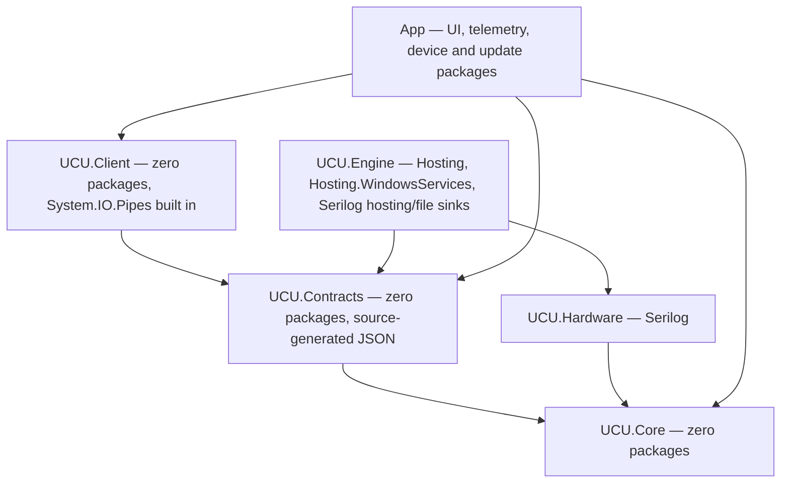

# Dependency Inventory

## Dependency model

The solution splits dependencies by process and layer. The contract and client projects are dependency-free BCL; only the engine pulls hosting, and only the app pulls the UI/hardware ecosystem.

## NuGet packages by project

| Project | Packages |
| --- | --- |
| `UCU.Core` | none (pure domain; net10.0) |
| `UCU.Contracts` | none — the wire contract uses `System.Text.Json` source generation from the SDK |
| `UCU.Client` | none — named pipes ship in the BCL |
| `UCU.Hardware` | `Serilog` |
| `UCU.Engine` | `Microsoft.Extensions.Hosting`, `Microsoft.Extensions.Hosting.WindowsServices`, `Serilog`, `Serilog.Extensions.Hosting`, `Serilog.Sinks.File` |

The app project (25 packages) keeps the product surface:

| Group | Packages | Use |
| --- | --- | --- |
| Application/UI | `WPF-UI`, `WPF-UI.Tray`, `CommunityToolkit.Mvvm`, `MahApps.Metro.IconPacks`, `PixiEditor.ColorPicker` | Fluent shell/tray, MVVM generation, icons, color controls. |
| Hosting/logging | `Microsoft.Extensions.Hosting`, `Serilog.Extensions.Logging`, `Serilog.Sinks.Console`, `Serilog.Sinks.File` | DI/lifecycle and structured logs. |
| Hardware/system | `LibreHardwareMonitorLib`, `System.Management`, `Microsoft.Windows.SDK.BuildTools`, `TaskScheduler`, `MouseKeyHook`, `System.ServiceProcess.ServiceController` | Telemetry, WMI, Windows contracts, autostart task registration, engine-service status queries, hotkeys. |
| GPU/performance | `LLT.NvAPIWrapper.Net`, `Microsoft.Diagnostics.Tracing.TraceEvent` | NVIDIA wrapper and ETW FPS fallback. |
| Device/data | `hidlibrary`, `Newtonsoft.Json`, `Accord.Math` | HID devices, JSON models, numeric utilities. |
| Discovery/content | `GameLib.NET`, `craftersmine.SteamGridDB.Net`, `FuzzyStrings.NetStandard` | Game discovery, artwork, name matching. |
| Notifications/update | `Microsoft.Toolkit.Uwp.Notifications`, `Octokit`, `Velopack` | Toasts, GitHub release API, per-machine MSI auto-update. |

`TaskScheduler` 2.12.2 spells the limited run level `TaskRunLevel.LUA` (not `Limited`). `System.Management` rides an `11.0.0-preview` line while the app targets .NET 10; release validation should record the resolved package graph.

## Windows platform dependencies

- WPF, selected Windows Forms APIs, WinRT Bluetooth/device enumeration.
- WMI (`root\CIMV2`, `root\wmi`, OEM classes) in the app.
- Service Control Manager (`ServiceController`, `sc.exe`) in the app's `EngineLifecycle` and the engine's `EngineInstaller`.
- Task Scheduler (app autostart task), registry APIs, power/device-arrival notifications, display APIs.
- Session-token APIs in the engine's `AppSessionLauncher`: `wtsapi32` (`WTSGetActiveConsoleSessionId`, `WTSQueryUserToken`), `advapi32` (`DuplicateTokenEx`, `CreateProcessAsUser`), `userenv` (`CreateEnvironmentBlock`).
- `\\.\ACPIDriver` IOCTLs (engine-only, `EcDriverTransport`), ETW sessions, `kernel32`/`user32`/`hid`/`setupapi` calls.

## Build and packaging payload

- **Engine staging:** the app csproj runs the engine project's `Build`/`Publish` with an **absolute** `OutDir`/`PublishDir` redirect into `$(OutDir)Service\` plus a staging-specific `IntermediateOutputPath` (the staging copy markers must describe the staged output: sharing one `obj\` with the engine's own build makes MSBuild skip the copy, which left `Service\` on a stale binary after an engine change). The absolute path keeps the service's full dependency closure (`UCU.Core/Contracts/Hardware`, hosting, Serilog) self-contained there and the app root never gains hardware-layer assemblies. The engine `ProjectReference` carries `ReferenceOutputAssembly="false"` (build order only).
- **Shims compiled at pack time** by `build\pack.ps1` with the .NET Framework `csc` (GAC only, C# 5 syntax): `Uninstall.exe` (uninstall chain, `requireAdministrator`) and `UCU.Updater.exe` (elevated update apply, same manifest).
- **Verified payload:** pack step 2b fails the build when the engine payload (`Service\Uniwill Control Utility Engine.exe/.dll/.deps/.runtimeconfig`, `UCU.Core/Contracts/Hardware.dll`, hosting, Serilog hosting sink) is missing from the publish dir.

## Tracked binary payload

27 tracked `.dll`, `.exe`, `.bin`, `.lib`, `.exp` files, about 8.6 MiB: PawnIO `.bin` modules (AMD/Intel, loaded from the app root), RTSS shared-memory bridge DLLs, `HidSharp.dll`, `DiskInfoToolkit.dll`, `BlackSharp.Core.dll`, `ADLX_*.dll`, `MagpieRT` imports, `RAMSPDToolkit-NDD.dll`, a root `kernel32.dll`, and debug C runtime files.

The EC kernel driver is **not** shipped: `UWACPIDriver.sys` (bound to the `INOU0000` ACPI device) is a machine prerequisite; `EcDriverDetectionService` checks `C:\Windows\System32\drivers\UWACPIDriver.sys` and the engine answers `HardwareUnavailable` without it.

Some tracked assemblies duplicate package-supplied assemblies, and several have no direct source-name reference; the repository would benefit from a publish manifest recording origin, version, hash, architecture and purpose per payload, compared by CI.

## Reproducibility gaps

- No `global.json` SDK pin, no package lock file, no CI record of the resolved package graph.
- No manifest records binary origin/version/hash/purpose; debug runtime DLLs ship in output rules.

[Back to documentation index](../README.md)
