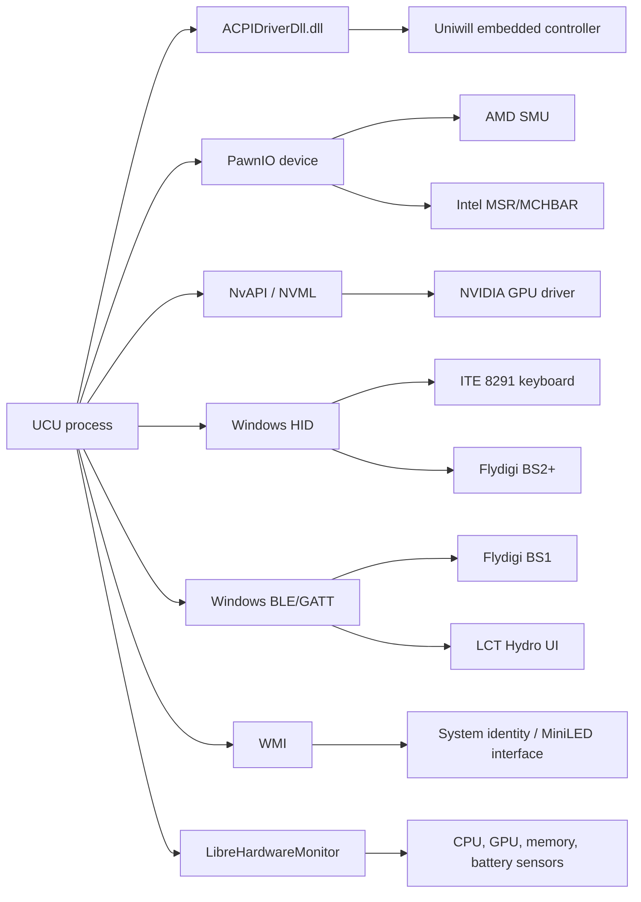

# Hardware Integration

## Integration map

## Uniwill embedded controller

`UniwillECService` dynamically loads `ACPIDriverDll.dll` and binds exported read/write functions. A lock serializes low-level EC access, and operations insert protocol-specific delays. The service exposes higher-level operations for:

- CPU/GPU temperatures and fan RPM.
- Fan curves, direct PWM, turbo, and automatic-control restoration.
- GPU power-control activation/deactivation and Dynamic Boost fields.
- Intel/AMD platform power values stored in EC registers.
- Keyboard and light-bar operations exposed by the EC.
- Battery charge mode and telemetry.

The service has an explicit initialization/activation sequence and checks support before feature pages rely on it. Detailed registers and table formats are documented in [Uniwill EC fan control](../protocols/uniwill-ec-fan-control.md) and [NVIDIA GPU power control](../protocols/nvidia-gpu-power-control.md).

## AMD CPU path

The AMD backend loads PawnIO modules from `Assets/AMD/PawnIO` and uses a mailbox abstraction to communicate with the Ryzen SMU. `Family.setCpuFamily()` chooses a processor family and supported command mapping. Profile commands can apply:

- Sustained and fast power limits.
- Thermal limits.
- Unified or per-CCD Curve Optimizer offsets.
- Other inherited UXTU SMU operations retained by the translator.

On shutdown, the shared Ryzen access layer is deinitialized.

## Intel CPU path

The Intel backend loads `IntelMSR.bin` and `IntelMCHBAR.bin` through PawnIO. It implements power-limit and voltage controls and deinitializes on exit. CPU voltage controls may be unavailable when firmware locks the relevant interface even if the processor family is recognized.

## NVIDIA GPU path

`NvTuning` combines several interfaces:

- Managed NvAPI wrapper for public driver operations.
- NVML P/Invoke for inventory/telemetry and selected controls.
- Private NVAPI calls for V-F curve access.
- Uniwill EC registers for laptop power ceilings and Dynamic Boost coordination.

GPU application order matters. Power ceilings can affect whether the driver accepts or clamps a V-F curve, so custom-profile logic applies power both before and after curve changes.

## ITE keyboard HID

`KeyboardHidService` discovers the controller, opens HID handles, uses feature reports for global control, and direct output reports for per-key color rows. The code accounts for firmware settle delays, direction priming, BGR channel order, row announcements, and BIOS persistence.

See [ITE 8291 keyboard HID protocol](../protocols/ite-8291-keyboard-hid-protocol.md).

## Flydigi HID devices

`FlydigiCoolerHidService` supports the BS2-family USB protocol and owns:

- Enumeration and connection.
- Input report parsing and query-response correlation.
- Fan gear, direct RPM, curve, RGB, and device-setting writes.
- Windows power notifications and HID arrival notifications.
- Health checks, reconnect loops with backoff, and scheduled behavior.
- Persistent device settings in `%APPDATA%/UCU/bs2pro_settings.json`.

The service is a singleton and implements `IDisposable`; the Flydigi page is also a singleton so its timers can be disposed during process teardown.

## Flydigi BS1 BLE

`FlydigiCoolerBleService` uses WinRT device enumeration and GATT. It handles discovery, address parsing, characteristic discovery, connection/session state, heartbeat writes, notification parsing, and OS-level arrival/removal monitoring. Settings are stored in `%APPDATA%/UCU/bs1_settings.json`.

## Hydro UI / LCT BLE

`WaterCoolerService` uses the Nordic UART GATT service implemented by supported LCT devices. It owns scanning, connection, notification parsing, pump/fan/RGB commands, smart-mode scheduling, standby/resume behavior, and reconnection. Settings are stored in `%APPDATA%/UCU/watercooler_settings.json`.

## Hardware monitoring

`HardwareMonitoringService` exposes category leases rather than a permanently maximal sensor tree. Consumers request any combination of CPU, GPU, memory, storage, motherboard, controller, and battery categories. The service reconfigures LibreHardwareMonitor when the union changes and returns `HardwareMetricsSnapshot` records.

Dashboard startup acquires a persistent CPU/GPU/memory/battery lease to avoid a costly reprobe when navigating. Temporary consumers receive `IDisposable` leases and release categories when finished.

## FPS monitoring

`FpsMonitoringService` uses this preference order:

1. RTSS shared memory when RTSS exposes a matching foreground process.
2. ETW DXGI/D3D present events through `TraceEventSession`.
3. No FPS value when the process is unavailable, protected, or unrecognized.

Process metadata is cached because foreground-process and module enumeration can be expensive or denied by anti-cheat-protected games.

## Display and MiniLED

- Refresh-rate discovery and selection use Win32 display configuration APIs.
- MiniLED local dimming uses WMI class/method calls compatible with the OEM interface and verifies state after writing.
- Panel identity is cached during startup so UI controls can be shown only on identified MiniLED configurations.

## Common adapter behavior

Hardware adapters generally follow a degraded-operation model:

- Unsupported or missing devices hide/disable feature surfaces.
- Discovery and connection failures are logged or exposed as status events.
- Reconnect-capable services back off or wait for device-arrival events.
- Resume treats previously connected BLE/HID sessions as potentially stale and rebuilds them.
- Persistence loads defaults when a settings file is absent or unreadable.

The exact wire formats are maintained under [`wiki/protocols`](../protocols/device-communication-protocols.md).

[Back to documentation index](../README.md)

