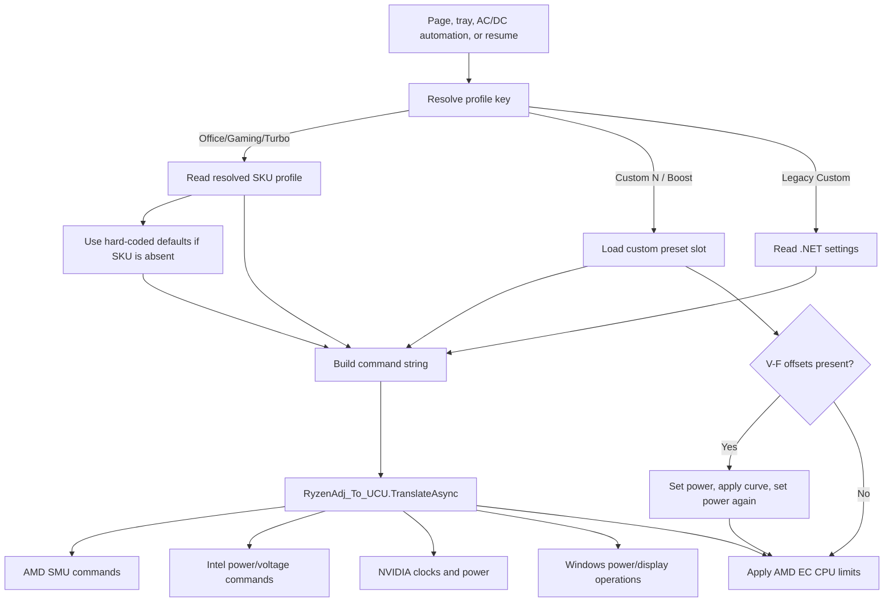
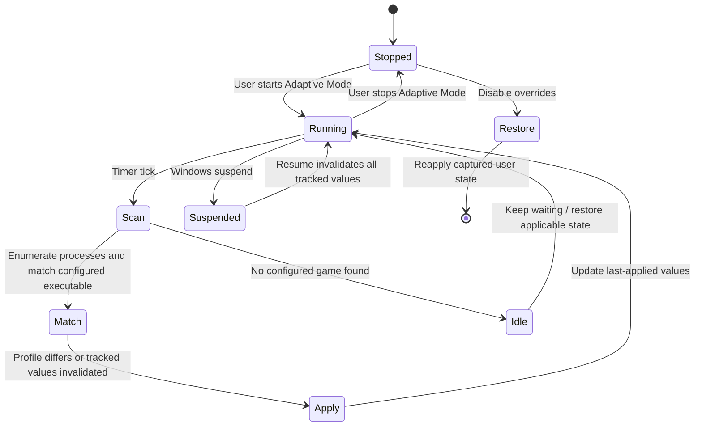
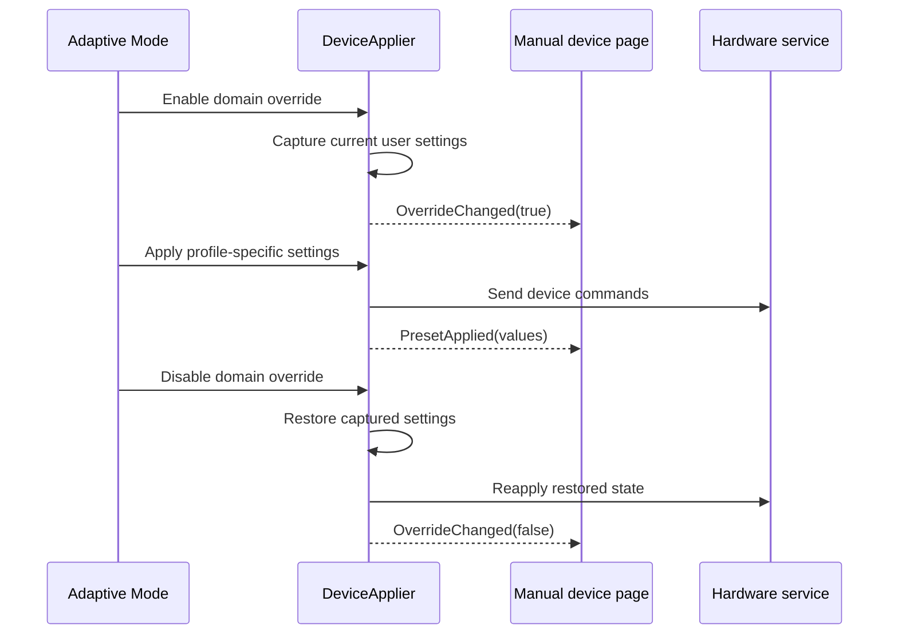

# Preset and Adaptive Mode Pipelines

## Preset types

UCU has three related but distinct profile systems:

| System | Storage | Trigger | Scope |
| --- | --- | --- | --- |
| Built-in profiles | Code + `SkuData/skus.json` | Presets page, tray, automation, resume | CPU/GPU platform tuning; named Office, Gaming, Turbo. |
| Custom profiles | `%LOCALAPPDATA%/UCU/custom_presets_{normal,boost}.json` | Presets page, tray, automation, resume | Five Normal and five Boost slots with CPU/GPU/V-F state. |
| Adaptive profiles | Application-directory `adaptivePresets.json` | Per-game polling in Adaptive page | CPU, GPU, EC fans, Flydigi, Hydro UI, keyboard, light bar. |

The code also retains legacy `PresetManager` files in the application directory for backup/import compatibility.

## Built-in and custom profile application

`PresetProfileApplier` is the shared coordinator for Presets, tray commands, power automations, and resume.

### SKU resolution

`SkuResolver` combines detected processor vendor, CPU/GPU names, and the JSON database to find a profile table. If no entry matches, built-in profiles use fallback values:

| Profile | CPU PL1/SPL | CPU PL2/FPL | GPU TGP | Dynamic Boost |
| --- | ---: | ---: | ---: | --- |
| Office | 45 W | 45 W | 95 W | Off |
| Gaming | 75 W | 85 W | 150 W | Off |
| Turbo | 135 W | 135 W | 150 W | 25 W |

SKU records override these values for known systems.

### Command translation

Profiles are converted to a space-separated internal command language. `RyzenAdj_To_UCU.TranslateAsync` interprets this language and routes individual options to AMD, Intel, NVIDIA, display, affinity, and Windows processor-power implementations. The command string is also persisted as last-applied state for automation and restoration.

### V-F curve ordering

For NVIDIA custom profiles with curve offsets:

1. GPU power/EC ceiling is set.
2. Curve offsets are applied through the private clock-boost-table path.
3. GPU power is set again in case the driver altered the EC ceiling.

The ordinary NVIDIA power command is omitted from the translated command when a V-F curve is active, preventing two competing application paths.

## Adaptive Mode

Adaptive Mode associates discovered games/applications with `AdaptivePreset` records. A profile can independently enable or disable each domain:

- CPU tuning.
- GPU power, clocks, Dynamic Boost, and per-profile V-F offsets.
- EC fan curves.
- Flydigi fan and RGB behavior.
- Hydro UI pump, fan, and RGB behavior.
- Keyboard global/per-key lighting.
- Light-bar state.

### Runtime loop

Adaptive code uses last-applied values to avoid writing unchanged state on every timer tick. Resume invalidates the cache so every enabled domain is applied again after firmware/driver state may have reset.

### Override ownership

`DeviceApplier` is the central ownership boundary between Adaptive Mode and manual device pages.

Manual pages subscribe to these events so their controls reflect the active profile and can disable interaction when an Adaptive override owns the domain.

### Persistence across restart

`isAdaptiveModeRunning` and per-domain enable flags are stored in .NET user settings. Startup restores override flags before the user returns to the Adaptive page. Keyboard override state has a separate `keyboard_saved_settings.json` backup so the pre-override state survives process restart. Other domain state is held by service settings and in-memory snapshots; maintainers should validate restart behavior when changing override ownership.

## AC/DC and resume interaction

- AC/DC automations are skipped while Adaptive Mode is running.
- Resume always reapplies the current profile and invalidates Adaptive diff tracking.
- Adaptive device domains then reapply on their next cycle.
- Device pages and tray menu read active override state to avoid presenting stale ownership.

## Data migration

- Legacy `custom_presets.json` migrates into the Normal-mode custom preset file.
- Adaptive GPU settings migrate from flat `Gpu*` fields into `GpuNormal` and `GpuBoost` objects.
- Watercooler settings migrate older Smart Pump fields into current Smart Mode fields only when the new values are still defaults.
- Backup import supports current format and a legacy v1 format.

## Extension guidance

When adding a new Adaptive-controlled domain:

1. Add explicit enable/state fields to `AdaptivePreset` with backward-compatible defaults.
2. Add an override ownership flag, capture/restore path, and events to `DeviceApplier`.
3. Route both Adaptive writes and manual-page synchronization through the coordinator.
4. Define restart and resume behavior.
5. Include the domain in backup/export if it has durable state.
6. Add tests at the storage, ownership, diff-tracking, and hardware-adapter boundaries described in [Testing Strategy](../project/testing-strategy.md).

[Back to documentation index](../README.md)
