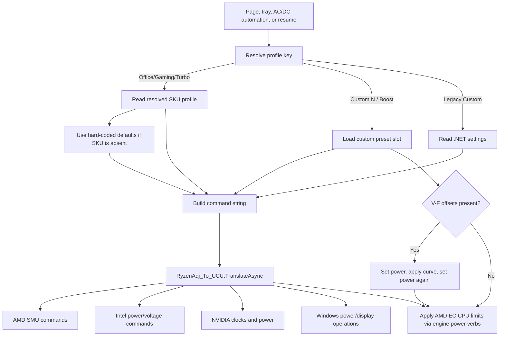
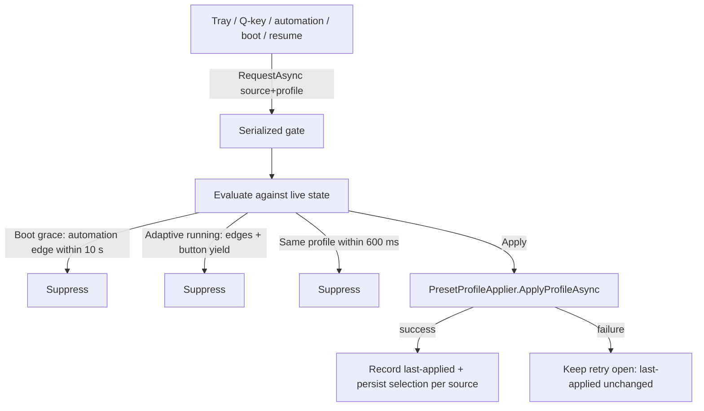
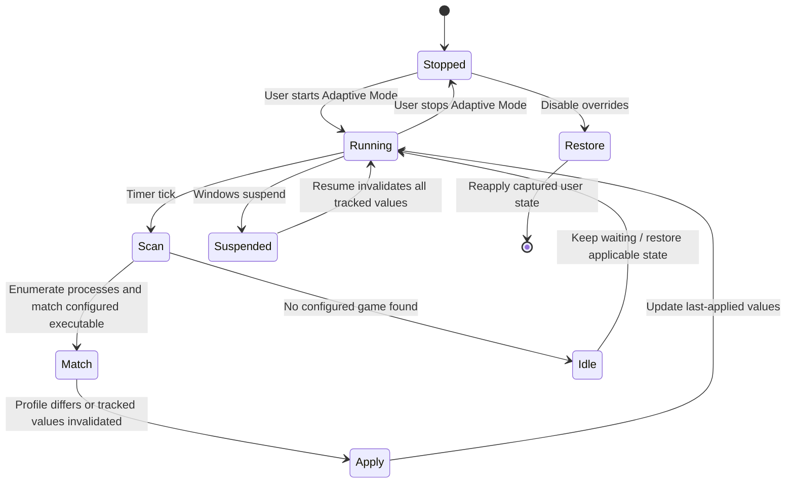
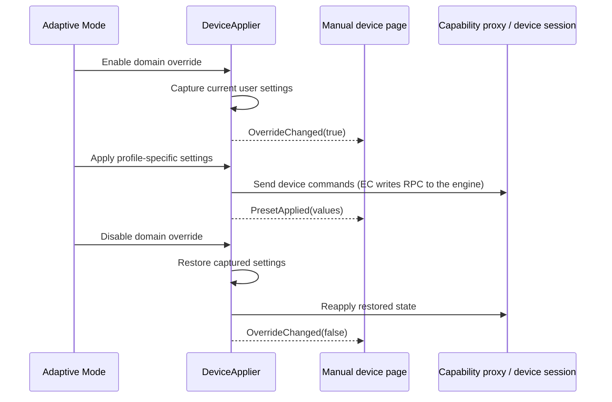

# Preset and Adaptive Mode Pipelines

## Preset types

UCU has three related but distinct profile systems:

| System | Storage | Trigger | Scope |
| --- | --- | --- | --- |
| Built-in profiles | Code + `SkuData/skus.json` | Presets page, tray, automation, resume | CPU/GPU platform tuning; named Office, Gaming, Turbo. |
| Custom profiles | `%LOCALAPPDATA%/UCU/custom_presets_{normal,boost}.json` | Presets page, tray, automation, resume | Five Normal and five Boost slots with CPU/GPU/V-F state. |
| Adaptive profiles | Application-directory `adaptivePresets.json` | Per-game polling in Adaptive page | CPU, GPU, EC fans, Flydigi, Hydro UI, keyboard, light bar. |

The code also retains legacy `PresetManager` files in the application directory for backup/import compatibility.

## Built-in and custom profile application

`PresetProfileApplier` is the shared coordinator for Presets, tray commands, power automations, and resume. Its CPU/GPU translation runs in the UI process (SMU/Intel/NVIDIA backends); every EC field it touches (power ceilings, fan tables) travels as an RPC verb to the engine service.

### SKU resolution

`SkuResolver` combines detected processor vendor, CPU/GPU names, and the JSON database to find a profile table. If no entry matches, built-in profiles use fallback values:

| Profile | CPU PL1/SPL | CPU PL2/FPL | GPU TGP | Dynamic Boost |
| --- | ---: | ---: | ---: | --- |
| Office | 45 W | 45 W | 95 W | Off |
| Gaming | 75 W | 85 W | 150 W | Off |
| Turbo | 135 W | 135 W | 150 W | 25 W |

SKU records override these values for known systems.

### Command translation

Profiles are converted to a space-separated internal command language. `RyzenAdj_To_UCU.TranslateAsync` interprets this language and routes individual options to AMD, Intel, NVIDIA, display, affinity, and Windows processor-power implementations. The command string is also persisted as last-applied state for automation and restoration.

### V-F curve ordering

For NVIDIA custom profiles with curve offsets:

1. GPU power/EC ceiling is set.
2. Curve offsets are applied through the private clock-boost-table path.
3. GPU power is set again in case the driver altered the EC ceiling.

The ordinary NVIDIA power command is omitted from the translated command when a V-F curve is active, preventing two competing application paths.

## Preset arbiter

Every preset-power-mode **intent** — startup restore, sleep-resume re-apply, tray selection, the physical Performance/Q-key button, and the AC/battery automations — routes through `PresetArbiter` (app service) in front of `PresetProfileApplier`. The arbiter is one serialized execution gate plus the pure `UCU.Core\Supervision\PresetArbiterPolicy` (the OpenRevo power-arbiter rules, adapted to UCU's app-side preset composition; the engine stays preset-illiterate).

Rules, in evaluation order at the moment the gate is taken (a queued intent re-checks live uptime, the Adaptive flag, and last-applied state, so late-arriving startup noise is judged against the current clock):

1. **Boot grace (10 s):** AC/battery automation edges are dropped during the first seconds after app start — Windows emits uncalibrated power-status events while the WMI battery probe settles, and those used to race the startup restore. UI clicks, the Q-key button, boot restore, resume, and Adaptive are never grace-suppressed.
2. **Adaptive ownership:** while `isAdaptiveModeRunning`, the AC/DC edges and the physical button yield to Adaptive (the rule `QKeyButtonService` enforced locally, centralized so no writer can forget it). A UI click passes: it is the documented way to take control back.
3. **Duplicate debounce (600 ms):** the same profile applied twice within the window applies once; a **failed** apply does not poison the state, so a retry of the same profile stays open.
4. **Persistence:** UI, Q-key, and automation intents persist the selection to `presetProfile`; boot-restore and resume intents re-apply without overwriting the saved choice, and the Adaptive engine never writes it.

Direct-apply paths that cannot route through the pipeline — the Presets page's slot-aware apply (page-local sliders, fan-slot bookkeeping), the tray's custom-slot legacy path, and the startup custom-slot restore — call `RecordApply` after applying so the debounce state stays honest against racing automation edges. Boot-time AC/DC restores are tagged `BootRestore` (grace never swallows them); only runtime power-status edges carry the automation tags, and their toasts fire only when `Applied` is true, so suppressed edges stay silent.

## Adaptive Mode

Adaptive Mode associates discovered games/applications with `AdaptivePreset` records. A profile can independently enable or disable each domain:

- CPU tuning.
- GPU power, clocks, Dynamic Boost, and per-profile V-F offsets.
- EC fan curves (fan-domain verbs).
- Flydigi fan and RGB behavior.
- Hydro UI pump, fan, and RGB behavior.
- Keyboard global/per-key lighting (HID session) and EC effects.
- Light-bar state (keyboard-domain verbs).

### Runtime loop

Adaptive code uses last-applied values to avoid writing unchanged state on every timer tick. Resume invalidates the cache so every enabled domain is applied again after firmware/driver state may have reset.

### Override ownership

`DeviceApplier` is the central ownership boundary between Adaptive Mode and manual device pages.

Manual pages subscribe to these events so their controls reflect the active profile and can disable interaction when an Adaptive override owns the domain.

### Persistence across restart

`isAdaptiveModeRunning` and per-domain enable flags are stored in .NET user settings. Startup restores override flags before the user returns to the Adaptive page. Keyboard override state has a separate `keyboard_saved_settings.json` backup so the pre-override state survives process restart. Other domain state is held by service settings and in-memory snapshots; maintainers should validate restart behavior when changing override ownership.

## AC/DC and resume interaction

- AC/DC automations and the Q-key button are suppressed while Adaptive Mode is running (the preset arbiter enforces this ownership rule for every source).
- AC/DC automation edges within the 10 s startup grace window are dropped by the arbiter; the startup restore itself is a `BootRestore` intent and always applies.
- Resume re-applies the current profile through the arbiter (serialized against racing applies) and invalidates Adaptive diff tracking.
- Adaptive device domains then reapply on their next cycle.
- Device pages and tray menu read active override state to avoid presenting stale ownership.

## Data migration

- Legacy `custom_presets.json` migrates into the Normal-mode custom preset file.
- Adaptive GPU settings migrate from flat `Gpu*` fields into `GpuNormal` and `GpuBoost` objects.
- Watercooler settings migrate older Smart Pump fields into current Smart Mode fields only when the new values are still defaults.
- Backup import supports current format and a legacy v1 format.

## Extension guidance

When adding a new Adaptive-controlled domain:

1. Add explicit enable/state fields to `AdaptivePreset` with backward-compatible defaults.
2. Add an override ownership flag, capture/restore path, and events to `DeviceApplier`.
3. Route both Adaptive writes and manual-page synchronization through the coordinator.
4. Define restart and resume behavior.
5. Include the domain in backup/export if it has durable state.
6. Add tests at the storage, ownership, diff-tracking, and hardware-adapter boundaries described in [Testing Strategy](../project/testing-strategy.md).

[Back to documentation index](../README.md)
