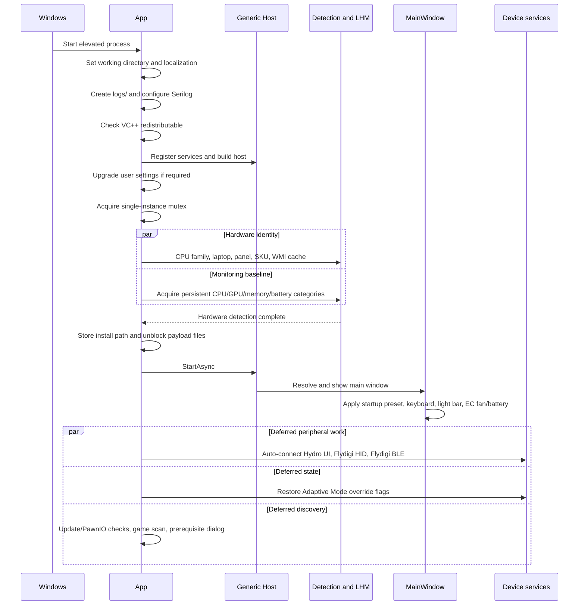
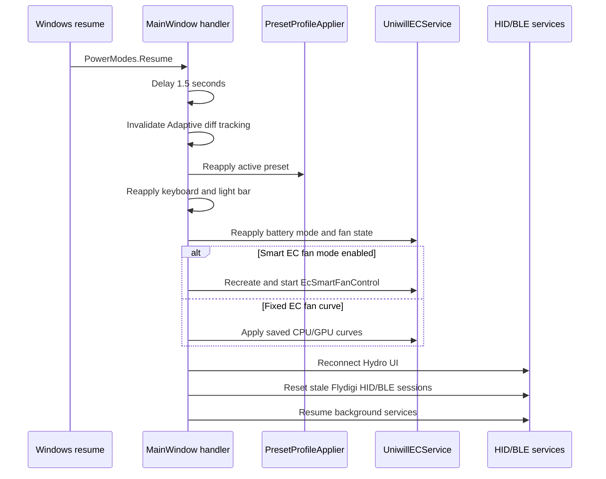

# Startup and Lifecycle

## Startup sequence

`App.OnStartup` is the process-level orchestrator. It deliberately performs device identity and baseline telemetry initialization before the main window is shown, then moves peripheral connection and update work to deferred tasks.

## Detailed stages

### 1. Process preparation

- The working directory is set to the executable directory.
- Localization initializes from `Properties.Settings.Default.Language`.
- `./logs/` is created and Serilog writes `ucu_log.txt` with daily rolling and an 8 MiB file-size limit.
- UI-thread and AppDomain unhandled-exception handlers are registered.
- Registry keys are inspected for x64/x86 VC++ runtime installation. If neither is detected, the app offers the Microsoft download page and exits.

### 2. Host composition

The Generic Host registers WPF navigation, monitoring, overlay, hardware sessions, device coordination, and pages. `UniwillECService` searches for `ACPIDriverDll.dll` in this order:

1. Application directory.
2. `C:\Program Files\OEM\Control Center\AiStoneService\MyControlCenter`.
3. The equivalent `Program Files (x86)` directory.

### 3. Settings migration and single instance

- Generated .NET settings call `Upgrade()` once per version when `SettingsUpgradeRequired` is true.
- A named mutex, `UniwillControlUtility`, elects the active process.
- A second process opens the named `UniwillControlUtility.Show` event, signals the first process, and shuts down.
- The first process runs a listener that restores and activates the main window when signalled.

### 4. Detection gate

The window does not open until two parallel jobs finish:

- WMI/identity: processor family, laptop model, MiniLED panel, SKU, and cached system information.
- LibreHardwareMonitor: persistent leases for CPU, GPU, memory, and battery categories.

Failures are logged and degraded behavior is allowed; the UI is still started.

### 5. Main-window initialization

`ApplicationHostService` resolves the window and navigation service. `MainWindow.Loaded` is the current single startup point for applying persisted profile, keyboard, light-bar, EC fan, and battery state. This placement avoids duplicate hardware writes when Dashboard navigation occurs.

The window also pre-resolves several heavy pages in the background/dispatcher sequence to reduce first-navigation delay.

### 6. Deferred tasks

The following tasks do not block the initial dashboard:

- Hydro UI and Flydigi auto-connect after a two-second Bluetooth stabilization delay.
- Restoration of Adaptive Mode override flags.
- Update check and PawnIO prerequisite check when an ICMP check to `8.8.8.8` succeeds.
- Installed-game synchronization.
- First-run prerequisite dialog.

## Power-source automation

`MainWindow` subscribes to `SystemEvents.PowerModeChanged`.

On AC/battery status changes, and only when Adaptive Mode is not running:

1. WMI reads `Win32_Battery.BatteryStatus`.
2. The configured AC or DC preset is resolved.
3. `PresetProfileApplier.BuildCommandString` produces the command.
4. The command is saved to .NET settings.
5. The shared translation pipeline applies it.
6. A notification is shown only when the effective power state changes.

## Resume sequence

Suspend/resume can reset EC and driver state, so resume is an explicit reapplication flow.

## Minimize and close behavior

- The notification-area icon remains available while the window is minimized or hidden.
- The `MinimizeClose` preference determines whether a normal close hides the window instead of terminating.
- Explicit tray exit allows shutdown.
- Navigation changes update title-bar device identity and tray state is refreshed whenever the tray menu opens.

## Shutdown sequence

1. Cancel/dispose the single-instance listener and mutex.
2. Deinitialize AMD SMU or Intel backend according to detected family.
3. Dispose the Flydigi page timers.
4. Disconnect Flydigi HID and synchronously dispose Flydigi BLE so Windows releases device sessions.
5. Stop and dispose the Generic Host on a background task to avoid a dispatcher deadlock.

Shutdown is best-effort in several device paths: exceptions are suppressed so process exit can continue. Because host shutdown is not awaited by the UI thread, maintainers should treat device-specific `Dispose` methods as the primary deterministic cleanup point.

## Failure behavior

- Startup composition failures are logged as fatal and shown in a message box.
- Dispatcher exceptions are logged, shown, and marked handled, so the process may continue.
- Terminating background exceptions are logged and an error dialog is attempted through the dispatcher.
- Deferred tasks use a fire-and-forget continuation that observes task exceptions but does not surface them to the UI.
- Many hardware discovery paths intentionally fall back to unavailable/unsupported state instead of aborting the application.

[Back to documentation index](../README.md)
