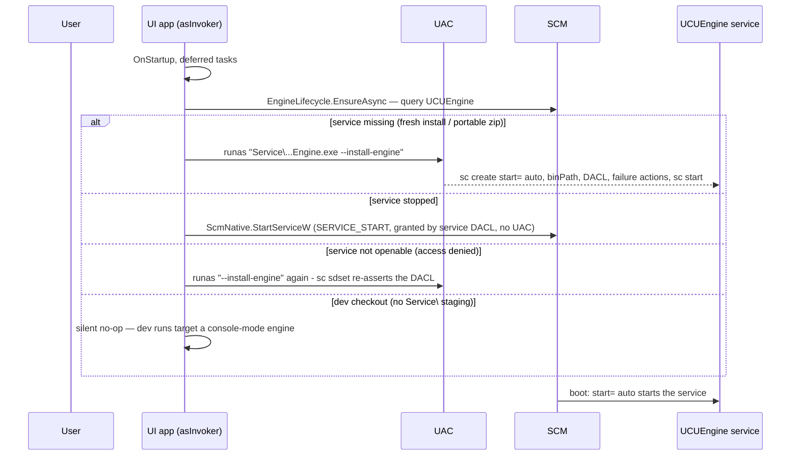
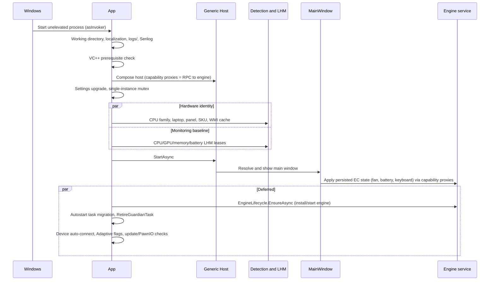
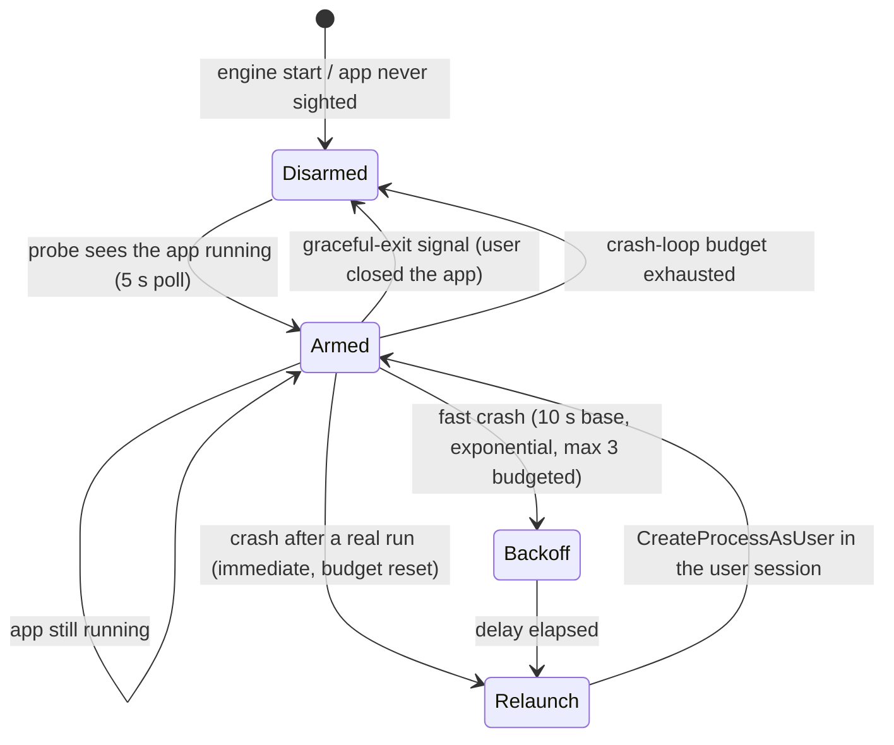
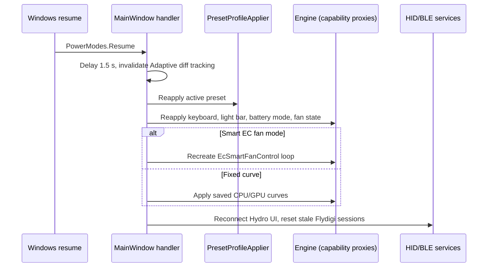

# Startup and Lifecycle

The product has two lifecycles: the **engine service** (installed once, running from boot) and the **UI app** (launched by the user, the autostart task, or the engine's supervisor). The app owns the engine's lifecycle; the engine supervises the app.

## Engine service lifecycle

- The install pass (`EngineInstaller` in the engine) is idempotent and re-applies binPath and DisplayName (the registration follows the exe through Velopack version directories, and re-applies the user-facing label "UCU Engine"; the SCM service name `UCUEngine` is the stable identity used by sc.exe and the app), the DACL `D:P(A;;FA;;;SY)(A;;FA;;;BA)(A;;CCSWRPRC;;;AU)` (Authenticated Users: query-config, query-status, **start**, read-control - and **not** `SERVICE_CHANGE_CONFIG`, which would let any authenticated user re-point `binPath` and execute as LocalSystem), the description, and SCM failure actions (restart ×3/min).
- `--console` runs the identical host as a console app with logs under `%LOCALAPPDATA%\UCU\engine`; the installed service logs to `%ProgramData%\UCU\engine\`.

## App startup sequence

`App.OnStartup` orchestrates the process. Device identity and baseline telemetry initialize before the window shows; peripheral connection and maintenance work move to deferred tasks.

Detailed stages:

1. **Process preparation.** Working directory set to the exe directory (native modules load from there; the autostart task and the supervisor set it too). Localization from settings. Logs go to `%LOCALAPPDATA%\UCU\logs\` — daily-rolling `ucu_log.txt` — and the file sink is non-fatal: a directory the user cannot write degrades logging to the console instead of refusing the launch. UI/AppDomain exception handlers. VC++ runtime registry probe.
2. **Host composition.** Navigation, monitoring, overlay, peripheral sessions, pages — plus the EC capability interfaces bound to the **RPC proxies** (`UCU.Client`). There is no in-process EC path: no app assembly references `UCU.Hardware`/`UCU.Engine` (the test suite's layering guard pins it). A developer points the same proxies at a console engine: `dotnet run --project UCU.Engine -- --console`.
3. **Settings migration and single instance.** `Upgrade()` once per version. The `UniwillControlUtility` mutex elects the active process; a second instance signals the first to show, then exits.
4. **Detection gate.** WMI/identity and LibreHardwareMonitor leases run in parallel; failures degrade, the UI still starts.
5. **Main-window initialization.** `MainWindow.Loaded` applies persisted profile/keyboard/light-bar/EC-fan/battery state — through the capability proxies, so an engine that is missing mid-startup degrades those pages instead of crashing. When relaunched by the supervisor (`--from-guardian`) the startup overlay is suppressed and the window opens minimized to the tray.
6. **Deferred tasks.** `EngineLifecycle.EnsureAsync`, legacy scheduled-task migration (below), device auto-connect, Adaptive override flags, update/PawnIO checks, game scan, prerequisite dialog.

### Startup budgets

The deferred tasks probe resources outside the app's control, and each is bounded so the splash cannot be held by one slow resource:

- **Update check:** 10 s.
- **Game-library scan:** 10 s (`SyncGameLibraryWithBudgetAsync`). The scan walks every local volume plus the current user's Store packages, so the splash is released at the budget and the list publishes whenever the scan lands (`PublishGameLibraryScan`); a failed scan keeps the list already published, since `null` reads as "no games" to the FPS overlay and Adaptive Mode. The scan's drive loop also skips `DriveType.Network`: a disconnected mapped drive blocks `Directory.Exists` in the redirector until the redirector times out (measured 21–63 s per process pass against a dead host), which is what the "sluggish 60–71%" report was.

- **EC writes at startup:** the engine is ensured first, then the writes are gated. Phase-1 task "Applying startup settings" begins with `EnsureEngineAndApplyDeferredAsync`: a missing service is registered and started there (the one UAC prompt of the product, inside the splash), and a stopped one is started unelevated through the DACL's `SERVICE_START` grant, which is why a first launch ends with the EC-fed metrics on screen and no trip to `services.msc`. The writes are then gated inside `EngineClient` by `IEngineServiceGate`: a verb for a service the SCM says is stopped is refused with `HardwareUnavailable` before the connect, because a connect to the missing pipe polls for the whole 5 s connect timeout and the call sites are many - the EC apply chain, a preset's `ec-*` writes, page constructors, the tray tick, the three EC telemetry caches. A preset batch also stops sending `ec-*` verbs at the first `HardwareUnavailable`/`Timeout`/`Busy`: that state does not change mid-batch. Writes skipped for a stopped engine are marked pending (`EngineStartupApply`) and applied when the service reaches `Running`: the EC resets the battery charge limit to the BIOS default at every cold boot, so "skipped" must not become "lost". The 78 % freeze this replaces was arithmetic: the tracker maps phase 1 as `50 + done/6 x 42`, so 78 % is 4 of 6 visible tasks done with the EC apply still pending, every verb in it paying 5 s.

Bounded tasks report at `Warning` when they outlive their budget, so the log distinguishes "the app is slow" from "a resource the user has is offline".

## Autostart and scheduled tasks

- The logon task is **"UCU Autostart"**, registered with **limited** privileges (`TaskRunLevel.LUA`) for the interactive user. The action's working directory is the exe folder.
- **The engine registers it, not the app** (`engine.set_autostart` -> `UCU.Engine\AutostartTask`): the Task Scheduler refuses task creation to a medium-integrity token, so the unelevated app cannot register its own entry (field, 2026-11-06: opening Settings threw `E_ACCESSDENIED` from `RegisterTaskDefinition`; 0.9.6 only managed it because the whole app ran elevated). The request carries the toggle and the delay; the service resolves the action path from its own `Service\` layout and the account from the app's session (console session as fallback) - never from the caller, or the verb would be a "schedule any program as this user" primitive.
- The app calls the engine first from `ScheduledTaskService` and keeps the local registration as the fallback for a dev run with no service.
- `MigrateLegacyAutostartTask` moves the pre-engine **"UCU"** task (highest privileges, for the old `requireAdministrator` manifest) to the new task once, preserving the delay setting.
- `RetireGuardianTask` removes the retired **"UCU Guardian"** watchdog task (the supervisor in the engine replaced it) and clears the vestigial `GuardianEnabled` setting.
- `SelfHealScheduledTask` re-points the task at the running exe when a moved install (zip → MSI migration) baked an old path.

## Crash supervision (engine-side)

`AppSupervision` is a hosted service in the engine: the XMG Control Center "relaunch the shell when it dies" behaviour, running the same policy (`UCU.Core\Supervision\GuardianPolicy`) the retired user-mode guardian used.

- Arming rule: the supervisor watches only after it has seen the app — logon autostart is the task's job, the supervisor is a crash/kill respawn.
- The probe reads the app process's `StartTime` (LocalSystem sees every session). The graceful-exit signal is a verb, not a file: the app calls `engine.notify_app_exit` at the top of `OnExit` and `AppExitSignal` records the timestamp. It must belong to the run that ended, so a signal from an earlier run (or one older than the 2-minute window) does not mask a crash. A flag file in the install root was the old mechanism — an unelevated app cannot write Program Files in a per-machine install, and no privilege boundary should require it to.
- The relaunch crosses the session-0 boundary through `AppSessionLauncher`: `WTSGetActiveConsoleSessionId` → `WTSQueryUserToken` (needs `SE_TCB_NAME`, LocalSystem holds it) → `DuplicateTokenEx` → `CreateEnvironmentBlock` → `CreateProcessAsUser` on `winsta0\default`, carrying `--from-guardian` (the app's historical crash-relaunch marker: minimized, no overlay).
- `--no-supervision` and a missing app exe beside the engine (dev layout) disable it, so dev and test hosts never spawn UI processes.

## Power-source automation

`MainWindow` subscribes to `SystemEvents.PowerModeChanged`. On AC/battery changes, and only when Adaptive Mode is not running, WMI reads battery status, resolves the configured AC/DC preset, builds the command string, persists it, and applies it through the shared translation pipeline (CPU/GPU backends in-process, EC fields via the engine). A toast fires only when the effective power state changes.

## Resume sequence

Suspend/resume can reset EC and driver state, so resume is an explicit reapplication flow.

The engine service survives sleep itself; after resume, the gate's driver handle is reused and the app re-pushes the state the firmware may have reset.

## Minimize, close and shutdown

- The tray icon persists while the window is hidden; `MinimizeClose` decides whether close hides or exits; tray exit terminates.
- `App.OnExit` reports the intentional exit to the engine first — `engine.notify_app_exit`, best-effort with a 2 s budget so a wedged engine cannot wedge the exit — then deinitializes SMU/Intel backends, disposes peripheral services, and stops the Generic Host on a background task (dispatcher-deadlock avoidance).
- Stopping the app never stops the engine; the service remains for the next launch and supervises this one's death as intentional.

## Updates and uninstall

- **Update:** there is no in-app updater. An installed copy is updated by downloading and running the release's `Uniwill-Control-Utility-win.msi`; the About card's `Check for updates` button only asks GitHub whether a newer release exists (`UpdateChecker`, one HTTPS GET + version compare) and links to the release page — it downloads and applies nothing. The app's own check/download/apply flow, `VelopackUpdateService` and the `UCU.Updater.exe` shim were deleted on 2026-11-10 — an installed build must never build Velopack's `UpdateManager` in-process (its registration repair can `/x` the live product; see the runbook).
- **Uninstall:** the elevated `Uninstall.exe` shim stops the engine synchronously (a force-killed app would look like a crash the supervisor resurrects), kills app and legacy guardian processes, deletes the "UCU Autostart"/legacy "UCU"/"UCU Guardian" tasks, `sc delete UCUEngine`, removes the legacy App Paths shim key and uninstall registry entries, then sweeps `%ProgramData%\UCU` and the install root.

## Failure behavior

- Composition failures are fatal (log + message box); dispatcher/domain exceptions are logged and (for dispatcher ones) marked handled.
- Engine unavailable: every RPC proxy answers `EngineException(HardwareUnavailable)`; pages disable EC features, the rest of the app runs.
- Deferred tasks observe exceptions in the log without surfacing them.
- A wedged engine queue fails fast and the SCM restarts the service (3/min); supervision of the app is untouched by the service restart because it re-arms on sighting.

[Back to documentation index](../README.md)
