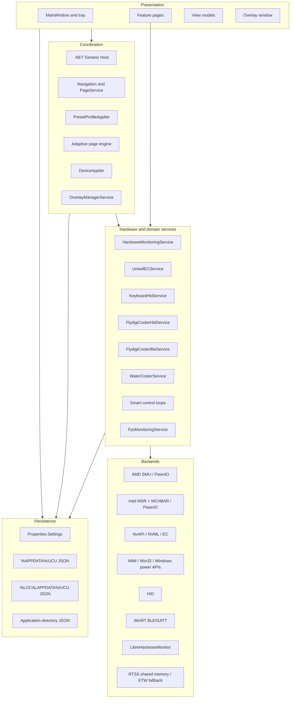
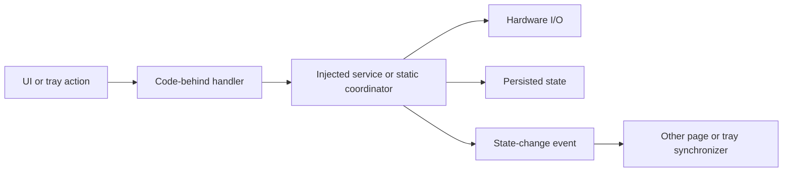

# System Architecture

## Executive view

UCU is a single-process, administrator-elevated WPF application built around the .NET Generic Host. The host supplies dependency injection, application lifecycle, structured logging, navigation services, and two hosted services. Most product behavior is divided among WPF pages, long-lived device services, static tuning backends, and JSON/.NET settings stores.

The architecture is layered by convention rather than enforced project boundaries: all code compiles into one executable assembly, and UI code can call service, model, script, and static settings APIs directly.

## Component model

## Layer responsibilities

### Presentation

- `Views/Windows/MainWindow.xaml.cs` owns navigation setup, notification-area commands, startup hardware application, power-mode event handling, resume reapplication, and close/minimize behavior.
- Feature pages own both UI state and significant domain orchestration. The largest are Adaptive, Flydigi Cooler, Fan Control, Presets, Keyboard, and Watercooler.
- View models exist for the dashboard, main window, settings, and overlay. MVVM is therefore selective, not a repository-wide rule.
- The performance overlay is a separate click-through WPF window controlled by a hosted manager and view model.

### Coordination

- `App.xaml.cs` builds the host, performs prerequisite checks, initializes hardware identity and monitoring, enforces a single process instance, starts the UI, and schedules deferred work.
- `ApplicationHostService` creates/shows the navigation window and applies light-bar boot state.
- `PresetProfileApplier` converts profile identities into CPU/GPU command sequences and applies V-F curve and EC power operations in a defined order.
- `DeviceApplier` coordinates Adaptive Mode overrides for Flydigi, Hydro UI, EC fans, keyboard, light bar, and CPU/GPU domains. It captures user state, applies profile state, notifies visible pages, and restores user state when an override ends.
- `PageService` resolves WPF pages from the dependency-injection container.

### Hardware and domain services

- `HardwareMonitoringService` uses category leases to keep only requested LibreHardwareMonitor domains active and returns immutable snapshots.
- `UniwillECService` serializes EC access, performs the activation handshake, applies fan tables and platform power fields, and reads temperatures/RPM/battery telemetry.
- Peripheral services own HID or GATT sessions plus their reconnect, heartbeat, notification, and persistence behavior.
- Smart-control services run periodic control loops that translate temperatures into device commands.
- FPS monitoring prefers RTSS shared memory and falls back to an ETW trace processor.

### Backends

- AMD controls use PawnIO-loaded modules and the SMU mailbox implementation.
- Intel controls use PawnIO modules for MSR and MCHBAR operations.
- NVIDIA controls use `LLT.NvAPIWrapper.Net`, NVML P/Invoke, private NVAPI calls, and Uniwill EC fields.
- Platform discovery and selected controls use WMI, registry APIs, power notifications, display APIs, and other Win32 calls.
- Device I/O uses HID libraries/direct output reports and WinRT BLE/GATT.

## Dependency-injection registrations

The application registers the following long-lived services as singletons:

- Navigation, theme, and taskbar services.
- `IHardwareMonitoringService` and `GpuInventoryService`.
- `IFpsMonitoringService`, `OverlaySettingsStore`, and `OverlayManagerService`.
- `WaterCoolerService`, `FlydigiCoolerHidService`, `FlydigiCoolerBleService`.
- `UniwillECService` and `DeviceApplier`.
- The Flydigi page itself, because it owns timers that must be disposed with the host.

Most other pages and the main window are registered as scoped. In this desktop process, they are resolved from the host provider and effectively live according to navigation/host usage rather than web-style request scopes.

## State and communication styles

UCU uses several communication mechanisms:

- Direct method calls from code-behind to services and static helpers.
- Dependency-injected singleton services for long-lived device sessions.
- .NET events for override changes, applied presets, connection state, settings changes, and monitoring updates.
- WPF `DispatcherTimer` and thread-pool timers for polling/control loops.
- Static application state such as detected processor family, resolved SKU, cached system information, and active profile data.
- JSON files and `Properties.Settings.Default` for durable state.

## Concurrency model

- The WPF dispatcher owns visual state.
- Startup parallelizes WMI/system discovery and LibreHardwareMonitor initialization.
- BLE/HID services use background loops, cancellation tokens, notifications, timers, locks, and reconnect backoff.
- Hardware monitoring serializes category changes and snapshot refreshes.
- Adaptive Mode has multiple timers and an explicit guard to avoid concurrent application work.
- Shutdown intentionally avoids blocking the UI thread while hosted services stop, because some stop paths may dispatch back to WPF.

## Architectural constraints

- The executable requires Windows and a Windows 11 SDK-level target (`10.0.22621.0`).
- The manifest requests administrator elevation on every launch.
- Several features require bundled native DLLs/modules to be colocated with the executable.
- Hardware behavior is model- and firmware-dependent; SKU resolution and detector results determine which controls are shown or which values are used.
- The application directory is also used for logs and some legacy JSON data, so writable deployment layout affects operation.

## Related pages

- [Startup and lifecycle](startup-and-lifecycle.md)
- [Preset and Adaptive Mode pipelines](preset-and-adaptive-pipelines.md)
- [Hardware integration](hardware-integration.md)
- [Configuration and data](../operations/configuration-and-data.md)
- [Codebase map](codebase-map.md)

