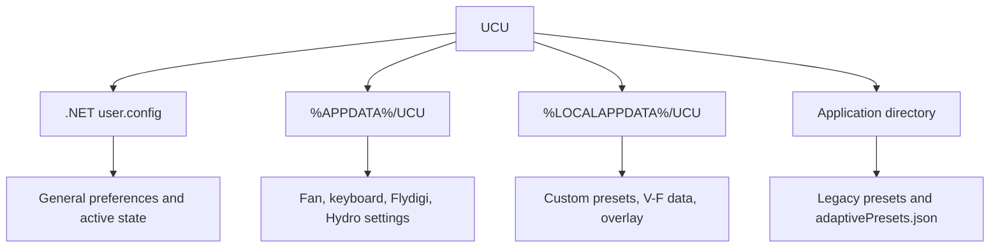

# Configuration and Data

## Storage overview

UCU persists state in four locations:

This split reflects incremental development rather than one unified store. Backup/import bridges most locations.

## .NET user settings

`Properties/Settings.settings` defines user-scoped settings. The runtime file is managed by .NET under the user's local application-data configuration hierarchy, which includes application identity and version.

Major setting groups include:

- Startup: start on boot, delay, start minimized, minimize-on-close.
- Profile state: active built-in/custom profile, command strings, custom CPU/GPU values.
- Automations: AC, DC, resume profile and command fields.
- Adaptive state: running flag, automatic start/switch, per-domain enable flags.
- Application: language, update checks, prerequisite dialog, logging level.
- Lighting/battery: light-bar values and battery mode.
- Feature gates: Flydigi, GPU power boost, GPU clocks, local dimming.

At startup, `Settings.Default.Upgrade()` migrates compatible settings from the previous application version once. Corrupt configuration is deleted and defaults are reloaded when the framework reports a nested `ConfigurationErrorsException`.

## `%APPDATA%/UCU`

| File | Owner | Content |
| --- | --- | --- |
| `fancontrol_settings.json` | `FanControlSettingsService` | Unified/split EC curves, thresholds, smart-fan configuration. |
| `keyboard_settings.json` | `KeyboardSettingsService` | Keyboard power, brightness, effect, colors, per-key data, idle behavior. |
| `keyboard_saved_settings.json` | `KeyboardSettingsService` | Pre-Adaptive keyboard state used to restore an override across restart. |
| `bs2pro_settings.json` | `FlydigiCoolerHidService` | HID cooler fan/RGB/device/curve settings. |
| `bs1_settings.json` | `FlydigiCoolerBleService` | BLE cooler settings. |
| `watercooler_settings.json` | `WaterCoolerService` | Hydro UI connection, pump/fan/RGB/smart-mode state. |

Most of these stores return defaults when files are absent or unreadable. Writes are not uniformly atomic: the central backup importer and overlay store use temporary-file replacement, while several individual settings services write directly.

## `%LOCALAPPDATA%/UCU`

| File | Owner | Content |
| --- | --- | --- |
| `custom_presets_normal.json` | `CustomPresetStore` | Five custom Normal-mode CPU/GPU profile slots. |
| `custom_presets_boost.json` | `CustomPresetStore` | Five custom Boost-mode CPU/GPU profile slots. |
| `vf_presets.json` | `VfCurvePresetStore` | V-F curve preset slots. |
| `vf_stock.json` | `VfStockCurveStore` | Captured stock V-F points. |
| `overlay.json` | `OverlaySettingsStore` | Overlay visibility, metrics, refresh, scale, opacity, placement and hotkeys. |

`CustomPresetStore.MigrateLegacyFile` copies the earlier `custom_presets.json` representation into the Normal-mode store when needed.

## Application directory

The executable directory is stored in `Settings.Default.Path`. Current/legacy files include:

| File | Status |
| --- | --- |
| `adaptivePresets.json` | Active per-game Adaptive Mode profile store. |
| `apuPresets.json` | Legacy custom AMD APU store retained by backup/import. |
| `amdDtCpuPresets.json` | Legacy custom AMD desktop store retained by backup/import. |
| `intelPresets.json` | Legacy custom Intel store retained by backup/import. |
| `bs2pro_settings.json` | Legacy/application-directory preset data included in backup/import. |
| `logs/ucu_log.txt` | Current structured diagnostic log; daily rolling, 8 MiB per file limit. |

Because the application runs elevated and uses its install directory for active data, portable ZIP extraction is the least surprising deployment model. Installing below a protected directory changes file ownership and backup expectations.

## Packaged read-only data

- `SkuData/skus.json` is copied beside the application and resolves model-specific profile values.
- `Localization/*.json` files are embedded resources.
- Assets contain images plus native modules and helper binaries selected by the project file.

## Backup format

`PresetBackupService` writes version `2` JSON. The export includes:

- Legacy processor preset files.
- Adaptive profiles.
- Flydigi preset data.
- Normal/Boost custom preset stores.
- V-F presets and stock curve.
- Overlay, fan, keyboard, Flydigi, and watercooler settings.
- Most user-scoped .NET settings.

Runtime-only settings such as `isAdaptiveModeRunning`, `FirstBoot`, migration flags, and transient tracking flags are intentionally excluded.

Import validates the top-level shape, accepts legacy version `1`, prepares data before writing, and uses temporary-file replacement. Legacy preset-file writes are rolled back if the grouped operation fails. Other grouped locations are written after preparation but do not share one cross-location transaction.

## Data migration rules

| Migration | Rule |
| --- | --- |
| .NET settings | Framework `Upgrade()` once per application version. |
| Custom presets | Legacy single file becomes Normal-mode file if Normal is absent. |
| Adaptive GPU | Flat GPU fields become `GpuNormal` and `GpuBoost`; old V-F name is not converted into offsets. |
| Watercooler | Legacy Smart Pump fields migrate only when current Smart Mode fields remain defaults. |
| Backup | Version 1 merges legacy custom/adaptive objects; version 2 restores the broader state set. |

## Configuration change checklist

When adding a durable setting:

1. Choose the owner and storage location deliberately.
2. Provide a default that preserves behavior for missing JSON properties.
3. Define migration from every previous representation that could still exist.
4. Add the field to backup/export when users would expect it to move machines.
5. Decide whether startup, resume, reconnect, and Adaptive override restoration use it.
6. Add round-trip and migration tests.
7. Update this page.

[Back to documentation index](../README.md)

