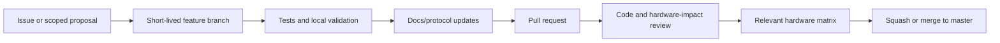

# Contribution Workflow

## Current repository process

The repository contains bug and feature request templates, but no `CONTRIBUTING.md`, pull-request template, code owners, continuous-integration workflow, release workflow, or automated test project.

Both issue templates still assign `JamesCJ60`, and README issue/release links point to `jgudec/Uniwill-Control-Utility` while the current origin is the `Uniwill-Control-Utility` organization. These references should be reconciled when repository ownership is finalized.

## Recommended branch flow

Use focused changes. Protocol modifications, large page refactors, new hardware support, and release-process changes should not be mixed in one pull request unless they are inseparable.

## Issue intake

A useful bug report includes:

- Exact UCU version or commit.
- Windows build.
- Laptop brand/model plus manufacturer, product and baseboard strings.
- CPU, GPU, BIOS/EC firmware, and display type.
- Peripheral model, connection type and firmware for device issues.
- PawnIO and RTSS versions where relevant.
- Steps, expected behavior, observed behavior, frequency, and resume/navigation context.
- Relevant diagnostic log and screenshots.

Feature requests should identify the device/protocol source, expected ownership (manual page, preset, Adaptive Mode, tray, automation), persistence needs, and tested hardware.

## Pull-request requirements

Each pull request should state:

1. Problem and intended behavior.
2. Components and persisted formats affected.
3. Tests added and commands run.
4. Hardware models/firmware exercised.
5. Cold-start, resume, reconnect, and shutdown impact.
6. Migration/backup compatibility.
7. Documentation and localization changes.
8. Known limitations.

## Change-specific review gates

| Change | Required review focus |
| --- | --- |
| EC register/table logic | Address/source evidence, activation sequence, delays, restoration, target models. |
| HID/BLE protocol | Frame length, checksum/order, throttling, reconnect, notification parsing, disposal. |
| Presets/Adaptive | Ownership, partial-domain application, restore semantics, persistence and migration. |
| Startup/resume | Dispatcher behavior, duplicate writes, deferred-task ordering, device reconnection. |
| Persistence | Defaults, corrupt-file fallback, atomic writes, migration, backup/import. |
| Localization/UI | All locales, long strings, RTL rendering, page lifecycle and event unsubscription. |
| Release/update | Version parser, owner/repo, asset name/order, clean upgrade. |

## Commit structure

Prefer reviewable commits that each leave the repository internally consistent. Typical groups:

- Model/protocol and tests.
- Service behavior and tests.
- UI integration and localization.
- Documentation and operational notes.

Do not mix generated build output or local logs with source commits. Native dependency updates should be isolated and include upstream version/source information.

## Definition of done

- The intended behavior is covered by automated tests where a hardware adapter can be substituted.
- Affected hardware paths are exercised on the relevant device matrix.
- Build and tests pass from a clean clone.
- No new unobserved background task, timer, event subscription, or device handle remains after navigation/exit.
- New persisted fields load old data and participate in backup/import as intended.
- User-visible text is localized or has an explicit follow-up.
- Architecture, operations, or protocol documentation is updated.
- Release notes are supplied for user-visible changes.

[Back to documentation index](../README.md)

