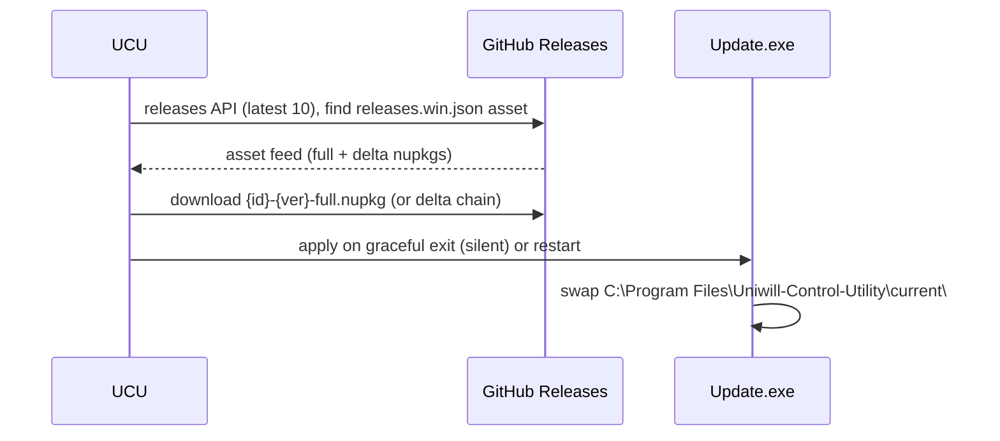

# Release Process

## Current state

The repository now owns its packaging end to end:

- `build\pack.ps1` publishes, stages the native payload, and runs `vpk pack`
  (Velopack) to produce the per-machine MSI, full/delta nupkgs, the
  `releases.win.json` feed index, and the portable ZIP.
- `vpk` is pinned in `dotnet-tools.json` (`dotnet tool restore`).
- The in-app updater is Velopack (`Services\VelopackUpdateService.cs`) reading
  the GitHub Releases feed; the legacy Octokit/msiexec flow is removed.
- Version has a single source of truth: `<Version>` in `Directory.Build.props`
  (3-part `a.b.c` — Velopack rejects 4-part versions).
- Releases are published manually: run the script, upload the printed
  manifest to a GitHub release tagged with the same version.

## Version contract

- `<Version>` in `Directory.Build.props` (repository root) is the only version
  field. It flows to `AssemblyVersion`/`FileVersion`/`ProductVersion` for every
  project (app, `UCU.Client/Contracts/Core/Hardware`, the engine and the test
  assemblies), to the title-bar chip and the About page, and to
  `build\pack.ps1`, which reads it through the app project as the Velopack
  `packVersion`. Per-project `<Version>` fields are gone deliberately: they
  let a release ship a new app over a stale engine, and the engine payload's
  file version is the freshness probe `pack.ps1` asserts.
- The version must be 3-part SemVer2 (`0.9.5`). Bump the third part for every
  release. The GitHub release tag must equal the version (e.g. tag `0.9.5`).

## Updater contract (Velopack)



Implications:

- Only releases that carry a `releases.win.json` asset are visible to the
  updater — historical releases (plain zips/MSIs) are ignored.
- Asset names are generated by `vpk pack` and must be uploaded verbatim:
  `Uniwill-Control-Utility-{ver}-full.nupkg`,
  `Uniwill-Control-Utility-{ver}-delta.nupkg`,
  `Uniwill-Control-Utility-win.msi`, `releases.win.json`.
- Deltas are built from the newest full nupkg in the persistent `Releases\`
  directory; keep it seeded (`vpk download github`, step 4 of the script).
- Portable (ZIP) installs have no Velopack layout: every update feature
  no-ops (`UpdateManager.IsInstalled` gate) and Settings says so.
- Updates apply on graceful exit (title-bar card / tray quit) — never as a
  surprise restart.

## Build and publish commands

```powershell
dotnet tool restore
.\build\pack.ps1
```

The script reads the version from the csproj, publishes framework-dependent
win-x64 (`--self-contained false`, no single-file — native DLLs load from the
exe directory), stages the loose native payload (the script's `$payload` list
is the packaging manifest and fails on any missing file), packs the
per-machine MSI (`--msi --instLocation PerMachine`, `-f net10-x64-desktop`
runtime dependency), and zips the portable artifact.

## Recommended release checklist

### 1. Prepare version metadata

- Bump `<Version>` (3-part) in `Directory.Build.props`.
- Prepare a changelog for the average user (features, fixes, behavior
  changes) for the GitHub release body — the in-app updater shows only the
  version, so the release page is the only place users learn what is new.
- List the data migrations users will encounter (settings upgrade, install
  layout moves, scheduled-task re-pointing) in a "Migration" section of the
  same release body; migrations needing logic go in `PrepareUserSettings`.

### 2. Validate source

- Restore, build Release x64, run `dotnet test`.
- Review warnings, package resolution, and the final dependency graph.

### 3. Validate on hardware

- Run the compatibility matrix from [Testing Strategy](../project/testing-strategy.md).
- Exercise cold start, second-instance activation, tray controls, AC/DC
  transitions, sleep/resume, and exit.
- Verify AMD and Intel paths on representative devices.
- Verify EC fan/battery/light-bar behavior and each supported peripheral
  transport.

### 4. Package

- `dotnet tool restore; .\build\pack.ps1`.
- Confirm the printed manifest lists the MSI, full nupkg, delta nupkg (when a
  previous release exists), `releases.win.json`, and the ZIP.

### 5. Release validation

The debug (F5) layout is not a release layout: Velopack puts the app under
`packages\<version>` behind a `current` link, the per-machine install root
is admin-writable, and the engine service is registered from the installed
path. Each shipped route needs its own pass.

- Payload freshness: pack.ps1 step 2b' fails the pack when the staged engine
  (`artifacts\publish\Service\Uniwill Control Utility Engine.dll/.exe`) is
  older than the app exe, or its file version is not the release version.
  Presence alone is not freshness: the staging target's copy step is the one
  place a stale engine can ride into both the MSI and the portable ZIP (it
  did, before the staging `IntermediateOutputPath` fix), which is why the
  assertion exists.
- Install the MSI on a clean Windows account (Program Files, elevated).
  The MSI is the shipped installer (Windows Installer auto-elevates on
  double-click). The Velopack `*-Setup.exe` is a 7 MB web-installer
  bootstrapper, is not part of the upload manifest, and is stamped
  `requireAdministrator` by pack.ps1 step 5b only as a convenience;
  a failed asInvoker run of it can leave a partial per-user layout in
  `%LOCALAPPDATA%\Uniwill-Control-Utility` that must be deleted before
  any install retry.
- Install location: vpk's wizard has no destination page (its BrowseDlg
  is unreachable); the supported override is
  `msiexec /i app.msi VELOPACK_INSTALLDIR="D:\UCU"`, documented in the
  README. The in-app updater follows the exe, so custom roots update fine.
- Uninstall: Apps & Features (MSI) and the `Uninstall.exe` shim compiled
  into the layout by pack.ps1 step 2c. Sequence: kill guardian + app in
  the shim itself (`Process.Kill` — `taskkill` costs ~9.5 s per call,
  which was the ~30 s stall before the wizard), run `msiexec /x {GUID} /qb`
  synchronously (the client blocks on the wizard; a `start /wait` wrapper
  returns at hand-off and races the engine), remove the scheduled tasks,
  the App Paths elevation-shim key and all three ARP entries, then `rd`
  the install root with a 3 s retry (killed exes stay locked briefly under
  AV scanning). Stage timestamps land in `%TEMP%\ucu_uninstall_log.txt`.
  Velopack writes its ARP entry under HKCU\...\Uninstall\<packId> and its
  uninstall-time removal runs in the MSI's deferred CA context, which
  misses the user's HKCU — so a pure Control Panel uninstall leaves a
  stale entry that errors 1605 on retry. The shim deletes it; users
  uninstalling via Control Panel alone may need the entry right-click
  removed.
- Launch the installed app from an **unelevated** account: it must start with
  no prompt and write nothing to the install root, which a per-machine layout
  gives to Administrators only. App logs belong in `%LOCALAPPDATA%\UCU\logs`,
  settings and presets in `%APPDATA%\UCU` / `%LOCALAPPDATA%\UCU`; a log
  directory that cannot be created must degrade logging to the console, not
  abort the launch (the launch-level symptom of this defect is an
  "Access to the path …\current\logs is denied" popup). Known gap:
  `Settings.Default.Path` defaults to empty, so `adaptivePresets.json` is
  relative to the install root. Also confirm prerequisites, the settings
  upgrade, preserved user data, and that the autostart task points at the new
  path (the app self-heals the task after a zip → MSI migration).
- Test in-app update discovery against a local feed
  (`UCU_UPDATE_FEED_PATH=<Releases dir>`) before publishing.
- Engine service state after install: `services.msc` shows **UCU Engine**
  (SCM name `UCUEngine`, `start= auto`, recovery restart x3/min),
  `sc qc UCUEngine` reports a binPath inside the install root's version
  directory, `sc sdshow UCUEngine` shows the Authenticated Users
  query/start grant, and every fan/battery/keyboard operation runs with no
  UAC prompt (the one prompt of the product is the first-launch engine
  install).
- Supervision: kill the app process (Task Manager) and confirm the engine
  relaunches it; a tray exit must stay silent (no relaunch).
- In-app update (MSI layout only): point the feed at a local `Releases\`
  directory (`UCU_UPDATE_FEED_PATH=<dir>`), apply on graceful exit, and
  confirm `UCU.Updater.exe` stops the engine, swaps the layout, restarts
  the engine, and that `sc qc` then reports the new version directory with
  the "UCU Engine" label intact (the install self-heal re-applies binPath
  and DisplayName).
- Portable route (ZIP): extract to a folder and run the exe. Update
  features no-op (no Velopack layout) and Settings says so; the engine
  installs from that folder's `Service\` (one UAC prompt) and EC
  operations work. Move the folder and confirm the app re-points the
  service registration before EC operations work again.
- Uninstall end state (`Uninstall.exe` shim, or Apps & Features for the
  MSI): `sc query UCUEngine` reports 1060 (gone), no "UCU" / "UCU
  Autostart" / "UCU Guardian" tasks, no ARP entries, and the install root
  plus `%ProgramData%\UCU` are deleted.
- Confirm application exit releases HID/BLE sessions.

### 6. Publish and observe

- Create the Git tag equal to the version (e.g. `0.9.5`).
- Upload the manifest assets to the GitHub release (MSI + nupkgs +
  `releases.win.json` + ZIP).
- Verify the in-app updater discovers the release from GitHub.
- Monitor issue reports by device model and firmware.

## Recommended automation

The packaging script is the auditable chain today (local, no CI). A future
workflow should restore, build x64 Release, run unit tests on every pull
request, and run `build\pack.ps1` + draft-release on tags. Hardware approval
remains a separate maintainership gate.

[Back to documentation index](../README.md)
