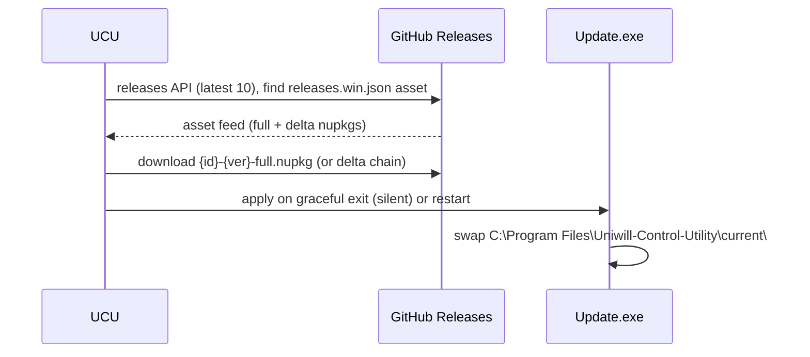

# Release Process

## Current state

The repository now owns its packaging end to end:

- `build\pack.ps1` publishes, stages the native payload, and runs `vpk pack`
  (Velopack) to produce the per-machine MSI, full/delta nupkgs, the
  `releases.win.json` feed index, and the portable ZIP.
- `vpk` is pinned in `dotnet-tools.json` (`dotnet tool restore`).
- The in-app updater is Velopack (`Services\VelopackUpdateService.cs`) reading
  the GitHub Releases feed; the legacy Octokit/msiexec flow is removed.
- Version has a single source of truth: `<Version>` in the project file
  (3-part `a.b.c` — Velopack rejects 4-part versions).
- Releases are published manually: run the script, upload the printed
  manifest to a GitHub release tagged with the same version.

## Version contract

- `<Version>` in `Uniwill Control Utility.csproj` is the only version field.
  It flows to `AssemblyVersion`/`FileVersion` (SDK), the title-bar chip, the
  About page, and `build\pack.ps1` (Velopack `packVersion`).
- The version must be 3-part SemVer2 (`0.9.5`). Bump the third part for every
  release. The GitHub release tag must equal the version (e.g. tag `0.9.5`).

## Updater contract (Velopack)



Implications:

- Only releases that carry a `releases.win.json` asset are visible to the
  updater — historical releases (plain zips/MSIs) are ignored.
- Asset names are generated by `vpk pack` and must be uploaded verbatim:
  `Uniwill-Control-Utility-{ver}-full.nupkg`,
  `Uniwill-Control-Utility-{ver}-delta.nupkg`,
  `Uniwill-Control-Utility-win.msi`, `releases.win.json`.
- Deltas are built from the newest full nupkg in the persistent `Releases\`
  directory; keep it seeded (`vpk download github`, step 4 of the script).
- Portable (ZIP) installs have no Velopack layout: every update feature
  no-ops (`UpdateManager.IsInstalled` gate) and Settings says so.
- Updates apply on graceful exit (title-bar card / tray quit) — never as a
  surprise restart.

## Build and publish commands

```powershell
dotnet tool restore
.\build\pack.ps1
```

The script reads the version from the csproj, publishes framework-dependent
win-x64 (`--self-contained false`, no single-file — native DLLs load from the
exe directory), stages the loose native payload (the script's `$payload` list
is the packaging manifest and fails on any missing file), packs the
per-machine MSI (`--msi --instLocation PerMachine`, `-f net10-x64-desktop`
runtime dependency), and zips the portable artifact.

## Recommended release checklist

### 1. Prepare version metadata

- Bump `<Version>` (3-part) in the project file.
- Prepare a changelog for the average user (features, fixes, behavior
  changes) for the GitHub release body — the in-app updater shows only the
  version, so the release page is the only place users learn what is new.
- List the data migrations users will encounter (settings upgrade, install
  layout moves, scheduled-task re-pointing) in a "Migration" section of the
  same release body; migrations needing logic go in `PrepareUserSettings`.

### 2. Validate source

- Restore, build Release x64, run `dotnet test`.
- Review warnings, package resolution, and the final dependency graph.

### 3. Validate on hardware

- Run the compatibility matrix from [Testing Strategy](../project/testing-strategy.md).
- Exercise cold start, second-instance activation, tray controls, AC/DC
  transitions, sleep/resume, and exit.
- Verify AMD and Intel paths on representative devices.
- Verify EC fan/battery/light-bar behavior and each supported peripheral
  transport.

### 4. Package

- `dotnet tool restore; .\build\pack.ps1`.
- Confirm the printed manifest lists the MSI, full nupkg, delta nupkg (when a
  previous release exists), `releases.win.json`, and the ZIP.

### 5. Release validation

- Install the MSI on a clean Windows account (Program Files, elevated).
  The MSI is the shipped installer (Windows Installer auto-elevates on
  double-click). The Velopack `*-Setup.exe` is a 7 MB web-installer
  bootstrapper, is not part of the upload manifest, and is stamped
  `requireAdministrator` by pack.ps1 step 5b only as a convenience;
  a failed asInvoker run of it can leave a partial per-user layout in
  `%LOCALAPPDATA%\Uniwill-Control-Utility` that must be deleted before
  any install retry.
- Install location: vpk's wizard has no destination page (its BrowseDlg
  is unreachable); the supported override is
  `msiexec /i app.msi VELOPACK_INSTALLDIR="D:\UCU"`, documented in the
  README. The in-app updater follows the exe, so custom roots update fine.
- Uninstall: Apps & Features (MSI) and the `Uninstall.exe` shim compiled
  into the layout by pack.ps1 step 2c (kills app + guardian, deletes the
  UCU/UCU Guardian tasks, runs the MSI uninstall, removes leftovers).
- Confirm startup elevation, prerequisites, settings upgrade, preserved user
  data, and that the "UCU" scheduled task points at the new path (the app
  self-heals the task after a zip → MSI migration).
- Test in-app update discovery against a local feed
  (`UCU_UPDATE_FEED_PATH=<Releases dir>`) before publishing.
- Confirm the crash guardian (`Uniwill Control Utility Service.exe`,
  "UCU Guardian" task) relaunches after a process kill and stays silent
  after tray exit.
- Confirm application exit releases HID/BLE sessions.

### 6. Publish and observe

- Create the Git tag equal to the version (e.g. `0.9.5`).
- Upload the manifest assets to the GitHub release (MSI + nupkgs +
  `releases.win.json` + ZIP).
- Verify the in-app updater discovers the release from GitHub.
- Monitor issue reports by device model and firmware.

## Recommended automation

The packaging script is the auditable chain today (local, no CI). A future
workflow should restore, build x64 Release, run unit tests on every pull
request, and run `build\pack.ps1` + draft-release on tags. Hardware approval
remains a separate maintainership gate.

[Back to documentation index](../README.md)
