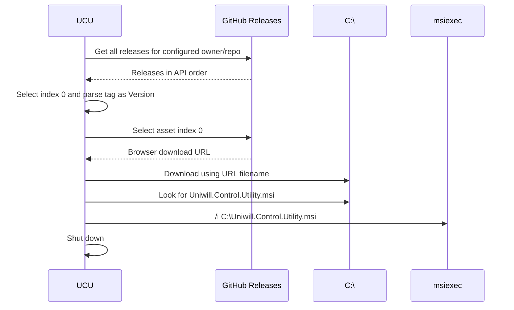
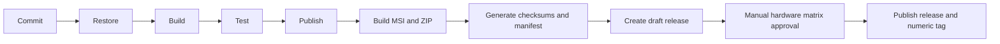

# Release Process

## Current state

The repository currently has:

- No Git tags in the cloned history.
- No GitHub Actions workflows.
- No installer or packaging project in the solution.
- A portable ZIP installation description in the README.
- An in-app updater that expects a GitHub release and launches a specific MSI filename.
- Version values duplicated in the project file and `App.xaml.cs`.
- Repository/release links split between the organization repository and `jgudec/Uniwill-Control-Utility`.

This means the release process is not fully reproducible from repository contents alone. The following sections separate observed updater contracts from the recommended maintainer checklist.

## Version contract

Current version `26.2.2` appears in:

- `<Version>` in the project file.
- `<AssemblyVersion>`.
- `<FileVersion>`.
- `App.version` in `App.xaml.cs`.

The updater parses the release tag with `new Version(tagName)`. A compatible tag therefore uses a numeric value such as `26.2.2`; a leading `v` is not accepted by the current parser.

## Updater contract



Implications:

- The configured owner is currently `jgudec`, not the new organization.
- The first release returned must be the intended latest release.
- The first asset must be the installer the updater should consume.
- Its filename must be exactly `Uniwill.Control.Utility.msi`, or the settings-page launch check will not find the downloaded file.
- The process must be able to write to `C:\`.
- Failed update checks/downloads usually return `false` without detailed UI diagnostics.

## Build and publish commands

```powershell
dotnet restore '.\Uniwill Control Utility.sln'
dotnet build '.\Uniwill Control Utility.sln' -c Release -p:Platform=x64
dotnet publish '.\Uniwill Control Utility\Uniwill Control Utility.csproj' `
  -c Release -r win-x64 -p:SelfContained=true
```

There is no repository-defined command that transforms publish output into the MSI expected by the updater. Until that packaging source is added, record the external tool, source definition, upgrade code/product code behavior, install scope, and exact invocation in each release record.

## Recommended release checklist

### 1. Establish the release identity

- Decide whether the organization or `jgudec` repository owns releases.
- Update README badges/links, Dashboard Wiki URL, `App.CheckForUpdate`, and Settings updater constants together.
- Confirm the Wiki location.

### 2. Prepare version metadata

- Choose one numeric version.
- Update all four version fields listed above.
- Add user-visible release notes and data-migration notes.
- Confirm release tags match the updater parser.

### 3. Validate source

- Restore and build Release x64 from a clean clone.
- Run the automated test suite once it exists.
- Review warnings, package resolution, and the final dependency graph.
- Validate every JSON resource and SKU database load.

### 4. Validate on hardware

- Run the compatibility matrix from [Testing Strategy](../project/testing-strategy.md).
- Exercise cold start, second-instance activation, tray controls, AC/DC transitions, sleep/resume, and exit.
- Verify AMD and Intel paths on representative devices.
- Verify NVIDIA power and V-F behavior on each supported generation.
- Verify EC fan/battery/light-bar behavior and each supported peripheral transport.

### 5. Package

- Publish self-contained win-x64 output.
- Confirm every project-managed native/content file exists in output.
- Build the MSI from a versioned repository-owned definition.
- Name the updater asset exactly `Uniwill.Control.Utility.msi` while the current client contract remains.
- If also shipping a ZIP, include the entire required file set.

### 6. Release validation

- Install/upgrade on a clean Windows account.
- Confirm startup elevation, prerequisites, settings upgrade, and preserved user data.
- Test in-app update discovery against a draft/pre-release staging strategy before publishing latest.
- Confirm uninstall/upgrade does not remove user data unexpectedly.
- Confirm application exit releases HID/BLE sessions.

### 7. Publish and observe

- Create the numeric Git tag.
- Publish release notes, MSI first, and optional ZIP.
- Verify the GitHub API asset ordering used by the client.
- Install through the in-app updater.
- Monitor issue reports by device model and firmware.

## Recommended automation

A future release workflow should produce an auditable chain:



At minimum, continuous integration should restore, build x64 Release, validate Markdown links/Mermaid blocks, and run unit tests on every pull request. Hardware approval remains a separate maintainership gate.

[Back to documentation index](../README.md)

