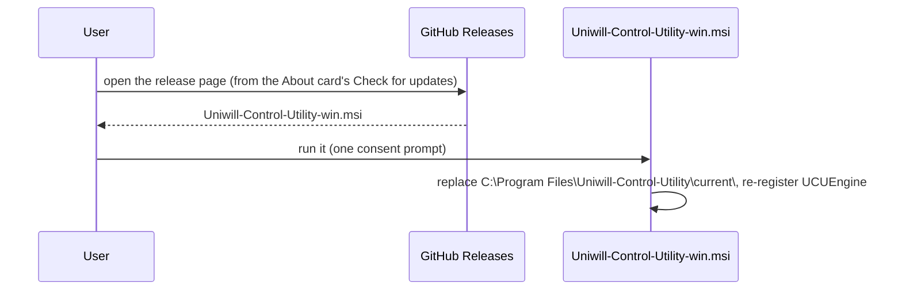

# Release Process

## Current state

The repository now owns its packaging end to end:

- `build\pack.ps1` publishes, stages the native payload, and runs `vpk pack`
  (Velopack) to produce the per-machine MSI.
- `vpk` is pinned in `dotnet-tools.json` (`dotnet tool restore`).
- There is **no in-app updater**: installed builds update by downloading and running the release's `Uniwill-Control-Utility-win.msi`. The About card's `Check for updates` button only queries the GitHub latest-release API (`UpdateChecker`) and links to the release page. `VelopackUpdateService`, its two settings and `UCU.Updater.exe` were deleted on 2026-11-10; an installed build must never build Velopack's `UpdateManager` in-process.
- vpk's update-package assets (`*-full.nupkg`, `*-delta.nupkg`, `releases.win.json`, `assets.win.json`) and its portable zip are **deleted by the script**: nothing in the product reads them any more, so they are neither shipped nor uploaded.
- Version has a single source of truth: `<Version>` in `Directory.Build.props`
  (3-part `a.b.c` — Velopack rejects 4-part versions).
- Releases are published manually: run the script, upload the printed
  manifest to a GitHub release tagged with the same version.

## Version contract

- `<Version>` in `Directory.Build.props` (repository root) is the only version
  field. It flows to `AssemblyVersion`/`FileVersion`/`ProductVersion` for every
  project (app, `UCU.Client/Contracts/Core/Hardware`, the engine and the test
  assemblies), to the title-bar chip and the About page, and to
  `build\pack.ps1`, which reads it through the app project as the Velopack
  `packVersion`. Per-project `<Version>` fields are gone deliberately: they
  let a release ship a new app over a stale engine, and the engine payload's
  file version is the freshness probe `pack.ps1` asserts.
- The version must be 3-part SemVer2 (`0.9.5`). Bump the third part for every
  release. The GitHub release tag must equal the version (e.g. tag `0.9.5`).

## Release assets



Implications:

- Only the installer asset matters: `Uniwill-Control-Utility-win.msi` (and
  `Uniwill-Control-Utility-win-Setup.exe` when vpk emits and the script keeps
  it). The feed index and update packages are deleted by `pack.ps1` — see the
  in-app updater note in "Current state".
- No portable ZIP ships: the engine is a machine-wide service, so an unpacked
  copy has no update or removal story. `vpk pack` still emits one; the script
  deletes it (vpk 1.2.161 has no flag).
- No deltas: with no `UpdateManager` there is no consumer for a delta package,
  so `vpk pack` runs without `--delta` and the persistent `Releases\` seeding
  step (`vpk download github`) is gone.
- No in-app apply path: the About card can only report that a newer release
  exists and link to it.

## Build and publish commands

```powershell
dotnet tool restore
.\build\pack.ps1
```

The script reads the version from the csproj, publishes framework-dependent
win-x64 (`--self-contained false`, no single-file — native DLLs load from the
exe directory), stages the loose native payload (the script's `$payload` list
is the packaging manifest and fails on any missing file), packs the
per-machine MSI (`--msi --instLocation PerMachine`, `-f net10-x64-desktop`
runtime dependency). There is no portable artifact.

## Recommended release checklist

### 1. Prepare version metadata

- Bump `<Version>` (3-part) in `Directory.Build.props`.
- Prepare a changelog for the average user (features, fixes, behavior
  changes) for the GitHub release body — it is the only place users learn
  what changed; there is no in-app "what's new".
- List the data migrations users will encounter (settings upgrade, install
  layout moves, scheduled-task re-pointing) in a "Migration" section of the
  same release body; migrations needing logic go in `PrepareUserSettings`.

### 2. Validate source

- Restore, build Release x64, run `dotnet test`.
- Review warnings, package resolution, and the final dependency graph.

### 3. Validate on hardware

- Run the compatibility matrix from [Testing Strategy](../project/testing-strategy.md).
- Exercise cold start, second-instance activation, tray controls, AC/DC
  transitions, sleep/resume, and exit.
- Verify AMD and Intel paths on representative devices.
- Verify EC fan/battery/light-bar behavior and each supported peripheral
  transport.

### 4. Package

- `dotnet tool restore; .\build\pack.ps1`.
- Confirm the printed manifest lists only the MSI (and the `Setup` bootstrapper when vpk emits it). The update-package assets are deleted by the script by design.

### 5. Release validation

The debug (F5) layout is not a release layout: Velopack puts the app under
`packages\<version>` behind a `current` link, the per-machine install root
is admin-writable, and the engine service is registered from the installed
path. Each shipped route needs its own pass.

- Payload freshness: pack.ps1 step 2c' fails the pack when the staged engine
  (`artifacts\publish\Service\Uniwill Control Utility Engine.dll/.exe`) is
  older than the app exe, or its file version is not the release version.
  Presence alone is not freshness: the staging target's copy step is the one
  place a stale engine can ride into the MSI payload (it
  did, before the staging `IntermediateOutputPath` fix), which is why the
  assertion exists.
- Payload cleanliness: pack.ps1 step 2a deletes `artifacts\publish` before
  publishing, because `dotnet publish` only writes what the current projects
  produce — an assembly from a deleted project survives in a reused layout,
  and the MSI template ships every file in it. The pre-engine service
  (`Uniwill Control Utility Service.*`) rode in every payload that way after
  the engine migration. Step 2c'' pins the invariant: the pack fails if a
  retired service/bridge assembly name appears in the layout.
- Install the MSI on a clean Windows account (Program Files, elevated).
  The MSI is the shipped installer (Windows Installer auto-elevates on
  double-click). The Velopack `*-Setup.exe` is a 7 MB web-installer
  bootstrapper, is not part of the upload manifest, and is stamped
  `requireAdministrator` by pack.ps1 step 5b only as a convenience;
  a failed asInvoker run of it can leave a partial per-user layout in
  `%LOCALAPPDATA%\Uniwill-Control-Utility` that must be deleted before
  any install retry.
- Install location: vpk's wizard has no destination page (its BrowseDlg
  is unreachable); the supported override is
  `msiexec /i app.msi VELOPACK_INSTALLDIR="D:\UCU"`, documented in the
  README. Updates follow the same route: run the new release's `Setup.exe`.
- Uninstall: Apps & Features (MSI) and the `Uninstall.exe` shim compiled
  into the layout by pack.ps1 step 2d. Sequence: kill guardian + app in
  the shim itself (`Process.Kill` — `taskkill` costs ~9.5 s per call,
  which was the ~30 s stall before the wizard), run `msiexec /x {GUID} /qb`
  synchronously (the client blocks on the wizard; a `start /wait` wrapper
  returns at hand-off and races the engine), remove the scheduled tasks,
  the App Paths elevation-shim key and all three ARP entries, then `rd`
  the install root with a 3 s retry (killed exes stay locked briefly under
  AV scanning). Stage timestamps land in `%TEMP%\ucu_uninstall_log.txt`.
  Velopack writes its ARP entry under HKCU\...\Uninstall\<packId> and its
  uninstall-time removal runs in the MSI's deferred CA context, which
  misses the user's HKCU, so a pure Control Panel uninstall leaves a stale
  entry that errors 1605 on retry - and it leaves the engine service
  registration behind, because the MSI never owned it (the app registers
  the service). The shim deletes both, so Control Panel's entry is
  redirected to the shim: the elevated engine install pass points the
  machine-level (MSI product-key) entry's `UninstallString` at
  `Uninstall.exe` (`EngineInstaller.RepairControlPanelUninstall`), and
  the app self-heals its own HKCU entry the same way at startup.
  Acceptance: uninstall from Control Panel, then confirm `sc.exe query
  UCUEngine` reports 1060, no `Uniwill Control Utility` entry remains in
  the program list, and the install root is gone. Known edge: `sc delete`
  on a registration with open handles (an open `services.msc`) leaves a
  delete-pending tombstone that vanishes when the last handle closes; a
  re-install against a tombstone fails with 1072.

- Launch the installed app from an **unelevated** account: it must start with
  no prompt and write nothing to the install root, which a per-machine layout
  gives to Administrators only. App logs belong in `%LOCALAPPDATA%\UCU\logs`,
  settings and presets in `%APPDATA%\UCU` / `%LOCALAPPDATA%\UCU`; a log
  directory that cannot be created must degrade logging to the console, not
  abort the launch (the launch-level symptom of this defect is an
  "Access to the path …\current\logs is denied" popup). Known gap:
  `Settings.Default.Path` defaults to empty, so `adaptivePresets.json` is
  relative to the install root. Also confirm prerequisites, the settings
  upgrade, preserved user data, and that the autostart task points at the new
  path (the app self-heals the task after a zip → MSI migration).
- Test in-app update discovery against a local feed
  (`UCU_UPDATE_FEED_PATH=<Releases dir>`) before publishing.
- Engine service state after install: `services.msc` shows **UCU Engine**
  (SCM name `UCUEngine`, `start= auto`, recovery restart x3/min),
  `sc qc UCUEngine` reports a binPath inside the install root's version
  directory, `sc sdshow UCUEngine` shows
  `D:P(A;;FA;;;SY)(A;;FA;;;BA)(A;;CCSWRPRC;;;AU)` - Authenticated Users with
  query-config, query-status, **start** (RP) and read-control, and no
  `LC` (change-config) - and every fan/battery/keyboard operation runs with no
  UAC prompt (the one prompt of the product is the first-launch engine
  install).
- Engine service across an MSI uninstall/reinstall: the MSI uninstall route
  (`msiexec /x`) leaves the registration and its DACL behind (only the
  `Uninstall.exe` shim stops and deletes it). Launching after such a
  reinstall must self-heal: the app detects that it cannot open the service,
  shows one elevation, re-asserts the DACL and starts it, and the EC metrics
  appear without touching `services.msc`.
- Supervision: kill the app process (Task Manager) and confirm the engine
  relaunches it; a tray exit must stay silent (no relaunch).
- Update path: no in-app updater exists. Run the new release's `Setup.exe`
  over the installed copy (same `velopack`/MSI route as a fresh install) and
  confirm the About page's Updates card says the installed build updates via
  the installer (`[Update]` no longer appears in the app log at all), the app
  version moved, `sc qc UCUEngine` reports the new `current\Service\` binPath
  with the "UCU Engine" label intact (the install self-heal re-applies
  binPath and DisplayName), and no `UCU.Updater.exe` exists in the layout.
- Upgrade from the previous release: install the new MSI over the installed
  copy (no uninstall first), then confirm the app version, `sc qc UCUEngine`
  reporting the new `current\Service\` binPath, exactly ONE visible Add/Remove
  Programs row (the pre-0.9.7 legacy key is removed by the install pass), and
  that settings/presets survived.
- Uninstall end state (`Uninstall.exe` shim, or Apps & Features for the
  MSI): `sc query UCUEngine` reports 1060 (gone), no "UCU" / "UCU
  Autostart" / "UCU Guardian" tasks, no ARP entries, and the install root
  plus `%ProgramData%\UCU` are deleted.
- Confirm application exit releases HID/BLE sessions.

### 6. Publish and observe

- Create the Git tag equal to the version (e.g. `0.9.5`).
- Upload the printed manifest asset(s) — the MSI, plus `Setup` when emitted — to the GitHub release.
- Verify the release carries `Uniwill-Control-Utility-win.msi`, and that the app's About → **Check for updates** answers "v<version> is available" for the new tag and offers the release page (it reads the GitHub latest-release API; nothing is downloaded or applied).
- Monitor issue reports by device model and firmware.

## Recommended automation

The packaging script is the auditable chain today (local, no CI). A future
workflow should restore, build x64 Release, run unit tests on every pull
request, and run `build\pack.ps1` + draft-release on tags. Hardware approval
remains a separate maintainership gate.

[Back to documentation index](../README.md)
