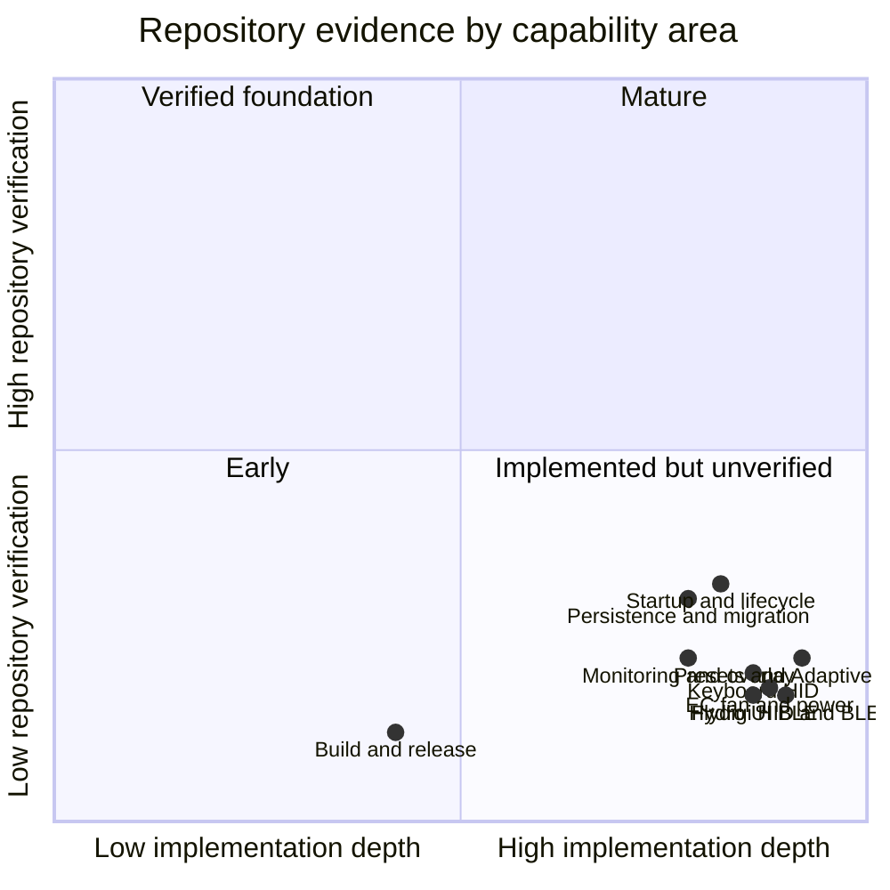

# Current-State Assessment

## Assessment basis

This page evaluates the repository at `eea723e` from code, project metadata, Git history, and static validation. README feature/status prose is not used as proof of readiness. No external hardware-run record is present in the repository, and the analysis machine did not yet have a .NET SDK, so executable behavior is not claimed where it could not be observed.

## Verdict

**The repository is a feature-rich, actively developed hardware-control application suitable for continued development and controlled hardware-lab use. The repository alone does not establish a reproducible, regression-qualified public release.**

This verdict is narrower than “the application does not work.” The code contains complete-looking implementations for major product flows, but release confidence cannot be derived from implementation volume. The missing evidence is automated regression coverage, continuous build output, a repository-owned packaging chain, a versioned hardware matrix, and a successful clean SDK build of this exact revision.

## Evidence summary

| Area | Observed evidence | Assessment |
| --- | --- | --- |
| Product implementation | 53,706 C# + 11,920 XAML lines; complete pages/services for profiles, Adaptive Mode, EC, HID, BLE, monitoring, overlay and persistence | Broad implementation exists. |
| Runtime architecture | Generic Host, DI, structured logs, single-instance handling, device reconnect, resume reapplication, cleanup paths | Operational concerns are explicitly handled. |
| Build definition | One valid SDK-style WPF project targeting .NET 10/Windows 22621; native/content payload declared | Build intent is clear. |
| Build proof | No SDK on the analysis machine; no CI workflow or stored build result | This revision is not independently build-verified here. |
| Automated tests | No test project, test framework, or test files found | Regressions are not machine-gated. |
| Hardware qualification | Detector/SKU/protocol lists exist; no versioned execution matrix or captured results | Enumeration is not proof of operation. |
| Release engineering | Self-contained publish properties exist; no installer source, release workflow, tags, or checksums | Release cannot be reproduced from the repository alone. |
| Update path | GitHub release client and MSI launch path exist | Contract is brittle and still points at the earlier repository owner. |
| Change rate | 196 commits in 2026-09; several startup/resume/device fixes in the last days | The code is under rapid stabilization, not a frozen release baseline. |
| Maintainability | 36 files over 500 lines; 18 over 1,000; large code-behind and service classes | Review and regression scope is concentrated. |
| Error observability | Serilog file/console logging and diagnostic levels exist | Core observability exists, but many hardware fallbacks suppress or only debug-log exceptions. |
| Data evolution | Multiple explicit migrations and versioned backup format | Compatibility work exists; stores remain fragmented. |
| Localization data | 21 catalogues parse; `zh-CN.json` has an orphan key at line 389 and fails JSON parsing | Selecting Simplified Chinese can fail catalogue loading during startup/culture change. |

## Implemented capability versus verified capability

Coordinates express repository evidence, not measured defect rates. The dominant pattern is substantial implementation with little automated qualification.

## Strong implementation signals

### Lifecycle depth

The code addresses cold start, settings upgrade, single-instance activation, delayed peripheral auto-connect, suspend/resume reapplication, stale BLE/HID sessions, notification-area ownership, and shutdown ordering. Recent commits specifically fix startup hardware-write ordering and resume state restoration, showing that maintainers are exercising these paths and correcting observed interactions.

### Protocol depth

The device services are not placeholders. They include frame builders/parsers, transport discovery, write throttling, notifications, query-response handling, reconnect loops, heartbeats, health checks, firmware reporting, RGB uploads, smart-control loops, and disposal. The protocol documents preserve register/frame details and implementation pitfalls.

### Persistence evolution

The code includes .NET settings upgrade, custom-preset migration, Adaptive GPU schema migration, watercooler legacy migration, and versioned backup import. The backup importer validates structure and uses atomic replacement for prepared files.

### Coordination improvements

`DeviceApplier` introduces explicit ownership and restore semantics between manual pages and Adaptive Mode. `PresetProfileApplier` consolidates profile application shared by the page, tray, automations, and resume. `HardwareMonitoringService` uses category leases rather than allowing every page to own an independent hardware monitor.

## Readiness constraints visible in code and repository

### No automated regression boundary

There are no unit, integration, UI, or protocol tests. Pure logic suitable for deterministic tests already exists—protocol frames, parsers, SKU matching, migrations, curve math, settings validation, and command generation—but it is not covered.

### No continuous build boundary

No workflow restores or compiles pull requests. The target is .NET 10 with a preview-version `System.Management` package and 23 other package references; a clean build result is therefore essential evidence, not a formality.

### Packaging is external to the repository

The application expects either a complete published file set or an MSI update, but no installer definition is present. The updater assumes release index 0, asset index 0, a numeric tag, an exact MSI filename, write access to `C:\`, and the old GitHub owner.

### Hardware behavior is coupled to UI lifecycle

Several large pages directly coordinate hardware. The repository has 54 `async void` methods—many are valid UI event handlers, while others are timers/helpers—and contains synchronous waits/sleeps around dispatcher and hardware operations. This raises the cost of reasoning about navigation, reentrancy, suspend/resume, and teardown.

### Large change surfaces

`Adaptive.xaml.cs` (3,660 lines), `FlydigiCooler.xaml.cs` (2,872), `FlydigiCoolerHidService.cs` (2,413), `MainWindow.xaml.cs` (2,241), and `UniwillECService.cs` (1,893) each combine multiple responsibilities. A change in one file can affect UI state, persistence, transport state, and lifecycle behavior together.

### Error handling is uneven

Broad catches are common in hardware/discovery code to keep unsupported systems usable. That is appropriate at process boundaries only when the failure remains observable and state is explicit. The code also contains numerous empty/best-effort catches and debug-only messages, so some partial failures are indistinguishable to operators from an unsupported feature.

### State is fragmented

State spans `.NET user.config`, roaming JSON, local JSON, and application-directory JSON. Backup/import covers most but not all transient/legacy behavior. Application-directory writes and logs also make deployment layout part of runtime behavior.

### One embedded localization catalogue is invalid

Static parsing found that `Localization/zh-CN.json` line 389 contains a string key without a colon/value, immediately followed by the complete key/value entry on line 390. `LocalizationService.LoadCatalogue` calls `System.Text.Json.JsonSerializer.Deserialize` without handling a catalogue parse failure. English and the other 20 non-Chinese catalogues parsed successfully in this assessment. This is a confirmed source defect, not a readiness inference.

## Actual maturity by subsystem

| Subsystem | Code status | Repository-verifiable maturity |
| --- | --- | --- |
| Application shell | Implemented with DI, navigation, tray, single instance and logging | Static completeness high; no automated lifecycle tests. |
| CPU/GPU presets | Implemented with built-in, SKU, custom Normal/Boost and V-F flows | Deterministic logic present; no tests and no run artifacts. |
| Adaptive Mode | Broad multi-domain implementation with diff tracking and restore ownership | Highest complexity and largest code surface; no regression suite. |
| EC fan/battery/power | Full service and UI paths plus detailed register documentation | Hardware-specific; no versioned device results. |
| Keyboard | Global/per-key implementation and detailed protocol notes | Transport path is complete-looking; no emulator/tests. |
| Flydigi | HID and BLE stacks, reconnect, smart control, RGB and settings | Deep implementation; concurrent/lifecycle behavior untested in repo. |
| Hydro UI | BLE commands, status, smart mode, standby/resume/fill | Deep implementation; no device matrix in repo. |
| Monitoring/overlay | Category leases, RTSS, ETW fallback and configurable WPF overlay | Complete code path; no performance or long-run evidence. |
| Persistence | Defaults, migrations and backup v2 | Better than other areas; still no round-trip/failure-injection tests. |
| Release/update | Partial publish and update client | Not reproducible end to end. |

## Minimum evidence for a release candidate

1. Clean restore/build/publish on a pinned .NET 10 SDK.
2. Automated tests for pure protocol, profile, migration, and store logic.
3. Repository-owned CI with archived build output.
4. Versioned installer/package source and exact artifact manifest.
5. Hardware execution matrix recording model, firmware, backend, feature, result, and tester/date.
6. Cold start, second instance, AC/DC, sleep/resume, reconnect, Adaptive ownership, and exit soak runs.
7. Update test from the previous released version using the actual GitHub owner and asset.
8. Triage of build warnings and high-value swallowed-error paths.
9. Correct `zh-CN.json` and make catalogue validation a build gate.

Until these exist, describe features as **implemented in code** or **observed on a named run**, not simply “supported.”

[Back to documentation index](../README.md)
