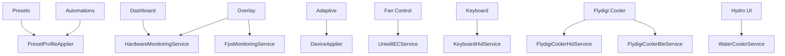

# Supported Hardware and Features

## Evidence levels

The repository does not contain an executable hardware test matrix. Documentation therefore distinguishes only facts visible in code:

| Level | Meaning |
| --- | --- |
| Enumerated | A detector has an explicit manufacturer/model, USB ID, BLE name, panel ID, or chassis rule. |
| Parameterized | A SKU/configuration record supplies model-specific values selected by runtime matching. |
| Implemented | A transport and command path exists in code. This does not prove operation on every enumerated device/firmware. |

No stronger claim is made without external run evidence. EC layouts, WMI instance names, firmware behavior, USB identifiers, and power limits may vary between visually similar systems.

## Laptop identities enumerated by code

- XMG NEO 16 (A25), baseboard substring `X6FR`.
- XMG NEO 16 (E25), baseboard substring `X6AR`.
- PCSpecialist Recoil III 16 AMD and Intel variants.
- Mifcom 16 AMD and Intel variants.
- Tuxedo Stellaris 16 Gen7 AMD and Intel variants.
- Mechrevo Dragon 16 Ultra (`X6FR`) and Aurora 16 Ultra (`X6AR`).

`LaptopDetector` matches case-insensitive manufacturer strings and checks whether the baseboard product contains the chassis marker. An unknown brand whose baseboard contains `X6` is treated as a TongFeng chassis for default imagery, but does not receive a named catalog identity.

## SKU parameters present in code

`SkuData/skus.json` contains six CPU-vendor/GPU combinations:

- Intel + RTX 5070 Ti Laptop, RTX 5080 Laptop, or RTX 5090 Laptop.
- AMD + RTX 5070 Ti Laptop, RTX 5080 Laptop, or RTX 5090 Laptop.

Although entry IDs use XMG A25/E25 names, `SkuResolver` does not match the laptop catalog, CPU model, or chassis. It filters by detected CPU vendor and matches an NVML GPU-name substring. Rebrands with the same vendor/GPU therefore receive the same profile parameters. Unknown combinations fall back to hard-coded values.

## Panel identities present in code

The panel database enumerates two MiniLED identities (`BOE0D5A` / `NE160QDM-NM9` and `AUO30A5` / `B160QAN03.K`) plus multiple IPS model strings. Local-dimming UI exposure depends on a WMI monitor matching one of the MiniLED entries.

## Processor and GPU paths

| Area | Mechanism | Notes |
| --- | --- | --- |
| AMD CPU | PawnIO modules + SMU mailbox commands | Family detection selects command behavior and supported controls. |
| Intel CPU | PawnIO MSR/MCHBAR modules | Includes PL1/PL2 and optional voltage paths. |
| NVIDIA GPU | NvAPI wrapper, NVML P/Invoke, private NVAPI calls, Uniwill EC | Used for power, Dynamic Boost, clocks, inventory, MUX state, and V-F curves. |
| AMD display/GPU helpers | Bundled ADLX DLLs | Present as runtime payload; the current primary profile pipeline is CPU/EC/NVIDIA oriented. |

## Peripheral paths

| Device family | Transport | Implemented behavior |
| --- | --- | --- |
| ITE 8291 keyboard | USB HID | Global effects, brightness, direction, touch-reactive modes, per-key colors, idle behavior. |
| Uniwill light bar | EC | Power, color, brightness, effect, speed. |
| Flydigi BS1 | Bluetooth LE/GATT | Discovery, connection, gear/RPM control, heartbeat, smart control. |
| Flydigi BS2/BS2 Pro/BS3/BS3 Pro | USB HID | Gear/RPM/curve control, RGB, device settings, reconnect and health monitoring. |
| LCT/XMG Hydro UI | Bluetooth LE/GATT | The page is exposed when the baseboard product contains `X6FR` or `X6AR`; service code implements pump, fan, RGB, status, smart mode, reconnect, standby, and fill cycle. |
| MiniLED panel | OEM WMI method | Local dimming toggle and verification. |

## Feature ownership map

## Implementation gaps visible in code

- Light-bar state contains a single RGB triplet; there is no per-zone or multi-color light-bar model/transport path.
- The overlay has implemented settings, window, hardware leases, RTSS input and ETW fallback; no automated or repository-recorded runtime validation accompanies it.
- One processor-family path explicitly states that memory timing retrieval is not implemented.
- Hardware enumerations and protocol implementations are broader than the repository's machine-verifiable evidence; support claims require a maintained external run matrix.

[Back to documentation index](../README.md)
