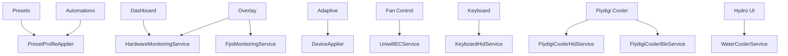

# Supported Hardware and Features

## Support levels

Use three different labels when discussing hardware:

| Level | Meaning |
| --- | --- |
| Tested | The README states that maintainers exercised the product on this model. |
| Detected | The code or SKU database has an explicit identification rule or record. |
| Protocol-compatible | The implemented protocol may work, but the repository does not provide a model-specific validation claim. |

Protocol compatibility is not equivalent to full product support. EC layouts, WMI instance names, firmware behavior, USB identifiers, and power limits may vary between visually similar systems.

## Explicitly tested laptops

- XMG Neo 16 (A25): AMD Ryzen 9 9955HX3D, NVIDIA GeForce RTX 5090 Laptop GPU, MiniLED panel.
- PCSpecialist Recoil 3 16 (Intel): Intel Core Ultra 9 275HX, NVIDIA GeForce RTX 5080 Laptop GPU, MiniLED panel.

The README notes that CPU voltage control could not be validated on the Intel Recoil because the firmware disables it; Intel CPU power-limit control was validated.

## Detected laptop identities

The current asset set and laptop detector cover named entries for:

- Mechrevo Aurora 16 Ultra and Dragon 16 Ultra.
- Mifcom 16.
- PCSpecialist Recoil 3 16 AMD and Intel variants.
- TUXEDO Stellaris 16 Gen7.
- Generic Uniwill IDY family.
- XMG Neo 25.

Detection uses system manufacturer/product/baseboard data and, for recent Mechrevo support, substring matching. `SkuData/skus.json` supplies CPU/GPU power profiles for known combinations; unknown systems fall back to hard-coded profile defaults.

## Processor and GPU paths

| Area | Mechanism | Notes |
| --- | --- | --- |
| AMD CPU | PawnIO modules + SMU mailbox commands | Family detection selects command behavior and supported controls. |
| Intel CPU | PawnIO MSR/MCHBAR modules | Includes PL1/PL2 and optional voltage paths. |
| NVIDIA GPU | NvAPI wrapper, NVML P/Invoke, private NVAPI calls, Uniwill EC | Used for power, Dynamic Boost, clocks, inventory, MUX state, and V-F curves. |
| AMD display/GPU helpers | Bundled ADLX DLLs | Present as runtime payload; the current primary profile pipeline is CPU/EC/NVIDIA oriented. |

## Peripheral paths

| Device family | Transport | Implemented behavior |
| --- | --- | --- |
| ITE 8291 keyboard | USB HID | Global effects, brightness, direction, touch-reactive modes, per-key colors, idle behavior. |
| Uniwill light bar | EC | Power, color, brightness, effect, speed. |
| Flydigi BS1 | Bluetooth LE/GATT | Discovery, connection, gear/RPM control, heartbeat, smart control. |
| Flydigi BS2/BS2 Pro/BS3/BS3 Pro | USB HID | Gear/RPM/curve control, RGB, device settings, reconnect and health monitoring. |
| LCT/XMG Hydro UI | Bluetooth LE/GATT | Pump, fan, RGB, status, smart mode, reconnect, standby, and fill cycle. |
| MiniLED panel | OEM WMI method | Local dimming toggle and verification. |

## Feature ownership map

## Not implemented or incomplete

- Multi-color light-bar control is listed as not implemented; single-color control is present.
- The live metric overlay is labelled work in progress in the README, although a substantial overlay subsystem exists.
- One processor-family path explicitly states that memory timing retrieval is not implemented.
- Hardware coverage is broader than the two systems declared as tested, so additional model validation remains necessary.

[Back to documentation index](../README.md)

