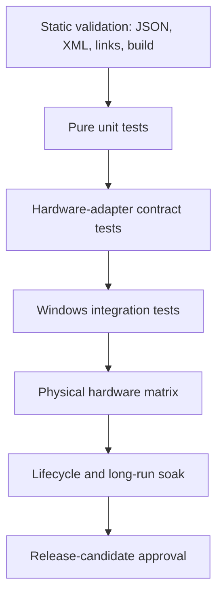

# Testing Strategy

## Current state

The solution contains no test project, test framework, test files, coverage configuration, or CI test command. Testing must therefore be introduced as a new engineering layer. The first goal is not maximal coverage; it is to create fast deterministic boundaries around code that currently feeds hardware writes.

## Qualification model



Each level answers a different question. A physical device run cannot replace deterministic protocol tests, and a unit suite cannot establish firmware behavior.

## Proposed test projects

```text
tests/
├── Ucu.Core.Tests/             Pure models, parsers, curves, migrations, commands
├── Ucu.Services.Tests/         Stores and coordinators using adapter fakes
├── Ucu.Windows.Tests/          WMI/registry/filesystem integration on Windows
└── Ucu.HardwareQualification/  Explicit opt-in runner for named devices
```

The application project is currently monolithic. Tests can initially reference it, but the medium-term boundary should extract protocol/core logic and hardware interfaces into focused libraries without changing behavior.

## First deterministic test set

### Protocols and parsing

- BS1 frame construction, checksum, command bytes, status parsing, and invalid frame lengths.
- BS2+ frame construction/parsing, gear table, RGB upload sequence, product-ID mapping, and query correlation.
- Watercooler command frames, Nordic UART UUIDs, flow/status parsing, and enum-to-byte mappings.
- Keyboard global report bytes, speed/direction transforms, per-key row announcement and BGR planar output.
- EC temperature/duty conversion and fan-curve table shape.

### Profiles and SKU resolution

- CPU-vendor and longest-GPU-pattern SKU matching.
- Office/Gaming/Turbo fallback values when no SKU matches.
- Normal/Boost custom-key parsing and slot bounds.
- AMD unified and per-CCD Curve Optimizer encoding.
- Intel PL/voltage command generation.
- NVIDIA command omission when V-F offsets own power application.
- V-F application order: power, curve, power.

### Persistence and migration

- Missing, empty, malformed and partially populated JSON.
- Legacy custom preset to Normal-store migration.
- Adaptive flat GPU fields to Normal/Boost objects.
- Watercooler Smart Pump to Smart Mode migration without overwriting user-set new fields.
- Overlay clamping and non-finite opacity handling.
- Backup v1/v2 validation, merge rules, rollback and atomic replacement.
- `.NET settings` export exclusions and type conversion.

### Coordination

- `DeviceApplier` captures state once, applies overrides, publishes events, and restores exactly once.
- Stopping Adaptive Mode restores every enabled domain.
- AC/DC automation is suppressed while Adaptive Mode owns the profile.
- Resume invalidates Adaptive tracking and reapplies active state.
- Singleton connection services dispose timers, tokens, notifications, handles, and sessions.

## Adapter boundaries required for testability

Introduce interfaces around side effects, incrementally:

| Boundary | Current concrete dependency | Test substitute |
| --- | --- | --- |
| EC | `UniwillECService` / native DLL | Register-memory fake with ordered write log. |
| HID | HidSharp/hidlibrary and direct output reports | Device enumerator + report sink/source. |
| BLE | WinRT `BluetoothLEDevice`, GATT services/characteristics | Session/characteristic fake with notification stream. |
| AMD/Intel | PawnIO modules | Command backend recording mailbox/MSR operations. |
| NVIDIA | NVAPI/NVML/private calls | GPU adapter with capability/result controls. |
| WMI/system | `ManagementObjectSearcher`, registry, power events | System-information provider fixtures. |
| Time | timers, delays, reconnect backoff | Fake clock/scheduler. |
| Files | static `File` and environment paths | Temporary store abstraction. |
| UI dispatch | WPF dispatcher | Dispatcher interface or synchronous test dispatcher. |

Do not replace all concrete calls at once. Extract a boundary when adding tests for the owning subsystem.

## Windows integration suite

Run on a Windows runner with no physical control hardware required:

- Host composition and service resolution.
- Localization resource enumeration and parse.
- SKU JSON copy/load from output.
- Settings stores under isolated temporary paths.
- Single-instance event behavior with a test-specific name.
- Overlay option persistence and hotkey registration abstraction.
- Update version/tag and release-asset selection against a fake GitHub client.
- Publish-output manifest verification for every required native/content file.

## Hardware qualification matrix

Store results as versioned data, for example `qualification/hardware-matrix.json`, with:

- UCU commit/version.
- Windows build.
- Manufacturer, system product, baseboard product.
- BIOS and EC firmware.
- CPU/GPU identifiers and driver versions.
- Panel ID.
- Peripheral model, VID/PID or BLE name, firmware.
- Test-case ID, result, notes, tester, timestamp.

Minimum matrix dimensions derived from code:

- AMD and Intel `X6FR`/`X6AR` paths.
- RTX 5070 Ti, 5080 and 5090 Laptop name matching where available.
- Both enumerated MiniLED panels and a known IPS panel.
- Flydigi BS1 and HID PIDs `0x1001` through `0x1004` as devices are available.
- Hydro UI on each enumerated chassis/firmware generation available to maintainers.

## Lifecycle scenarios

Every release candidate should exercise:

1. First start with absent settings.
2. Upgrade from the previous released settings and backup format.
3. Second-instance activation.
4. Repeated page navigation and event subscription cleanup.
5. AC to battery to AC automation transitions.
6. Sleep and hibernate with each peripheral connected.
7. Device unplug/replug and Bluetooth radio off/on.
8. Adaptive game start/stop with every domain independently enabled.
9. Tray changes while corresponding pages are not loaded.
10. Exit while polling, reconnect, smart-control, overlay and Adaptive loops are active.
11. Long-run telemetry/control soak with log-size and resource observation.

## CI stages

| Stage | Command/result |
| --- | --- |
| Validate data | Parse every JSON/XML/XAML file and verify duplicate keys/required files. |
| Restore | `dotnet restore` with a pinned SDK. |
| Build | Release x64, warnings captured and policy-enforced. |
| Unit/services tests | `dotnet test` with deterministic adapters. |
| Publish | Self-contained win-x64 output. |
| Manifest | Assert every native/content dependency exists and record hashes. |
| Docs | Validate relative Markdown links and Mermaid syntax. |

## Release gate

A release candidate is qualified only when:

- The pinned clean build and automated suite pass.
- Publish manifest matches expected files.
- Required matrix rows pass or are explicitly excluded from the release claim.
- Lifecycle scenarios pass on representative AMD and Intel systems.
- Upgrade and in-app update paths succeed from the previous release.
- Results are attached to the release commit.

[Back to documentation index](../README.md)

