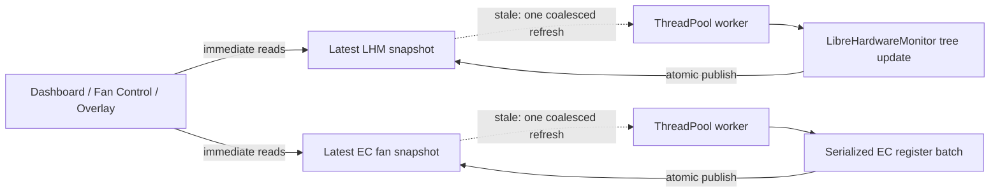

# Runtime Test Report: Shared Sensor Snapshot Cache

## Tested build

| Field | Value |
|---|---|
| Application version | `0.9.4.1` |
| LHM cache commit | `807a11c5de416e9808bca6b1152345a2c99165a0` |
| EC cache commit | `25dc5bace647ce0aca95d4da5dfcb048c7c0d6c3` |
| Branch | `codex/sensor-cache` |
| Configuration | `Debug`, `x64`, `net10.0-windows10.0.22621.0` |
| OS | Windows 10 Pro `10.0.19045` |
| SDK | .NET SDK `10.0.401` |
| Test host CPU | Intel Core Ultra 9 275HX |

## Purpose

This change removes direct LibreHardwareMonitor tree updates and periodic EC fan-register reads from UI callbacks. The previous `ReadSnapshot()` and `ReadSensor()` implementations could call `hardware.Update()` while holding the shared monitoring lock. Dashboard and Fan Control invoked those methods plus synchronous PWM reads from WPF `DispatcherTimer` handlers, so an expensive provider update or a busy EC lock could stall the UI thread.

The implemented model is an in-process stale-while-revalidate cache. It deliberately does not use an external Memcached process: the data is process-local, small, short-lived, and must remain available without an additional service.



## Implemented behavior

- `ReadSnapshot()` returns the last completed `HardwareMetricsSnapshot` immediately.
- `ReadSensor()` searches the raw readings captured with that same snapshot and does not touch hardware.
- A stale read schedules one background refresh; concurrent readers join the same refresh.
- The maximum refresh frequency is one completed refresh per second.
- A refresh failure preserves the last completed snapshot and remains retryable.
- Cache invalidation during a refresh discards the obsolete result. This prevents data sampled for an old monitoring-category set from being published as current.
- Sensor data is stored as immutable value records to avoid one object allocation per sensor on every refresh.
- Dashboard and Fan Control share one cached EC batch containing CPU/GPU temperature, both fan RPM values, and both PWM duties.
- The EC batch is captured under one native-I/O lock on a worker thread; the WPF timer callbacks no longer wait up to 500 ms for page-level EC access.
- Forced RPM refreshes after fan operations are asynchronous and generation-aware, so a pre-existing refresh cannot be reported as the requested new sample.
- The dashboard battery-temperature timer also performs its two-register EC read on a worker thread and suppresses overlapping reads.
- No autonomous polling loop was added. If visible UI and active controller code stop requesting readings, the cache does not refresh itself.

## Automated tests

Command:

```powershell
dotnet test '.\Uniwill Control Utility.Tests\Uniwill Control Utility.Tests.csproj' `
  -c Debug -p:Platform=x64 --no-restore --verbosity minimal
```

Result:

- Passed: 14
- Failed: 0
- Skipped: 0
- Duration reported by the test runner: approximately 43 ms

Covered behavior:

1. A blocked refresh does not block cached reads.
2. Concurrent reads create only one refresh operation.
3. A fresh value is reused until its one-second lifetime expires.
4. A failed refresh preserves the last good value and can be retried.
5. Invalidation during an active refresh prevents an obsolete result from being published.
6. Raw sensor lookup preserves hardware type, sensor type, and case-insensitive partial-name matching.
7. EC reads return immediately while one background capture is running.
8. EC PWM values are clamped and converted from the controller's 0-200 range to UI percentages.
9. Forced EC refresh returns the completed new sample, including when an older refresh was already running.
10. Immediately completed cache refreshes can be invalidated and restarted repeatedly.

The invalidation race test was observed failing against the first implementation (`expected 0, actual 1`) before generation-based invalidation was added, then passed after the fix.

## Build verification

Command:

```powershell
dotnet build '.\Uniwill Control Utility.sln' -t:Rebuild -c Debug `
  --no-restore -p:Platform=x64 --verbosity minimal
```

Result:

- Errors: 0
- Warnings: 82
- The warning count matches the baseline build taken before this change.

## Runtime smoke test

Executable:

```text
Uniwill Control Utility\bin\x64\Debug\net10.0-windows10.0.22621.0\Uniwill-Control-Utility.exe
```

### Startup and process state

- The process became responsive after approximately 304 ms in the first hidden-window probe.
- A normal-window run produced a real WPF main window with the title `Uniwill Control Utility`.
- The process remained responsive through every 25-40 second observation interval.
- The process was stopped after each probe; no test instance was left running.

### Steady-state samples

Measurements use `Process.TotalProcessorTime`, working set, and private bytes. They are diagnostic samples, not a deterministic benchmark.

| Scenario | Warm-up | Measurement | CPU time during interval | Memory observation |
|---|---:|---:|---:|---|
| Hidden-window candidate, LHM cache commit | 30 s | 10 s | 250.0 ms | working set 426.1 -> 416.0 MiB; private bytes 363.5 -> 350.9 MiB |
| Normal-window candidate, LHM cache commit | 15 s | 10 s | 312.5 ms | working set 428.8 MiB at end |
| Hidden-window candidate, final EC cache commit | 15 s | 10 s | 609.4 ms | working set 427.4 -> 422.2 MiB; private bytes 368.3 -> 360.4 MiB |

The initial cold-start sample included JIT, hardware discovery, and a large garbage collection and is therefore not used as the steady-state result.

### Managed stack trace

A 10-second `dotnet-trace` capture used the `dotnet-sampled-thread-time` profile after a 15-second warm-up.

Observed facts:

- `HardwareMonitoringService.CaptureState()` and `UpdateHardware()` executed through the ThreadPool path.
- `HardwareMonitoringService.UpdateHardware()` represented approximately 0.2% inclusive sampled thread time in that capture.
- WPF dispatcher message waiting and runtime wait primitives dominated the sample.
- Hardware activity included NVIDIA, Intel integrated GPU, storage, battery, and RAM/SPD providers, confirming that the test exercised a broad LibreHardwareMonitor tree.

The trace validates thread placement: the hardware refresh was not executed by the WPF dispatcher.

## Behavioral assessment

### Confirmed

- Synchronous UI reads no longer invoke LibreHardwareMonitor updates.
- LibreHardwareMonitor temperature/load/power consumers share the latest process-local state.
- Dashboard and Fan Control consume the same latest EC RPM/PWM snapshot without native I/O in their timer callbacks.
- Repeated readers do not multiply the hardware polling rate.
- Snapshot publication is atomic: consumers see either the previous complete state or the next complete state.
- Refresh work is demand-driven and coalesced.

### Not confirmed by this run

- Page-by-page visual navigation and perceived frame pacing were not automated on this host.
- External Hydro UI and Flydigi devices were not available for end-to-end device telemetry validation.
- The final process smoke test confirms the EC cache wiring does not prevent startup, but actual RPM/PWM correctness still requires a hardware-owner comparison against the machine's firmware or OEM utility.
- No multi-hour suspend/resume or display-hotplug soak test was performed.
- The process measurements from different worktree paths were not treated as a strict before/after benchmark because their per-path application settings produced different window states.

## Follow-up runtime checks

For a hardware-owner validation pass:

1. Open Dashboard, Fan Control, Watercooler, and Flydigi pages in sequence.
2. Confirm temperature and RPM values update within roughly one refresh interval.
3. Drag and scroll each page while telemetry updates and record visible stalls.
4. Enable the performance overlay together with a smart fan mode and verify that both consumers show consistent temperatures.
5. Minimize the application and compare process CPU time over at least 60 seconds.
6. Exercise suspend/resume and GPU display hotplug, then confirm that the last snapshot remains visible while the provider reconnects.
