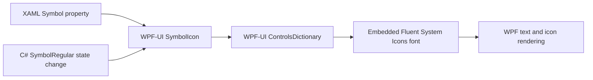

# Runtime Test Report: Windows 10 Icon Migration

## Test identity

| Field | Value |
|---|---|
| Application version | `0.9.4.1` |
| Tested commit | `a7cee6b` (`fix(ui): use packaged symbols for all icons`) |
| Base commit | `6ed03a89c5aa81c23831371ad60d0cb545c4da08` |
| Test date | 2026-09-27 |
| Configuration | `Debug`, `x64`, portable PDB symbols |
| Operating system | Windows 10 Pro 22H2, build `19045`, x64 |
| SDK | .NET SDK `10.0.401` |
| UI package | WPF-UI `4.3.0` |

## Change under test

The application previously created `FontIcon` controls with an explicit `Segoe Fluent Icons` font family. That font is not installed on the Windows 10 test host, so its glyphs were rendered as square placeholders.

The tested change replaces all application `FontIcon` usage with `SymbolIcon` and semantic `SymbolRegular` values. Static XAML icons and runtime state changes now use the same icon system. Existing path-based Flydigi and fan navigation icons remain unchanged.



No standalone font file was added to the application. `WPF-UI.dll` already contains `fluentsystemicons-regular.ttf` and `fluentsystemicons-filled.ttf` as embedded resources.

## Migration coverage

Before the change, the application source contained 108 references to `Segoe Fluent Icons` across 24 C# and XAML files.

The migration covers:

- main and footer navigation;
- page section and card icons;
- unavailable, warning, connected, and disconnected indicators;
- adaptive-mode Play and Stop states;
- battery AC and battery-source states;
- RTSS status states;
- water-cooler Standby and Resume states;
- long-lived informational notification icons;
- dialog and action-button icons.

The following verification command now reports no legacy icon references:

```powershell
& .\tools\Verify-NoSegoeFluentIcons.ps1
```

Result:

```text
PASS: application source uses SymbolIcon without legacy FontIcon references.
```

An independent source search also found zero `FontIcon` or `Segoe Fluent Icons` references in application C# and XAML files.

## Build result

The clean Debug build command was:

```powershell
dotnet build ".\Uniwill Control Utility.sln" `
  -t:Rebuild `
  -c Debug `
  --no-restore `
  -p:Platform=x64 `
  -p:DebugSymbols=true `
  -p:DebugType=portable `
  --verbosity minimal
```

| Result | Count |
|---|---:|
| Errors | 0 |
| Warnings | 82 |

The warning count matches the pre-change baseline. No new compiler or XAML compiler diagnostic was introduced by the icon migration.

## Windows 10 render smoke test

An STA WPF render test loaded the `ThemesDictionary` and `ControlsDictionary` from the built `WPF-UI.dll`, created representative `SymbolIcon` controls, and rendered them into a bitmap on the Windows 10 host.

The following symbols produced distinct icons rather than square placeholders:

- `Home24`;
- `Board20`;
- `VideoClip20`;
- `Water20`;
- `Keyboard20`;
- `Lightbulb20`;
- `BatteryCharge20`;
- `Settings24`.

The test also confirmed that all eight controls received non-empty glyph values and non-zero WPF layout dimensions.

## Application process smoke test

The rebuilt executable started and remained responsive during the smoke run.

| Metric | Result |
|---|---:|
| Responding | Yes |
| Threads | 41 |
| Working set | 409.4 MiB |
| Main window handle | 0 |

The saved application configuration had `StartMini=True`, so this run initialized into the tray and did not expose a main window handle. The process was stopped after the test.

## Limitations and manual check

Native window capture was unavailable to the automated UI tool on this host. Consequently, the build was not navigated page by page in a visible application window during this pass.

The remaining manual acceptance check is to open the Debug build on Windows 10 and visit every available navigation page, including device-dependent pages. The expected result is that section, state, and action icons render as semantic Fluent icons with their existing sizes, colors, margins, and tooltips.

The compiled XAML, source invariant, packaged-font render test, and responsive process smoke test passed. The report does not claim a completed live screenshot walkthrough.
