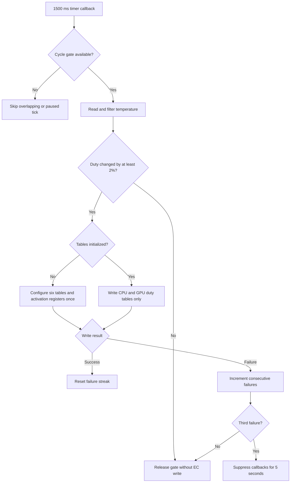

# Runtime Test Report: EC Smart Fan Write Throttling

## Tested build

| Field | Value |
|---|---|
| Application version | `0.9.4.2` |
| Implementation commit | `94034c5` |
| Branch | `codex/ecwrite-fix` |
| Base commit | `5d165e8` (`origin/master`) |
| Configuration | `Debug`, `x64`, `net10.0-windows10.0.22621.0` |
| OS | Windows 10 Pro `10.0.19045` |
| SDK | .NET SDK `10.0.401` |

## Purpose

`EcSmartFanControl` previously used a 1-second `System.Threading.Timer` and called `ApplySmartFanCurve` whenever the target duty changed. Every call rewrote CPU and GPU temperature-up, temperature-down, and duty tables, then read both duty tables back. A single update therefore generated 96 EC writes, 32 EC reads, and several fixed waits. The timer did not reject an overlapping callback, and failed writes were logged without any backoff.

The change keeps the full configuration path for the first successful control cycle, but subsequent updates write only the two 16-byte duty tables.



## EC traffic model

| Operation | Before | After, recurring update |
|---|---:|---:|
| Timer interval | `1000 ms` | `1500 ms` |
| Fan-table writes | 96 bytes across six tables | 32 bytes across two duty tables |
| Duty verification reads | 32 bytes | 0 |
| Fixed EC write delay | 96 × 6 ms | 32 × 6 ms |
| Inter-table wait | 4 × 150 ms in the complete apply path | 1 × 150 ms |
| Approximate recurring EC time | about 1.2 seconds | about 342 ms |
| Overlapping timer callbacks | possible | rejected with `Interlocked.CompareExchange` |
| Repeated failure handling | retry on every eligible tick | 5-second pause after three consecutive failures |

The first successful cycle still performs the complete table and activation sequence. This is intentional: recurring duty-only writes depend on the EC having already accepted the temperature tables and custom fan mode configuration.

## Failure behavior

- Checked smart-fan writes inspect the native `WriteEC` return code.
- A non-zero return code aborts the current table operation and is treated as a failed cycle.
- Three consecutive failed write cycles start a five-second pause.
- A successful write resets the failure streak.
- Missing telemetry or a tick that requires no duty change releases the cycle gate without being counted as an EC write failure.
- A failed write clears the filter and last-duty state so the desired duty is retried after the allowed delay.

## Automated tests

Command:

```powershell
dotnet test '.\Uniwill Control Utility.Tests\Uniwill Control Utility.Tests.csproj' `
  -c Debug -p:Platform=x64 --no-restore --nologo --verbosity minimal
```

Result:

- Passed: 22
- Failed: 0
- Skipped: 0
- Duration reported by the test runner: 33 ms

Eight tests were added for this change. They cover:

1. rejecting a second callback while a cycle is still running;
2. enforcing at least 1500 ms between accepted cycle starts;
3. pausing for five seconds after three consecutive failures;
4. resetting the failure streak after a successful write;
5. producing exactly two recurring register blocks;
6. using CPU duty address `0x0F20`;
7. using GPU duty address `0x0F50`;
8. rejecting duty arrays that are not exactly 16 bytes long.

The new test project initially failed because the cycle gate and duty-only plan did not exist. The focused suite then passed with 8 tests after implementation, followed by the complete 22-test run.

## Build verification

Command:

```powershell
dotnet build '.\Uniwill Control Utility.sln' -t:Rebuild -c Debug `
  -p:Platform=x64 --no-restore --nologo --verbosity minimal
```

Result:

- Errors: 0
- Warnings: 82
- The warning count matches the existing `master` baseline; this change did not add a new compiler diagnostic.

## Static execution-path verification

- `EcSmartFanControl.Start()` derives its 1500-ms timer period from the same gate policy used to reject early callbacks.
- The first successful write calls `ApplySmartFanCurve` and marks the tables initialized.
- Later writes call `ApplySmartFanDuty`.
- `ApplySmartFanDuty` consumes the tested 32-byte write plan and contains no EC read operation.
- The former CPU/GPU duty readback was removed from `ApplySmartFanCurve`.
- All smart-fan table writes use checked EC write helpers.

## Runtime limits of this test

The build and test suite ran on supported Uniwill hardware, but the saved `EcSmartFanMode` setting was disabled. The automated run therefore did not alter the user's fan profile or generate a long-running physical EC duty trace. The reported operation counts are derived from the executed write plan and the service's 6-ms per-register delay, not from an external bus analyzer.

The PCSpecialist freeze scenario was not reproduced on the test machine. A hardware-owner validation should enable Smart Fan Mode, change the target duty repeatedly, and confirm through logs that one full initialization is followed by `Updated smart fan duty only` messages without UI stalls or system freezes.
