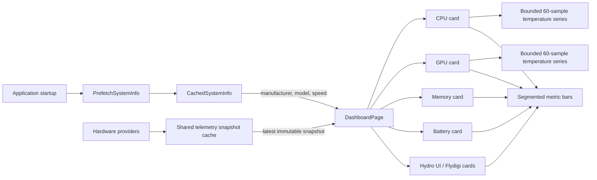

# Runtime Test Report: Home Modular Telemetry Grid

## Tested build

| Field | Value |
|---|---|
| Application version | `0.9.4.2` |
| Initial implementation commit | `b1fb932` |
| Review-fix commits | `db993c9`, `0c77127` |
| Base commit | `5d165e8` (`origin/master`) |
| Branch | `codex/home-modular-grid` |
| Configuration | `Debug`, `x64`, `net10.0-windows10.0.22621.0` |
| OS | Windows 10 Pro `10.0.19045` |
| SDK | .NET SDK `10.0.401` |
| Test host | Intel Core Ultra 9 275HX, NVIDIA GeForce RTX 5080 Laptop GPU, 32 GB DDR5 |

## Purpose

This change replaces the compact Home telemetry list with a modular dashboard grid. It makes current state readable at a glance while retaining the shared sensor snapshot introduced in the sensor-cache work. The UI adds bounded 60-sample temperature trends and segmented value bars; it does not introduce another polling loop or direct hardware access.

RAM manufacturer, model, and configured transfer rate are displayed from the system information already prefetched during application startup.



## Implemented behavior

- CPU and GPU cards show temperature and utilization as primary metrics.
- Each processor card retains a 60-tick temperature timeline. Missing readings advance the timeline as gaps, and a polling pause longer than three seconds resets the trace before rendering resumes.
- Power, clock, fan, memory, battery-temperature, RAM-temperature, cooler-fan, and pump values use a reusable segmented renderer.
- The segmented renderer clamps out-of-range data and ensures a positive non-zero value remains visible as at least one segment.
- CPU and GPU model names are reused from the existing cached system information.
- The Memory card displays used/total capacity, utilization, DIMM temperatures, RAM manufacturer/model, and speed.
- RAM identity formatting avoids repeating a manufacturer already present in the model string and falls back to `Not available` for missing data.
- Battery and connected-device cards use status pills and stronger visual grouping. Healthy and reduced battery states use distinct green and amber treatments.
- Hydro UI and Flydigi remain conditional: hidden device cards do not leave empty half-width containers.
- The dashboard uses a centered `1200`-pixel maximum content width with consistent 12-pixel card gutters.
- Theme foreground resources are inherited at each card root so unstyled child text cannot fall back to the system black brush in dark mode.
- Display metrics use Segoe UI Variable with Segoe UI fallback instead of a console font.
- No navigation-icon or bundled-font changes are included; those remain isolated in the separate font-distribution change.

## Automated tests

Command:

```powershell
dotnet test '.\Uniwill Control Utility.Tests\Uniwill Control Utility.Tests.csproj' `
  -c Debug -p:Platform=x64 --no-build --verbosity minimal
```

Result:

- Passed: 40
- Failed: 0
- Skipped: 0
- Duration reported by the test runner: 38 ms

New coverage:

1. The temperature timeline remains bounded and evicts its oldest sample.
2. Invalid, non-finite, and non-positive readings become timeline gaps rather than stale connected points.
3. A long unavailable interval removes old samples from the 60-tick window.
4. RAM manufacturer/model strings are combined without duplication.
5. Aggregated mixed-vendor RAM data is not positionally paired after independent cache deduplication; explicit manufacturer names are preserved and ambiguous values remain grouped.
6. Missing RAM identity and speed values use a deterministic fallback.
7. RAM speed is presented in `MT/s`.
8. A polling pause longer than the configured interval clears the old temperature timeline.
9. Battery-health values classify as healthy, reduced, or unavailable at the presentation threshold.
10. Segmented-bar values clamp to the valid range.
11. A positive value too small to fill a complete segment still activates one segment.
12. Invalid segmented-bar scales return zero active segments.

## Build verification

Command:

```powershell
dotnet build '.\Uniwill Control Utility.sln' -c Debug `
  -p:Platform=x64 --no-restore --verbosity minimal
```

Result:

- Errors: 0
- Warnings on a non-incremental compile: 82
- The warning count matches the current `master` baseline and is handled by a separate warning-cleanup change.

## Runtime test

Executable:

```text
Uniwill Control Utility\bin\x64\Debug\net10.0-windows10.0.22621.0\Uniwill-Control-Utility.exe
```

### Startup

- The Debug process opened a responsive WPF window titled `Uniwill Control Utility`.
- Hardware discovery populated CPU, GPU, memory, battery, and Hydro UI cards.
- The revised candidate was left running for manual inspection after verification.

### Values observed on the test host

- CPU and GPU temperature trends updated from the shared dashboard snapshots.
- RAM identity rendered as `Kingston · KF564S38-16`.
- RAM speed rendered as `7200 MT/s`.
- Both DIMM temperature rows were populated.
- Battery health and charge limit were populated.
- Hydro UI fan and pump values were populated.

### Visual defect found and corrected

The first runtime candidate exposed a dark-theme regression: metric-row labels and several values rendered black because the new `UserControl` roots did not provide an inherited foreground. The same pass also showed that the initial implementation had lost several visual details from the approved concept.

The follow-up candidate corrected the root cause and restored the intended presentation:

- inherited theme foregrounds;
- Segoe UI Variable metric typography;
- section dividers;
- card glyphs;
- chart scale labels;
- segmented bars;
- battery and device status pills.

The updated running build was accepted for pull-request preparation.

## Confirmed

- Dashboard rendering consumes existing cached snapshots and startup system information.
- The redesign does not add WMI queries, direct sensor-tree updates, EC register reads, or an autonomous timer.
- Trend storage is bounded.
- Missing telemetry uses `--` or `Not available` rather than stale placeholder values.
- The Debug build starts and remains responsive on the test host.
- The implementation remains based directly on `master`, independent of the font-bundle and warning-cleanup pull request.

## Not covered by this run

- Light-theme visual review.
- Minimum-window-width and high-DPI matrix testing.
- End-to-end Flydigi card rendering with a connected physical cooler.
- Multi-hour telemetry soak, suspend/resume, or display-hotplug testing.
- Navigation glyph rendering on Windows 10 without the separate bundled-font change.

## Follow-up checks

1. Review the dashboard in light theme.
2. Exercise the minimum supported window size at 100%, 125%, 150%, and 200% scaling.
3. Connect each supported Flydigi model and verify the RPM range and long RGB-mode names.
4. Leave the dashboard visible for at least two hours and confirm stable trend memory usage.
5. Retest the branch together with the bundled-font change only after both pull requests are independently accepted.
