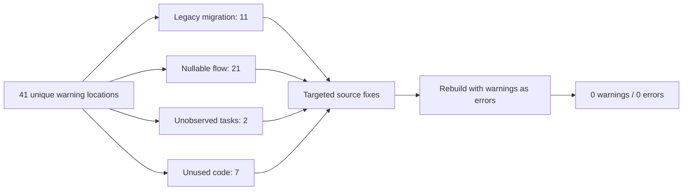

# Runtime Test Report: Compiler Warning Cleanup

## Tested build

| Field | Value |
|---|---|
| Application version | `0.9.4.2` |
| Master base | `5d165e89e7b506486f8edabd5ec4d2443a5e052f` |
| Bundled-font commits | `e1b8f07`, `a2cf04f` |
| Warning-cleanup commit | `d75a48f` |
| Branch | `codex/build-warning-cleanup` |
| Configuration | `Debug`, `x64`, `net10.0-windows10.0.22621.0` |
| OS | Windows 10 Pro `10.0.19045` |
| SDK | .NET SDK `10.0.401` |

## Purpose

The baseline solution rebuild completed with 82 reported compiler warnings. The application project is compiled directly and again as a dependency of the test project, so the solution output duplicated each diagnostic. The baseline contained 41 unique warning locations.

This cleanup resolves the causes without disabling warnings at the project level or changing the public runtime architecture.



## Baseline warning inventory

| Warning | Unique locations | Cause |
|---|---:|---|
| `CS0618` | 11 | Intentional reads of private legacy JSON fields during settings migration |
| `CS8602` | 10 | Nullable services or UI fields dereferenced after invariants not understood by the compiler |
| `CS8601` | 6 | Nullable constructor inputs or resource lookups assigned to non-null fields/properties |
| `CS8629` | 3 | Nullable value types filtered before `.Value`, without compiler-recognized narrowing |
| `CS0168` | 2 | Empty exception handlers declared but did not use the exception |
| `CS4014` | 2 | Asynchronous BLE disconnect operations launched without explicit handling |
| `CS8603` | 2 | A method declared to return `JToken` intentionally returned `null` for missing or invalid files |
| `CS8618` | 2 | Static navigation fields initialized by the main-window constructor |
| `CS0219` | 1 | Unused fan-curve interpolation local |
| `CS0414` | 1 | EC boost-state field was assigned but never read |
| `CS8622` | 1 | Dispatcher timer callback sender nullability did not match `EventHandler` |

## Implemented changes

- Scoped `CS0618` suppression to the single legacy-migration method. The obsolete fields remain marked and cannot silently spread into new code.
- Corrected nullable return metadata for optional preset-backup tokens.
- Added explicit service preconditions or guards where a missing dependency previously led to an immediate null dereference.
- Added resource-brush fallbacks and used `TryFindResource` where fallback behavior is intended.
- Converted nullable color filtering to `OfType<Color>()`.
- Made crosshair and range-highlight initialization invariants explicit in `VfCurveEditor`.
- Added the missing drag-position guard in shift-selection handling.
- Awaited the BLE disconnect during system resume.
- Marked the synchronous suspend disconnect as intentional background work and attached fault logging.
- Logged Turbo enable/disable exceptions instead of swallowing them.
- Removed unused interpolation and EC state fields.
- Corrected five non-UTF-8 dash bytes in `MainWindow.xaml.cs` while making the targeted source edits.

## Strict build verification

Command:

```powershell
dotnet build '.\Uniwill Control Utility.sln' -t:Rebuild -c Debug `
  -p:Platform=x64 --no-restore --verbosity minimal -warnaserror
```

Result:

- Warnings: 0
- Errors: 0
- Duration: 2.39 seconds

The ordinary output directory was rebuilt after stopping the previous manual-test instance. Earlier development passes used isolated output directories so that the running executable did not block replacement of the application host.

## Automated tests

Command:

```powershell
dotnet test '.\Uniwill Control Utility.Tests\Uniwill Control Utility.Tests.csproj' `
  -c Debug -p:Platform=x64 --no-restore --no-build --verbosity minimal
```

Result:

- Passed: 15
- Failed: 0
- Skipped: 0
- Duration: 36 ms

The compiler itself served as the regression check for the cleanup: the baseline rebuild reported 82 warnings, while the final rebuild used `-warnaserror` and completed with no diagnostics.

## Runtime smoke test

Executable:

```text
Uniwill Control Utility\bin\x64\Debug\net10.0-windows10.0.22621.0\Uniwill-Control-Utility.exe
```

After a 10-second startup interval, followed by the application's single-instance show signal when required:

| Observation | Result |
|---|---|
| Process ID | `10452` |
| Process exited | No |
| Main window responding | Yes |
| Window title | `Uniwill Control Utility` |
| Main window handle | Non-zero (`525804`) |
| Total process CPU time | 5,578.1 ms |
| Working set | 434.0 MiB |
| Private memory | 367.1 MiB |

The process was intentionally left running for manual navigation and device checks. These process values are startup diagnostics, not a performance benchmark.

## Manual checks still required

1. Exercise suspend and resume with connected Flydigi HID and BLE coolers.
2. Toggle Turbo on and off and verify the new diagnostic paths only appear when an operation fails.
3. Open the V-F curve editor and test shift-selection, range dragging, theme changes, and window resizing.
4. Connect a watercooler with Smart Mode enabled and verify that the mode restarts after connection.
5. Open prerequisite and overlay settings pages under light and dark themes and verify status colors.
