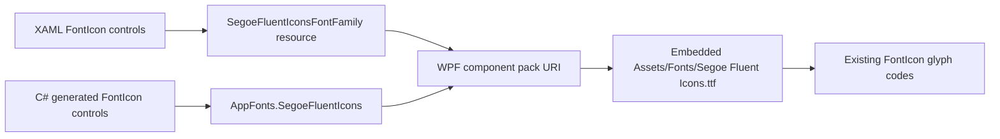

# Runtime Test Report: Bundled Segoe Fluent Icons

## Tested build

| Field | Value |
|---|---|
| Application version | `0.9.4.2` |
| Base commit | `5d165e8` |
| Implementation commit | `e1b8f07b0784e66fc229fced9dc9b42f696a8124` |
| Branch | `codex/bundled-fluent-icons` |
| Configuration | `Debug`, `x64`, `net10.0-windows10.0.22621.0` |
| OS | Windows 10 Pro `10.0.19045` |
| SDK | .NET SDK `10.0.401` |
| Bundled font | `Assets/Fonts/Segoe Fluent Icons.ttf` |
| Font size | 408,752 bytes |
| Font SHA-256 | `82F5DC0E0CB9F41EFAD49E5423C76768AE0FC96E062A0893B6C729B863033013` |

## Purpose

Windows 10 installations may not provide the `Segoe Fluent Icons` family used by the existing `FontIcon` controls. In that case, private-use glyphs are rendered as placeholder squares. This change preserves the existing `FontIcon` controls and glyph values while moving font resolution from an operating-system-installed family to a font embedded in the application assembly.

## Runtime architecture



The font is declared as a WPF `Resource` in the application project. Static XAML uses the application resource `SegoeFluentIconsFontFamily`; dynamically created icons use the shared `AppFonts.SegoeFluentIcons` instance. Both paths address the same assembly resource with the family fragment `#Segoe Fluent Icons`.

## Scope of the change

- The original `FontIcon` control type is retained.
- All 97 original glyph assignments are retained.
- No `SymbolIcon` migration is included.
- XAML references no longer request the operating-system family by name.
- Dynamically created C# icons no longer construct an operating-system `FontFamily` by name.
- The font file is embedded in the application assembly and is not copied as a loose runtime dependency.
- Two inline `FontIcon` markup extensions in `Adaptive.xaml` were expanded to property-element syntax so they can use `StaticResource`; their glyph values are unchanged.

## Automated font-resource test

The added test opens the font through WPF's component resource API, creates a `GlyphTypeface` from the extracted resource, and checks both the family identity and representative private-use glyphs.

Representative verified code points:

`E713`, `E721`, `E768`, `E7C3`, `E80F`, `E945`, `E946`, `EB42`, `ED39`, `F167`, `F404`.

Command:

```powershell
dotnet test '.\Uniwill Control Utility.Tests\Uniwill Control Utility.Tests.csproj' `
  -c Debug -p:Platform=x64 --no-restore --no-build --verbosity minimal
```

Result:

- Passed: 15
- Failed: 0
- Skipped: 0
- Test runner duration in the final post-commit run: 45 ms

The test proves that the built application resource contains the expected font family and the glyphs used by representative navigation, action, status, and device icons. It does not replace page-by-page visual inspection.

## Build verification

Command:

```powershell
dotnet build '.\Uniwill Control Utility.sln' -t:Rebuild -c Debug `
  -p:Platform=x64 --no-restore --verbosity minimal
```

Result:

- Errors: 0
- Warnings: 82
- The warnings were pre-existing in the rebased project state.

## Runtime smoke test

Executable:

```text
Uniwill Control Utility\bin\x64\Debug\net10.0-windows10.0.22621.0\Uniwill-Control-Utility.exe
```

After startup and a 10-second observation interval:

| Observation | Result |
|---|---|
| Process exited | No |
| Main window responding | Yes |
| Window title | `Uniwill Control Utility` |
| Main window handle | Non-zero (`198054` in the recorded run) |
| Total process CPU time | 5,328.1 ms |
| Working set | 439.2 MiB |
| Private memory | 398.2 MiB |

These values are a startup diagnostic sample, not a performance benchmark. The smoke-test process was stopped after collecting the sample.

After the final rebuild and test pass, a fresh Debug instance was started as process `9432`. It remained alive and responsive, and the application's single-instance show event restored a visible main window titled `Uniwill Control Utility` with a non-zero window handle. This instance was intentionally left running for the hardware owner's visual pass.

## Confirmed by this run

- The supplied TTF identifies itself as `Segoe Fluent Icons`.
- The exact TTF is present in the WPF application resources.
- Representative application glyph code points are present in that TTF.
- Static and dynamically created icons use application-owned font references.
- The solution rebuilds and the test suite passes on Windows 10.
- The Debug executable starts, creates a responsive WPF window, and stays alive during the observation interval.

## Pending manual visual pass

The following checks require interaction with the running window and are deliberately not reported as completed:

1. Inspect every navigation item and verify that no placeholder square appears.
2. Open Dashboard, Adaptive, Automations, Battery, Fan Control, Flydigi Cooler, Keyboard, Light Bar, Presets, Overlay Settings, Settings, Watercooler, and About.
3. Check icons in normal, hover, selected, disabled, and active-operation states.
4. Trigger controls that create icons from C# and verify that they match the XAML icons.
5. Record any remaining square together with the page, control label, and UI state.

## Operational note

The bundled font file was supplied separately from the repository. Before distributing builds outside the development workflow, the project owner should record the applicable font license and redistribution terms alongside the release inputs.
